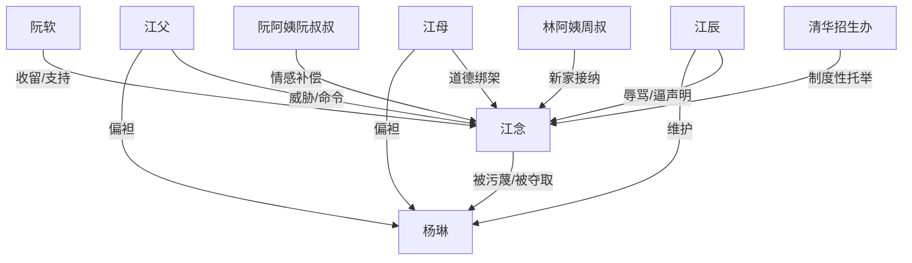

# 角色标签图谱

## 角色清单

### 江念 — 清醒断亲学霸大女主

- 叙事功能: 被压迫者、真相锚点、撤场式反杀执行者。
- 核心标签: 711 分、清醒、被错待的亲女儿。
- 弧光: 渴望家不散 → 不再解释 → 主动离家 → 拥有新家。
- 台词风格: 短句、冷静、越来越少解释。
- 关键行为: 取消采访、退群删人、离家去京市、拒绝补办升学宴。
- 读者情绪关系: 心疼、代入、爽、替她松一口气。

### 杨琳 — 白莲偷分网红表妹

- 叙事功能: 核心施害者和矛盾放大器。
- 核心标签: 没妈疼护身符、伪造成绩、偷荣誉。
- 弧光: 被全家偏爱 → 借升学宴造人设 → 全网翻车 → 休学当网红失败。
- 台词风格: 装无辜、阴阳挑衅、借哭转移矛盾。
- 关键行为: 发挑衅视频、偷穿礼服、偷用江念分数、伪造成绩单、造谣藏准考证。
- 读者情绪关系: 恨、鄙夷、期待报应。

### 江辰 — 偏心暴躁哥哥

- 叙事功能: 家庭暴力和道德绑架的执行者。
- 核心标签: 暴躁、护表妹、拒绝真相。
- 弧光: 骂江念歹毒 → 逼她让风头 → 逼声明洗白 → 后悔喝酒。
- 台词风格: 吼叫、命令、威胁。
- 关键行为: 砸准考证、骂她有病、威胁学费、要求发声明。
- 读者情绪关系: 恨、厌烦、期待他被真相打脸。

### 江母 — 失格母亲

- 叙事功能: 亲情背叛的主要来源。
- 核心标签: 偏心、糊涂、迟来忏悔。
- 弧光: 扇亲女儿巴掌 → 给杨琳买裙子 → 怕丢脸逼江念来 → 哭着道歉。
- 台词风格: 软硬兼施，前期道德绑架，后期哭求。
- 关键行为: 认定江念争宠、买走江念礼服、求补办升学宴。
- 读者情绪关系: 心寒、愤怒、拒绝原谅。

### 江父 — 面子型父亲

- 叙事功能: 家庭权威和面子压力来源。
- 核心标签: 冷漠、重脸面、缺位。
- 弧光: 让江念跪下 → 问电视台几点到 → 威胁断学费 → 唉声叹气。
- 台词风格: 命令式、家长权威式。
- 关键行为: 要求跪下道歉、逼她去升学宴、威胁经济。
- 读者情绪关系: 厌恶、失望。

### 阮软 — 仗义闺蜜

- 叙事功能: 女主逃离原生家庭的桥梁。
- 核心标签: 直爽、护短、行动派。
- 弧光: 收留江念 → 带她进阮家 → 介绍京市资源 → 传递翻车消息。
- 台词风格: 网感强、情绪外放。
- 关键行为: 让江念住家、介绍家教、陪她去京市。
- 读者情绪关系: 安心、解气。

### 阮阿姨/阮叔叔 — 替代家庭入口

- 叙事功能: 对照原生家庭，提供第一层情感补偿。
- 核心标签: 温暖、细心、尊重。
- 弧光: 给瓜心和烧烤 → 送站给钱 → 说“你值所有好的东西”。
- 台词风格: 朴素、直接、暖。
- 关键行为: 接纳江念、给五千块、送她离开。
- 读者情绪关系: 治愈、心酸。

### 林阿姨/周叔 — 新家确认者

- 叙事功能: 最终归属感的承接者。
- 核心标签: 温和、稳定、新家。
- 弧光: 准备房间和饭菜 → 让江念当家教 → 朋友圈称她“闺女”。
- 台词风格: 日常家常，少大道理。
- 关键行为: 安置江念、做红烧排骨、叫她回家吃饭。
- 读者情绪关系: 温暖、补偿、泪点。

### 周逸 — 新生活任务对象

- 叙事功能: 展示江念能力被正常使用与尊重。
- 核心标签: 腼腆、想冲清北、听劝。
- 弧光: 初见紧张 → 接受严格计划。
- 台词风格: 轻松、少年感。
- 关键行为: 接受辅导。
- 读者情绪关系: 放松、过渡。

## 关系网络

## 角色功能对照表（供改编参考）

| 原角色 | 极致标签 | 叙事功能 | 读者情绪功能 | 改编时必须保留的 |
|--------|---------|---------|-------------|---------------|
| 江念 | 清醒断亲学霸 | 被夺荣誉的主角 | 心疼与爽 | 高价值真实身份、撤场式反击 |
| 杨琳 | 白莲偷分表妹 | 施害者 | 恨与报应期待 | 装弱、偷荣誉、公开翻车 |
| 江辰 | 暴躁偏心哥哥 | 压迫执行者 | 怒 | 逼迫女主让步、真相后后悔 |
| 江母 | 失格母亲 | 亲情背叛 | 心寒 | 偏心表妹、迟来道歉被拒 |
| 阮家/林家 | 替代家庭 | 情绪补偿 | 治愈 | 具体生活照顾，不空喊关爱 |
| 清华招生办 | 权威托举 | 降维证明 | 公义 | 制度资源接住女主 |
