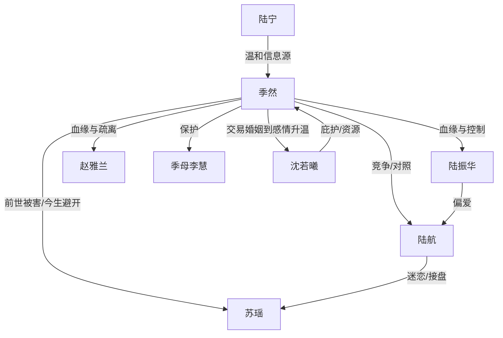

# 角色标签图谱

## 角色清单

### 季然 — 重生清醒真少爷
- 叙事功能: 第一人称主角，承载复仇、避坑、资源积累与新生主题。
- 核心标签: 重生者、清醒、被低估
- 弧光: 前世讨好型棋子 → 今生冷静布局者 → 脱离陆家的自由人
- 台词风格: 短句、直接、拒绝含糊
- 关键行为: 拒认陆家少爷、安顿母亲、挖药材、拒绝苏瑶、接受沈家联姻
- 读者情绪关系: 心疼、代入、期待他打脸

### 沈若曦 — 清冷女掌权人/交易型守护者
- 叙事功能: 外部高权力盟友，提供资源、庇护和甜宠补偿。
- 核心标签: 清冷、强势、理性
- 弧光: 旁观解围者 → 交易联姻对象 → 情感升温的伴侣
- 台词风格: 简短、命令式、利益逻辑清晰
- 关键行为: 家宴解围、射箭赛组队、帮承包灵雾山、上门提亲
- 读者情绪关系: 爽、安心、磕感

### 苏瑶 — 毒蛇前妻/功利美人
- 叙事功能: 前世致死施害者，今生避坑对象。
- 核心标签: 美艳、功利、危险
- 弧光: 前世妻子与杀人者 → 今生主动接近 → 被季然拒绝后转向陆航
- 台词风格: 试探、撒娇、逼问
- 关键行为: 前世推季然坠崖，今生试图接近并联姻
- 读者情绪关系: 恨、厌恶、期待她落空

### 陆航 — 被偏爱的假继承人/嫉妒接盘者
- 叙事功能: 季然在陆家的对照组，承载家族偏心与苏瑶线反讽。
- 核心标签: 嫉妒、愚蠢、被宠坏
- 弧光: 优越继承人 → 嫉妒者 → 苏瑶接盘者
- 台词风格: 挑衅、幼稚、占有欲强
- 关键行为: 警告季然远离苏瑶，提亲现场主动求娶
- 读者情绪关系: 轻蔑、看笑话

### 陆振华 — 冷血豪门父亲
- 叙事功能: 陆家权力代表，亲情债主要来源。
- 核心标签: 利益至上、冷漠、控制欲
- 弧光: 施舍式认亲 → 控制季然 → 发现季然高价值后试图攀附
- 台词风格: 命令、训斥、家族利益压人
- 关键行为: 接回季然、要求其帮衬陆航、后期想借季然搭沈家
- 读者情绪关系: 恨、厌烦

### 赵雅兰 — 体面冷漠的豪门母亲
- 叙事功能: 软性压迫代表，制造“亲生却不亲”的刺痛。
- 核心标签: 客气、挑剔、势利
- 弧光: 疏离接纳 → 撮合苏瑶 → 沈家提亲后态度转变
- 台词风格: 表面温和，实则安排
- 关键行为: 家宴介绍、撮合苏瑶、维护家族体面
- 读者情绪关系: 冷感厌恶

### 季母李慧 — 被保护的亲情锚点
- 叙事功能: 主角行动的情感动机和补偿对象。
- 核心标签: 辛苦、沉默、善良
- 弧光: 前世被抛下受苦 → 今生被提前安顿 → 见证儿子新生
- 台词风格: 担忧、朴素、母亲式关怀
- 关键行为: 挡在季然身前、担心钱来路、婚礼上欣慰
- 读者情绪关系: 心疼、希望她被补偿

### 陆宁 — 陆家中少数温和者
- 叙事功能: 陆家内部的缓冲角色，提供信息。
- 核心标签: 温和、中立、有边界
- 弧光: 家中友善姐姐 → 见证季然变化
- 台词风格: 平和、好奇
- 关键行为: 借钱给季然、告知沈若曦身份
- 读者情绪关系: 中性偏好感

## 关系网络

## 角色功能对照表（供改编参考）

| 原角色 | 极致标签 | 叙事功能 | 读者情绪功能 | 改编时必须保留的 |
|--------|---------|---------|-------------|---------------|
| 季然 | 重生清醒真少爷 | 主角/布局者 | 代入、爽、心疼 | 死过一次后的冷静，不再讨好 |
| 沈若曦 | 清冷女掌权人 | 高权力盟友/甜宠对象 | 安心、磕感、爽 | 利益逻辑与强势出手 |
| 苏瑶 | 毒蛇前妻 | 前世致死反派 | 恨、厌恶 | 美丽危险、功利接近 |
| 陆航 | 被宠坏继承人 | 对照组/接盘者 | 轻蔑、看笑话 | 嫉妒与误判 |
| 陆家父母 | 体面冷血豪门 | 亲情压迫源 | 憋屈、愤怒 | 把主角当工具而非孩子 |
| 季母 | 被保护母亲 | 情感锚点 | 心疼、补偿期待 | 主角必须优先保护她 |
