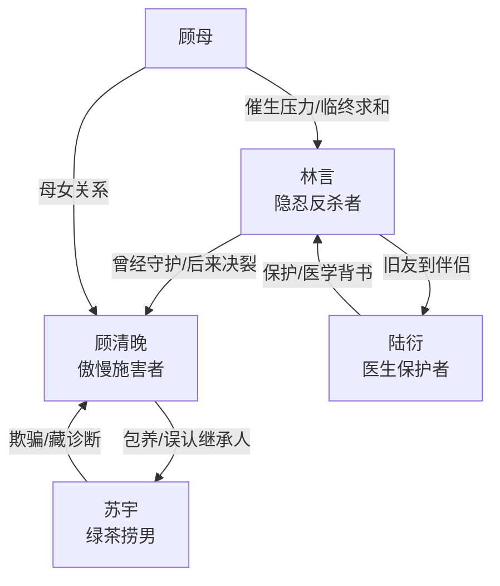

# 角色标签图谱

## 角色清单

### 林言 — 隐忍清醒受害者 / 反杀型前夫
- 叙事功能: 受害者、真相持有者、最终清算者。
- 核心标签: 隐忍、深情、决绝。
- 弧光: 替妻背锅守护尊严 → 被羞辱至心死 → 公开揭穿 → 重建生活。
- 台词风格: 前期压抑短句，后期冷静判决式。
- 关键行为: 结扎背锅、忍辱取病历、庆典爆料、拒绝复合。
- 读者情绪关系: 前半心疼，高潮爽，结尾获得补偿感。

### 顾清晚 — 傲慢女总裁 / 追妻火葬场反派
- 叙事功能: 施害者、误判者、悔恨承债者。
- 核心标签: 掌控欲、傲慢、迟来悔恨。
- 弧光: 自以为掌控婚姻与继承 → 公开崩塌 → 疯狂追悔 → 孤独终老。
- 台词风格: 施舍式、命令式，后期哀求式。
- 关键行为: 包养苏宇、囚禁下药、林场弃置、逼林言当众感谢。
- 读者情绪关系: 强恨点，后期报应爽点来源。

### 苏宇 — 绿茶捞男 / 假继承人
- 叙事功能: 第三者、挑拨者、骗局载体。
- 核心标签: 伪善、贪婪、表演型脆弱。
- 弧光: 得意上位 → 公开暴露 → 被惩罚下放工厂。
- 台词风格: 哭诉、自残威胁、道德倒打一耙。
- 关键行为: 扇林言耳光、假自残、骗顾清晚、藏确诊单。
- 读者情绪关系: 厌恶，辅助顾清晚降智与崩塌。

### 陆衍 — 清冷保护者 / 新生补偿
- 叙事功能: 证据背书者、救援者、新 CP。
- 核心标签: 专业、可靠、边界清晰。
- 弧光: 旧友医生 → 反杀协助者 → 伴侣与新家庭支点。
- 台词风格: 冷静、专业、护短。
- 关键行为: 提供医学证明、庆典拦住苏宇、保护林言、陪伴重建生活。
- 读者情绪关系: 安全感、补偿感。

### 顾母 — 迟来道歉的家族见证者
- 叙事功能: 顾家压迫余波与最终句号。
- 核心标签: 传统、亏欠、临终忏悔。
- 弧光: 施压催生的背景人物 → 病危道歉 → 未能促成和解。
- 台词风格: 断续、哀求。
- 关键行为: 病危点名见林言，请求给顾清晚机会。
- 读者情绪关系: 轻微怜悯，但不动摇站队。

## 关系网络



## 角色功能对照表（供改编参考）

| 原角色 | 极致标签 | 叙事功能 | 读者情绪功能 | 改编时必须保留的 |
|--------|---------|---------|-------------|---------------|
| 林言 | 隐忍反杀受害者 | 真相持有者 | 心疼转爽 | 替对方背锅多年、最终不回头 |
| 顾清晚 | 傲慢女总裁 | 核心施害者 | 恨与报应 | 掌控欲、公开羞辱、迟来悔恨 |
| 苏宇 | 绿茶捞男 | 第三者骗局 | 厌恶 | 假柔弱、骗财骗感情、被揭穿 |
| 陆衍 | 清冷保护者 | 补偿型新 CP | 安全感 | 专业背书、公开保护、建立新生活 |
| 顾母 | 家族压力源 | 旧关系收尾 | 句号感 | 临终求和但无法逆转 |
```
