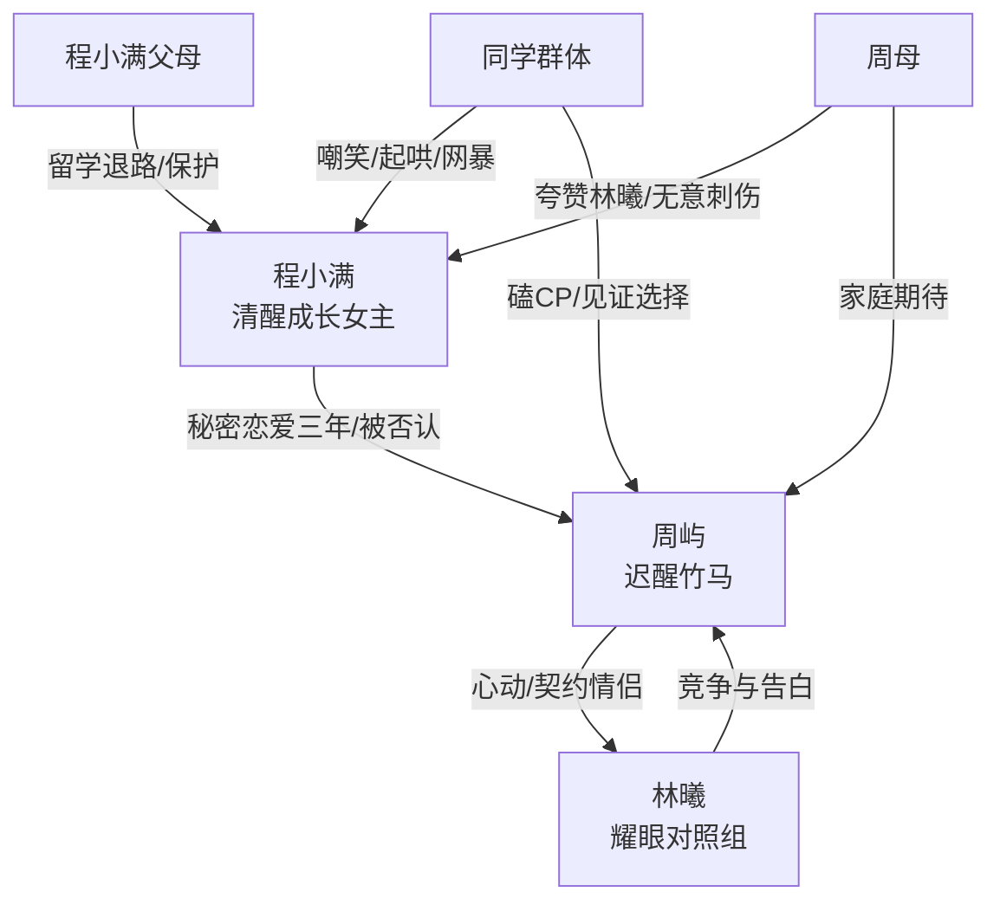

# 角色标签图谱

## 角色清单

### 程小满 — 被贬低后自救的清醒女主
- 叙事功能: 情绪承受者、价值重建者、最终裁决者
- 核心标签: 小透明、隐忍深情、清醒成长
- 弧光: 暗恋/秘密恋爱中等待官宣 → 被彻底伤透 → 出国重建自我 → 平静拒绝旧爱
- 台词风格: 前期少说、后期直白清算，关键词是“受够了”“不用等我了”
- 关键行为: 回“好”、决定留学、点赞朋友圈、打周屿耳光、拉黑、拒绝复合
- 读者情绪关系: 心疼、代入、爽、释然

### 周屿 — 高傲迟醒的竹马男主
- 叙事功能: 主要施害者、情绪债来源、火葬场承担者
- 核心标签: 天之骄子、爱面子、迟来深情
- 弧光: 享受女主爱意并当众否认 → 移情林曦 → 侵犯女主前途 → 失去后醒悟 → 长期等待仍被拒
- 台词风格: 前期命令式、哄骗式；后期卑微道歉式
- 关键行为: 稳心率、抢伞、官宣林曦、改志愿、否认喜欢、生日会承认、追到国外
- 读者情绪关系: 恨、憋屈、看他崩塌的爽

### 林曦 — 耀眼对照组/情敌
- 叙事功能: 刺激男主动心、放大女主自卑、引爆男主选择
- 核心标签: 优秀、骄傲、被偏爱
- 弧光: 死对头式暧昧对象 → 契约女友 → 当众表白失败
- 台词风格: 骄傲直接，带施舍感
- 关键行为: 心率180、进周家、发游乐场朋友圈、生日会告白
- 读者情绪关系: 前期膈应，后期也有被男主伤害的同情

### 同学群体 — 校园舆论暴力机器
- 叙事功能: 公开羞辱放大器、见证男主否认与迟来官宣
- 核心标签: 起哄、拜高踩低、CP粉
- 弧光: 嘲笑女主倒贴 → 逼问周屿喜欢谁 → 见证周屿公开承认
- 台词风格: 弹幕化、群体化、尖锐
- 关键行为: 玩挑战、刷丑照、写桌面辱骂、直播弹幕
- 读者情绪关系: 厌恶、窒息、期待打脸

### 程母/父母 — 外部退路与价值托底
- 叙事功能: 给女主留学通道，承接她离开的现实可能
- 核心标签: 支持、接纳、远方
- 弧光: 担心女儿国内上大学 → 安排留学 → 拒绝周屿骚扰
- 台词风格: 温和理性
- 关键行为: 电话询问、安排手续、告知周屿放过女主
- 读者情绪关系: 安心、补偿

### 周母 — 无意伤害的价值评价者
- 叙事功能: 用“优秀女孩”标准再次刺痛女主
- 核心标签: 热情、功利、后知后觉
- 弧光: 夸林曦天生一对 → 四年后解释后悔
- 台词风格: 家长式热络
- 关键行为: 夸林曦、给钱约会、四年后提起往事
- 读者情绪关系: 轻微反感、现实感

## 关系网络

## 角色功能对照表（供改编参考）

| 原角色 | 极致标签 | 叙事功能 | 读者情绪功能 | 改编时必须保留的 |
|--------|---------|---------|-------------|---------------|
| 程小满 | 被贬低后自救的清醒女主 | 承债与终局裁决 | 心疼、代入、释然 | 从“等待被承认”到“自我承认”的弧光 |
| 周屿 | 高傲迟醒竹马 | 施害与追悔 | 恨、爽、火葬场 | 当众否认、迟来公开、最终被拒 |
| 林曦 | 耀眼对照组 | 情感催化剂 | 膈应、对照 | 她必须真实优秀，不能写成纯恶毒女配 |
| 同学群体 | 舆论暴力机器 | 放大公开羞辱 | 愤怒、憋屈 | 公开场合的嘲笑必须高频出现 |
| 父母 | 外部退路 | 提供离开可能 | 安全感 | 女主离开必须有现实路径 |
