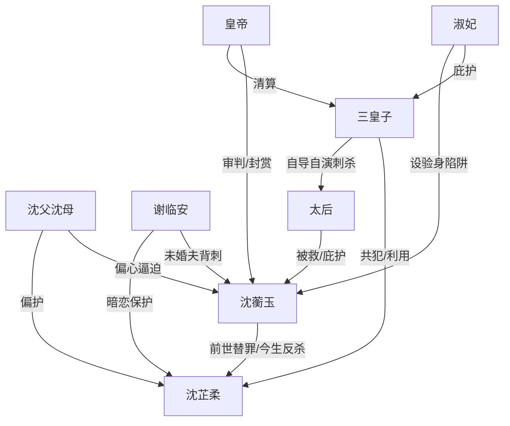

# 角色标签图谱

## 角色清单

### 沈蘅玉 — 重生刚烈嫡女
- 叙事功能: 第一人称主角，承载前世情绪债与今生反杀线。
- 核心标签: 重生、清白、刚烈
- 弧光: 替罪弃女 → 公开自证 → 救驾功臣 → 护国郡主
- 台词风格: 短句、反问、审判式质问。
- 关键行为: 拒认罪、以死明志、要求当众验身、抢救驾功劳、天牢送三皇子上路。
- 读者情绪关系: 心疼、愤怒代入、复仇爽感。

### 沈芷柔 — 白莲替嫁受宠妹妹
- 叙事功能: 初始罪名制造者，家庭偏心的受益人，三皇子阴谋的共犯。
- 核心标签: 装弱、受宠、恶毒
- 弧光: 准皇子妃 → 当众破身败露 → 鞭刑沉塘
- 台词风格: 哭诉、推责、装无辜，败露后歇斯底里。
- 关键行为: 推罪给姐姐、刻姐姐小名、拒绝验身、反咬三皇子。
- 读者情绪关系: 恨、厌恶、期待报应。

### 沈父沈母 — 偏心冷血父母
- 叙事功能: 亲情背刺源，强化女主孤立无援。
- 核心标签: 偏心、伪孝道、冷血
- 弧光: 逼女儿顶罪 → 当众失势 → 流放三千里
- 台词风格: 孝道压迫、辱骂、命令。
- 关键行为: 当众指认女主、逼磕头、前世亲手沉塘。
- 读者情绪关系: 强恨点，承担亲情债。

### 谢临安/谢临风 — 清名伪君子未婚夫
- 叙事功能: 爱情背刺源，坐实女主罪名的关键伪证人。
- 核心标签: 伪君子、痴恋妹妹、欺君
- 弧光: 清冷君子 → 当众作伪证 → 杖责革功名、三代为奴
- 台词风格: 伪深情、伪宽容、道德绑架。
- 关键行为: 伪称与女主肌肤之亲，为沈芷柔遮掩。
- 读者情绪关系: 恶心、愤怒、期待名声崩塌。

### 三皇子 — 淫乱傲慢皇权反派
- 叙事功能: 真正幕后男恶，后半段二次复仇目标。
- 核心标签: 皇权傲慢、淫乱、算计
- 弧光: 准新郎皇子 → 庶人 → 刺杀败露 → 鸠酒赐死
- 台词风格: 甩锅、命令、理直气壮。
- 关键行为: 与沈芷柔宫宴寻刺激，计划推女主顶罪，自导自演救驾。
- 读者情绪关系: 核心大反派，死局清算对象。

### 淑妃 — 护短阴毒宫妃
- 叙事功能: 私刑规则提供者，皇权母系庇护伞。
- 核心标签: 阴狠、护子、弄权
- 弧光: 高位审判者 → 被皇帝踹倒 → 冷宫吊死
- 台词风格: 威胁、羞辱、咬牙切齿。
- 关键行为: 要乱棍打死女主，安排验身嬷嬷陷阱。
- 读者情绪关系: 恨、压迫感、崩塌爽。

### 皇帝 — 公权力审判者
- 叙事功能: 公开规则的最终裁决者，反杀必须借用的权力。
- 核心标签: 多疑、重威严、可被证据推动
- 弧光: 问罪者 → 查案者 → 清算者 → 封赏者
- 台词风格: 威严、暴怒、判决式。
- 关键行为: 接受女主以死明志，命三司会审，封女主郡主。
- 读者情绪关系: 工具性公正来源。

### 太后 — 后期补偿与身份背书者
- 叙事功能: 二次复仇节点，女主获封的情感背书。
- 核心标签: 慈爱、尊贵、被救者
- 弧光: 被刺杀目标 → 感恩女主 → 保护女主
- 台词风格: 温和、怜惜。
- 关键行为: 被女主救下，承诺以后护她。
- 读者情绪关系: 补偿、温暖、身份认可。

## 关系网络

## 角色功能对照表（供改编参考）

| 原角色 | 极致标签 | 叙事功能 | 读者情绪功能 | 改编时必须保留的 |
|--------|---------|---------|-------------|---------------|
| 沈蘅玉 | 重生刚烈嫡女 | 受害者与反杀执行者 | 心疼、代入、爽 | 拒绝顶罪、公开自证、二次清算 |
| 沈芷柔 | 白莲受宠妹妹 | 初始施害者 | 恨、期待报应 | 装弱推罪、关键物证败露、镜像受罚 |
| 父母 | 偏心冷血亲人 | 亲情债来源 | 极致憋屈 | 用孝道逼认、前世亲手害死 |
| 未婚夫 | 伪君子 | 爱情背刺 | 恶心、愤怒 | 伪证坐实女主失贞 |
| 三皇子 | 皇权反派 | 终极清算对象 | 终局爽 | 真凶、未死隐患、救驾翻身被截胡 |
| 淑妃 | 阴毒保护伞 | 私刑陷阱 | 压迫感 | 验身陷阱、护子弄权 |
| 皇帝 | 公权力 | 规则裁决 | 公审爽 | 被女主逼向查案 |
| 太后 | 补偿背书 | 后期封赏 | 温暖 | 救驾功劳与身份跃升 |
