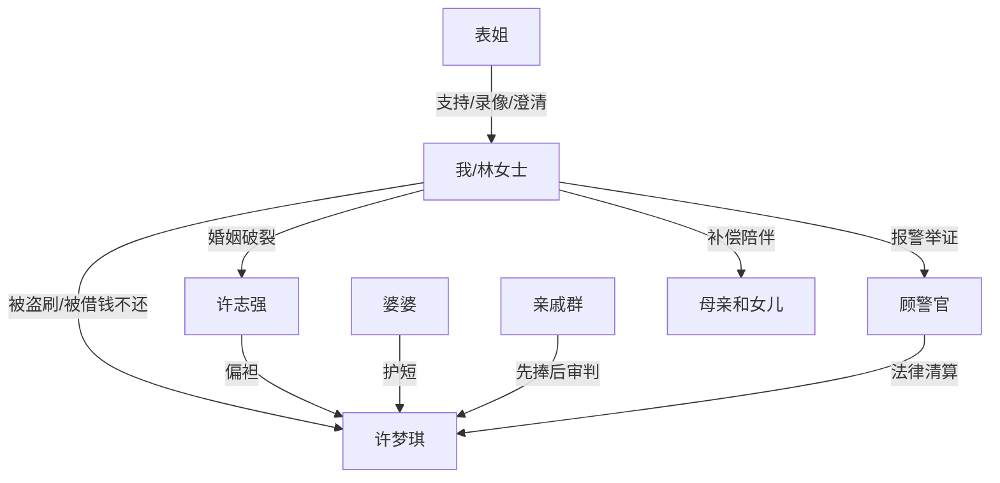

# 角色标签图谱

## 角色清单

### 我 / 林女士 — 清醒设局型大嫂
- 叙事功能: 受害者、设局者、最终清算者。
- 核心标签: 清醒、证据控、有底线。
- 弧光: 长期忍让 → 冷静设局 → 法律清算 → 离婚自救。
- 台词风格: 短句、反问、直接定性。
- 关键行为: 设置支付保护；保存消费记录；拒给密码；报警；离婚。
- 读者情绪关系: 心疼转爽，读者期待她别再忍。

### 许梦琪 / 小姑子 — 偷钱装阔型吸血亲戚
- 叙事功能: 主反派，制造侵占和社死爽点。
- 核心标签: 虚荣、贪便宜、赖账。
- 弧光: 偷刷试水 → 高调做东 → 收银台崩盘 → 拘留赔钱。
- 台词风格: 群聊浮夸、电话慌乱、上门装可怜。
- 关键行为: 18 元试卡；五一挂账一万五；向女主索要密码；拒不还旧债。
- 读者情绪关系: 强恨点，越装越想看她翻车。

### 许志强 / 丈夫 — 偏心和稀泥型伴侣
- 叙事功能: 次反派，证明女主婚姻结构不可救。
- 核心标签: 偏妹、冷漠、甩锅。
- 弧光: 让女主借卡 → 逼女主给密码 → 不敢转钱 → 离婚时指责女主狠。
- 台词风格: “屁大点事”式轻描淡写。
- 关键行为: 要女主配合妹妹撑面子；拒绝自己兜底；情感施压。
- 读者情绪关系: 失望、厌恶，推动离婚爽点成立。

### 婆婆 — 亲情绑架型长辈
- 叙事功能: 家庭伦理压迫源之一。
- 核心标签: 偏女儿、道德绑架、怕丢脸。
- 弧光: 夸女儿懂事 → 逼儿媳撤案 → 离婚财产还想分羹。
- 台词风格: 长语音、哭嚎、道德审判。
- 关键行为: 替小姑子撑腰；要求撤案。
- 读者情绪关系: 恨点加压。

### 表姐 — 外部见证人 / 爽点转播器
- 叙事功能: 眼线、证人、读者替身。
- 核心标签: 机灵、站队女主、群体传播。
- 弧光: 怀疑小姑子 → 现场直播 → 群里替女主澄清。
- 台词风格: 口语化、吐槽、实时播报。
- 关键行为: 收银台录像；垫钱；群里说明盗刷过程。
- 读者情绪关系: 提供看戏快感和站队确认。

### 亲戚群体 — 舆论审判场
- 叙事功能: 先捧后踩，放大小姑子社死。
- 核心标签: 势利、爱看热闹、公开评价。
- 弧光: 夸梦琪大气 → 发现真相 → 集体追债。
- 台词风格: 家常碎嘴、补刀。
- 关键行为: 饭前捧场；饭后质疑；群里追债。
- 读者情绪关系: 爽点扩音器。

### 顾警官 — 法律清算执行者
- 叙事功能: 将家庭纠纷升级为可验证的法律后果。
- 核心标签: 专业、利索、程序化。
- 弧光: 受理证据 → 判断立案标准 → 通知拘留赔偿。
- 台词风格: 条理清晰。
- 关键行为: 确认预谋、传唤、处罚。
- 读者情绪关系: 正义落地。

## 关系网络

## 角色功能对照表（供改编参考）

| 原角色 | 极致标签 | 叙事功能 | 读者情绪功能 | 改编时必须保留的 |
|--------|---------|---------|-------------|---------------|
| 我 | 清醒设局型大嫂 | 受害者转清算者 | 心疼、爽 | 不吵先取证，最后切断关系 |
| 许梦琪 | 偷钱装阔型吸血亲戚 | 主反派 | 恨、想看翻车 | 偷用资源装体面 |
| 丈夫 | 偏心和稀泥型伴侣 | 婚姻压迫证明 | 寒心、促离 | 要女主牺牲但自己不出钱 |
| 婆婆 | 亲情绑架型长辈 | 道德压力 | 厌恶 | “一家人”压迫话术 |
| 表姐 | 见证人 | 转播爽点 | 代入看戏 | 现场证据与群体澄清 |
| 亲戚 | 舆论场 | 社死放大 | 群体打脸 | 先捧后踩的反差 |
