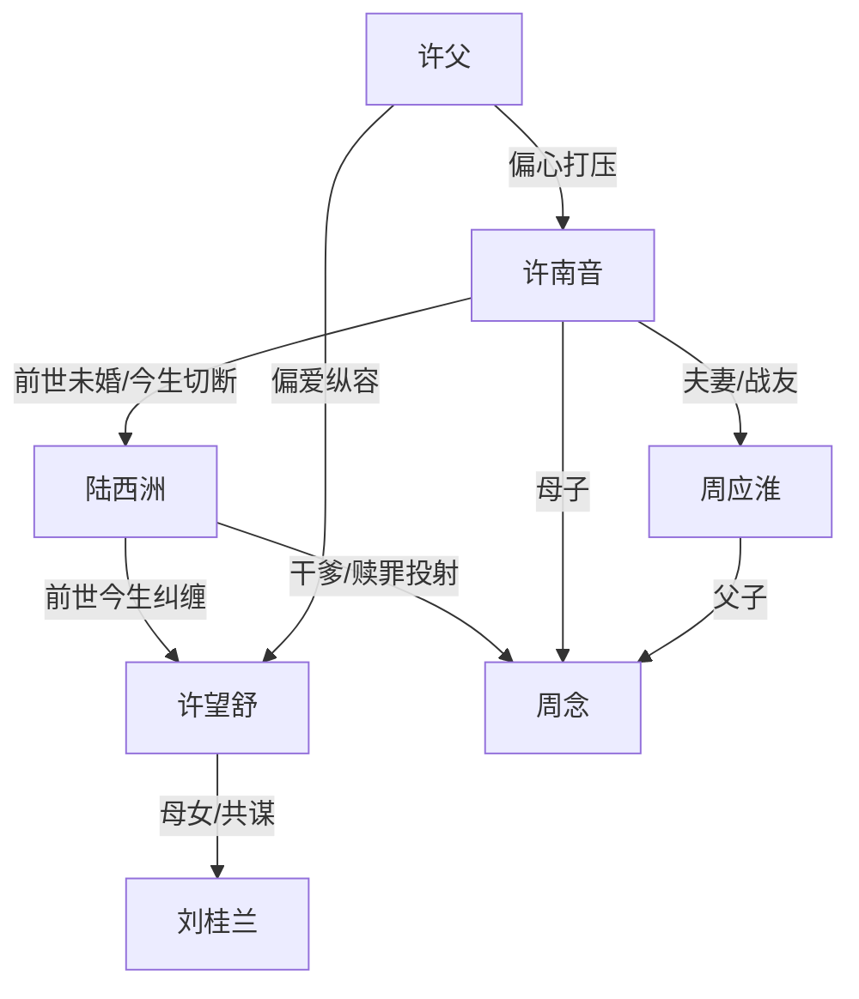

# 角色标签图谱

## 角色清单

### 许南音 — 清醒重生大女主

- 叙事功能: 受害者、反抗者、新人生建立者、道德坐标中心
- 核心标签: 清醒、能忍、能断
- 弧光: 被辜负一生的守候者 → 主动夺回命运的军官与母亲
- 台词风格: 短、冷、少解释
- 关键行为: 保住名额、六点出逃、立功归来、另嫁周应淮、敬茶断前尘
- 读者情绪关系: 心疼、代入、爽、最终复杂共情

### 陆西洲 — 自私深情型悔恨男主

- 叙事功能: 主要亏欠者、压迫源、悔恨承载者、最终赎罪者
- 核心标签: 傲慢、迟钝、悔悟
- 弧光: 以为“哄哄就好”的占有者 → 失去后崩塌的旁观者 → 牺牲赎罪的军人
- 台词风格: 前期笃定油滑，后期沉默发哑
- 关键行为: 逼婚、造谣、娶许望舒、离婚、查案、认干儿子、留下断后
- 读者情绪关系: 前期恨，后期痛快，结尾复杂惋惜

### 许望舒 — 绿茶替代者

- 叙事功能: 持续争夺资源、制造诬陷、推动陆西洲选错
- 核心标签: 乖巧伪装、嫉妒、表演型受害
- 弧光: 被偏爱的妹妹 → 顶替新娘 → 失去婚姻与前途
- 台词风格: 委屈、退让式攻击、“不是故意的”
- 关键行为: 下药、假摔、替嫁、撒谎、怂恿母亲害许南音
- 读者情绪关系: 恨、厌恶、期待被揭穿

### 周应淮 — 稳定并肩型真伴侣

- 叙事功能: 新秩序、新人生、尊重型亲密关系的象征
- 核心标签: 克制、可靠、并肩
- 弧光: 冷淡搭档 → 默契战友 → 丈夫与父亲
- 台词风格: 简短实用，不多承诺
- 关键行为: 与许南音并肩完成任务、成婚生子、接纳但约束陆西洲
- 读者情绪关系: 安心、补偿、治愈

### 刘桂兰 — 家庭伦理恶源

- 叙事功能: 偏心与旧案真凶，支撑家庭伦理复仇线
- 核心标签: 阴狠、偏心、算计
- 弧光: 继母压迫者 → 害死生母真凶 → 被判清算
- 台词风格: 咒骂、挑拨、装慈爱
- 关键行为: 帮女儿抢名额、谋害许南音生母、策划继续污蔑
- 读者情绪关系: 恨、期待法律清算

### 许父 — 懦弱偏心父亲

- 叙事功能: 家庭压迫的合法化声音
- 核心标签: 偏心、好面子、父权
- 弧光: 打压许南音 → 认下换新娘 → 被事实边缘化
- 台词风格: 命令式、道德绑架
- 关键行为: 掌掴、逼让名额、承认许望舒替嫁
- 读者情绪关系: 憋屈、厌恶

## 关系网络

## 角色功能对照表（供改编参考）

| 原角色 | 极致标签 | 叙事功能 | 读者情绪功能 | 改编时必须保留的 |
|--------|---------|---------|-------------|---------------|
| 许南音 | 清醒重生大女主 | 夺回命运 | 心疼转爽 | 不解释、不回头、拿回核心资源 |
| 陆西洲 | 悔恨亏欠者 | 压迫与赎罪 | 恨转复杂 | 前期傲慢和后期牺牲都要保留 |
| 许望舒 | 绿茶替代者 | 争夺资源 | 恨点制造 | 假摔/装委屈/替代女主位置 |
| 周应淮 | 稳定新伴侣 | 补偿关系 | 安心 | 并肩能力与尊重边界 |
| 刘桂兰 | 蛇蝎继母 | 伦理恶源 | 清算期待 | 旧案罪行和继续加害计划 |
| 许父 | 偏心父亲 | 家庭压迫 | 憋屈 | 当众站队妹妹 |
