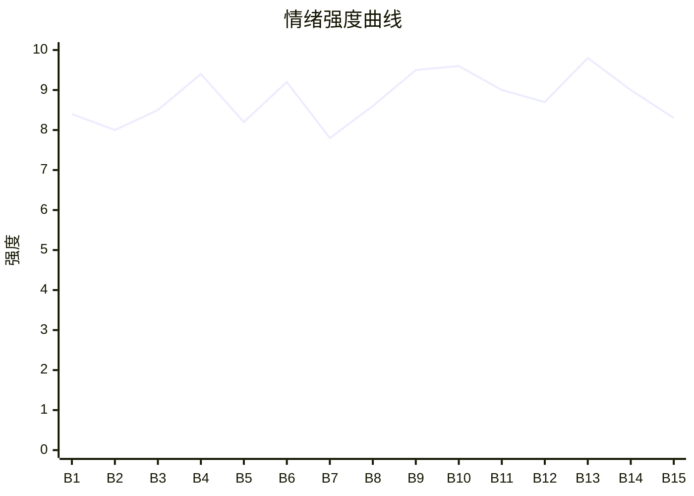

# Beat Sheet 节拍器

## 全文概况
- 总字数: 约 32000 字
- 节拍数: 15 幕
- 核心母题（Logline）: 黑道女强陈知鱼救下死对头并强行成婚，患绝症后主动退场，却被丈夫与白月光反复误解伤害；当真相层层揭开，丈夫在失去边缘才发现爱她，并用余生赎罪。
- 情绪模式: 极致打压 → 清醒退场 → 二次碾压 → 真相反噬 → 追妻火葬场 → 生死回温

## 节拍详表

### Beat 1: 救命恩变婚姻牢笼 [1]
- **字数**: 约 1500 字（占比 4.7%）
- **核心事件**: 交代三年前陈知鱼救虞仲晏、婚姻来源、白月光回归和女主绝症。
- **情绪标签**: 震惊、憋屈、宿命感
- **情绪强度**: 8.4/10
- **情绪方向**: ⚡突变
- **冲突类型**: 大转折
- **悬念钩子**: 她只有三个月可活，为什么还要离婚退场？
- **叙事速度**: 快
- **对话占比**: 32%
- **reversal_mechanism**: [M5]
- **hook_strength**: 8.4/10
- **关键句**: “反正，她没几天好活了。”
- **原文摘录**: 三年前虞家倒台，陈知鱼自断三指救下虞仲晏；婚后他仍在外养像白月光的人。白月光沈伊年回归后，虞仲晏当众为她下跪求陈知鱼放过。陈知鱼不吵不闹，因为她脑瘤恶性，活不过三个月，并递出离婚协议：“虞仲晏，你要的自由，我现在还你。”

### Beat 2: 放手被当成算计 [1-2]
- **字数**: 约 2000 字（占比 6.3%）
- **核心事件**: 虞仲晏撕毁离婚协议，沈伊年装可怜，陈知鱼安排离开公司。
- **情绪标签**: 心寒、误解、退场感
- **情绪强度**: 8.0/10
- **情绪方向**: ↓下降
- **冲突类型**: 微冲突
- **悬念钩子**: 她真正退出清晏后，权力结构会怎样崩？
- **叙事速度**: 中
- **对话占比**: 42%
- **reversal_mechanism**: [M5]
- **hook_strength**: null
- **关键句**: “斗了这么多年，连放手都被当作算计。”
- **原文摘录**: 虞仲晏不信她无条件离婚，将协议撕碎扬在她脸上。陈知鱼忍着脸上火烧的痛没躲，只说三天后会议准时到场。她摘下无名指素戒，扣下合照，询问秘书自己走后是否愿意留下，准备彻底抽身。

### Beat 3: 会议退场与东水被夺 [2]
- **字数**: 约 2300 字（占比 7.2%）
- **核心事件**: 陈知鱼在会议上宣布离开清晏，虞仲晏随后要夺走东水房子。
- **情绪标签**: 屈辱、失重、病痛
- **情绪强度**: 8.5/10
- **情绪方向**: ↓下降
- **冲突类型**: 大转折
- **悬念钩子**: 东水被砸，女主会不会反击？
- **叙事速度**: 中
- **对话占比**: 45%
- **reversal_mechanism**: [M5]
- **hook_strength**: null
- **关键句**: “那间房子是她小姨生前最后留下的。”
- **原文摘录**: 会议上沈伊年被带来，何秘书被打，陈知鱼宣布离开清晏。虞仲晏冷笑让她明天别再踏进公司。会后他提出东水房子给沈伊年，陈知鱼拒绝，却接到阿姨电话：有人正在砸房子。她撑在桌上，眼前青黑，彻底失去意识。

### Beat 4: 东水反击与白漆酷刑 [3-4]
- **字数**: 约 3000 字（占比 9.4%）
- **核心事件**: 陈知鱼病中赶去东水，惩戒沈伊年，却被虞仲晏灌白漆重伤。
- **情绪标签**: 爽、痛、窒息
- **情绪强度**: 9.4/10
- **情绪方向**: ⚡突变
- **冲突类型**: 大转折
- **悬念钩子**: 她抢救三天后，还会不会继续纠缠？
- **叙事速度**: 快
- **对话占比**: 38%
- **reversal_mechanism**: [M5, M3]
- **hook_strength**: null
- **关键句**: “那一刻，陈知鱼真的以为她要死在这里了。”
- **原文摘录**: 陈知鱼高烧赶到东水，看见小姨骨灰被堆在角落，直接用刷子羞辱沈伊年并逼她给骨灰磕头。虞仲晏赶到后扇她、踹她，命人把白漆灌进她嘴里。辛辣、窒息、抽搐，她被救护车拉走，抢救三天。

### Beat 5: 病房最后通牒 [4-5]
- **字数**: 约 2200 字（占比 6.9%）
- **核心事件**: 陈知鱼在病房明确切断关系，虞仲晏却仍高高在上。
- **情绪标签**: 清醒、寒心、决绝
- **情绪强度**: 8.2/10
- **情绪方向**: →平稳
- **冲突类型**: 微冲突
- **悬念钩子**: 她说不签离婚就绝不放过二人，会如何兑现？
- **叙事速度**: 中
- **对话占比**: 36%
- **reversal_mechanism**: [M5]
- **hook_strength**: null
- **关键句**: “我这次，是真的不想再跟他有任何瓜葛。”
- **原文摘录**: 陈知鱼抢救后肺被灼穿。王悬探望时，她请求转告虞仲晏签离婚协议。虞仲晏来病房说可以不娶沈伊年，也可让她回公司，但不能再动沈。陈知鱼冷冷回击：只要他一天不签，她绝不放过他和沈伊年。

### Beat 6: 慈善晚会与火场抛弃 [5-6]
- **字数**: 约 3000 字（占比 9.4%）
- **核心事件**: 晚会上沈伊年挑衅失败，火灾中虞仲晏因“怀孕”抛下陈知鱼。
- **情绪标签**: 嫉妒、讽刺、绝望
- **情绪强度**: 9.2/10
- **情绪方向**: ↓下降
- **冲突类型**: 大转折
- **悬念钩子**: 火场后她还能活吗？
- **叙事速度**: 快
- **对话占比**: 44%
- **reversal_mechanism**: [M5]
- **hook_strength**: null
- **关键句**: “在沈伊年一声‘我有宝宝了’出来后，虞仲晏收手转头走得决绝。”
- **原文摘录**: 慈善晚会上里安表现出对陈知鱼的倾慕，沈伊年当众羞辱她却被反怼。洗手间外突发火灾，虞仲晏冲来一瞬想伸手，却因沈伊年一句怀孕转身带她离开。陈知鱼扶着墙笑出了泪。

### Beat 7: 离婚成功与白月光失能 [6-8]
- **字数**: 约 3100 字（占比 9.7%）
- **核心事件**: 王悬帮陈知鱼拿到离婚证，沈伊年接手公司后暴露无能。
- **情绪标签**: 讽刺、短爽、暗痛
- **情绪强度**: 7.8/10
- **情绪方向**: ↑上升
- **冲突类型**: 微冲突
- **悬念钩子**: 虞仲晏会何时发现陈知鱼真的消失？
- **叙事速度**: 中
- **对话占比**: 35%
- **reversal_mechanism**: [M3]
- **hook_strength**: null
- **关键句**: “离开他我哪里都好。”
- **原文摘录**: 陈知鱼再次抢救后，王悬关掉电视安慰她。里安制造舆论牵制虞仲晏，陈知鱼迅速拿到离婚证。沈伊年进入清晏后端出荒唐菜品、闹出笑话，王悬怒骂她连陈知鱼一根毫毛都比不上。

### Beat 8: 梦见断指与空屋失踪 [8-9]
- **字数**: 约 2600 字（占比 8.1%）
- **核心事件**: 虞仲晏开始不安，梦见陈知鱼流血断指，去东水发现她彻底消失。
- **情绪标签**: 不安、迟来的痛、空洞
- **情绪强度**: 8.6/10
- **情绪方向**: ↑上升
- **冲突类型**: 大转折
- **悬念钩子**: 她到底去了哪里？
- **叙事速度**: 中
- **对话占比**: 28%
- **reversal_mechanism**: [M5]
- **hook_strength**: null
- **关键句**: “连陈知鱼最在意的她小姨的骨灰也消失不见。”
- **原文摘录**: 虞仲晏梦见陈知鱼浑身是血，地上掉下三根断指，醒后终于想起她为救自己付出的代价。他去东水，发现家具覆白布、骨灰不见、号码成空号，开始烦躁地追问她在哪。

### Beat 9: 离婚证撕碎与病情曝光 [9-10]
- **字数**: 约 2600 字（占比 8.1%）
- **核心事件**: 虞仲晏发现离婚证后崩溃，王悬说出陈知鱼快死了。
- **情绪标签**: 震惊、报应、崩塌
- **情绪强度**: 9.5/10
- **情绪方向**: ⚡突变
- **冲突类型**: 大转折
- **悬念钩子**: 他会如何面对病历和沈伊年的欺骗？
- **叙事速度**: 快
- **对话占比**: 50%
- **reversal_mechanism**: [M5, M6]
- **hook_strength**: null
- **关键句**: “陈知鱼不想活了，虞仲晏。”
- **原文摘录**: 虞仲晏在办公室发现离婚证，撕碎后质问王悬。王悬怒斥他活该，并说出陈知鱼脑瘤、肺烧穿、宁愿一个人死外面。虞仲晏捡起病历碎片，看见“病人自愿放弃治疗”。

### Beat 10: 录音、病危与认知粉碎 [11-12]
- **字数**: 约 2600 字（占比 8.1%）
- **核心事件**: 沈伊年隐瞒病情的录音和病危通知曝光，虞仲晏意识到自己错过了所有机会。
- **情绪标签**: 悔恨、恐慌、自厌
- **情绪强度**: 9.6/10
- **情绪方向**: ↑上升
- **冲突类型**: 大转折
- **悬念钩子**: 沈伊年会怎样被清算？
- **叙事速度**: 快
- **对话占比**: 45%
- **reversal_mechanism**: [M3, M5, M6]
- **hook_strength**: null
- **关键句**: “时至今日，虞仲晏才意识到他曾有机会让她回头，一次又一次地，被他错过。”
- **原文摘录**: 王悬播放沈伊年质问陈知鱼何时死的录音，甩出两次抢救的病危通知。虞仲晏想起白漆、火场、她哑掉的声音和瘦脱相的手腕，认知彻底打碎。他给了沈伊年一巴掌：“沈伊年，你还我陈知鱼。”

### Beat 11: 白月光真相与反派清算 [13-15]
- **字数**: 约 3500 字（占比 10.9%）
- **核心事件**: 沈伊年自导自演、自残和医生催化病情的真相曝光，虞仲晏展开报复。
- **情绪标签**: 爽、寒、报应
- **情绪强度**: 9.0/10
- **情绪方向**: ↑上升
- **冲突类型**: 大转折
- **悬念钩子**: 何斯择和王悬是否知道陈知鱼藏身处？
- **叙事速度**: 快
- **对话占比**: 43%
- **reversal_mechanism**: [M3, M6]
- **hook_strength**: null
- **关键句**: “从头到尾，陈知鱼从头到尾都没做错过什么。”
- **原文摘录**: 陈华盛打伤沈伊年导致大出血。虞仲晏在废弃渔厂审问沈伊年暗线，医生承认故意开错药催化陈知鱼脑瘤。监控证明东水割伤事件是沈自导自演。虞仲晏终于明白，所有罪证都是自己强加给陈知鱼。

### Beat 12: 城中村等死与新生诱生 [16-17]
- **字数**: 约 3200 字（占比 10.0%）
- **核心事件**: 陈知鱼藏在城中村等死，准备将遗产给王悬孙女，却被新生儿短暂唤起生机。
- **情绪标签**: 平静、心软、诀别
- **情绪强度**: 8.7/10
- **情绪方向**: →平稳后下降
- **冲突类型**: 微冲突
- **悬念钩子**: 她送走众人后注射镇定剂，能否被救回？
- **叙事速度**: 慢
- **对话占比**: 40%
- **reversal_mechanism**: [M5]
- **hook_strength**: null
- **关键句**: “等人一走，她就结束自己。”
- **原文摘录**: 陈知鱼其实没出城，住在城中村毛坯房里，靠里安送药送粥苟活。她拟好资产协议给王悬孙女。王悬抱着刚出生的孙女上门，婴儿奶香让她心软，但送客后她仍翻出镇定剂，一点点推进血管。

### Beat 13: 自杀休克与抢救赎罪 [18-19]
- **字数**: 约 3000 字（占比 9.4%）
- **核心事件**: 虞仲晏及时赶到拔针送医，陈知鱼经历多次病危，男主跪求被骂。
- **情绪标签**: 恐惧、悔恨、拉扯
- **情绪强度**: 9.8/10
- **情绪方向**: ⚡突变
- **冲突类型**: 大转折
- **悬念钩子**: 她醒来后会不会接受他的悔意？
- **叙事速度**: 快
- **对话占比**: 32%
- **reversal_mechanism**: [M5, M6]
- **hook_strength**: null
- **关键句**: “知鱼..陈知鱼、算我求你，别这样对我..”
- **原文摘录**: 虞仲晏踹门冲入，拔掉针筒，将休克的陈知鱼送上救护车。除颤、强心剂、抢救室、七份病危通知接连出现。医生说她求生意志太差。虞仲晏跪在王悬面前认错，得知她醒来后立刻冲进病房。

### Beat 14: 醒后拒绝与手术约定 [20-22]
- **字数**: 约 3300 字（占比 10.3%）
- **核心事件**: 陈知鱼醒来拒绝怜悯，虞仲晏求她手术，并承诺若醒不了就让她死。
- **情绪标签**: 抗拒、心软、迟来的爱
- **情绪强度**: 9.0/10
- **情绪方向**: ↓后↑
- **冲突类型**: 大转折
- **悬念钩子**: 她是否会原谅？手术能否成功？
- **叙事速度**: 中
- **对话占比**: 52%
- **reversal_mechanism**: [M5, M3]
- **hook_strength**: null
- **关键句**: “因为我后悔了。我爱你。”
- **原文摘录**: 陈知鱼醒后全程无视虞仲晏，半夜痛醒后质问他是不是来可怜自己。他崩溃求她不要不要他。之后他找来专家评估，陈知鱼拒绝手术，因为怕瘫痪。虞仲晏承诺若手术失败或瘫了，亲自给她安乐死。她问为什么，他答：“因为我后悔了。我爱你。”

### Beat 15: 原谅、昏迷、苏醒与仲夏收束 [23]
- **字数**: 约 3000 字（占比 9.4%）
- **核心事件**: 手术前陈知鱼原谅虞仲晏，术后昏迷近一年后醒来，二人进入赎罪式生活。
- **情绪标签**: 生死、释然、余温
- **情绪强度**: 8.3/10
- **情绪方向**: ↑回温
- **冲突类型**: 大转折
- **悬念钩子**: 正文完结，无付费后钩
- **叙事速度**: 中
- **对话占比**: 30%
- **reversal_mechanism**: [M5, M6]
- **hook_strength**: null
- **关键句**: “恨吗，爱吗？一切随风散去。”
- **原文摘录**: 手术前陈知鱼失明，被推进手术室前对虞仲晏说“我原谅你了”。手术三天三夜成功，但她昏迷近一年。虞仲晏日复一日按摩照顾，里安每日陪聊。陈知鱼苏醒后被称为奇迹，恢复后回家。沈伊年疯了，虞仲晏悄悄补回结婚证。窗外知了声声，又一年仲夏。

## 情绪曲线可视化

## 节拍密度检测
- 平均每 2130 字一个节拍
- 微冲突密度: 每约 2500 字一次
- 大转折密度: 每约 3200 字一次
- 判定: 符合高频节拍器标准；虽然篇幅较长，但每章基本都有误解、病痛、真相或抢救推进。

## 反转机制清单(Reversal Mechanisms)

| 机制 ID | 机制名 | 承载 Beat | 关键段落/金句 | 等价改编提示 |
|--------|--------|-----------|--------------|-------------|
| M5 | 温度反转曲线 | Beat 1-15 | “如今再没有人会强迫他了，难道不该高兴吗？”/“因为我后悔了。我爱你。” | 必须保留正温回忆、归零伤害、负值悔恨三段，男主悔恨要占后 1/3 足量篇幅。 |
| M6 | 多层递进反转 | Beat 9-15 | 离婚证发现 → 病情曝光 → 沈伊年真相 → 手术昏迷苏醒 | 层数不能少，每层反转要升维：情感、事实、罪证、生死价值。 |
| M3 | 因果回旋反讽 | Beat 4, 10, 14 | 他曾让她“求饶也没用”，后来他说“算我求你，别这样对我”；他要自由，她真还他自由后他崩溃 | 保留“施害者的话术反噬自身”，让男主用曾经不屑的低姿态偿还。 |
