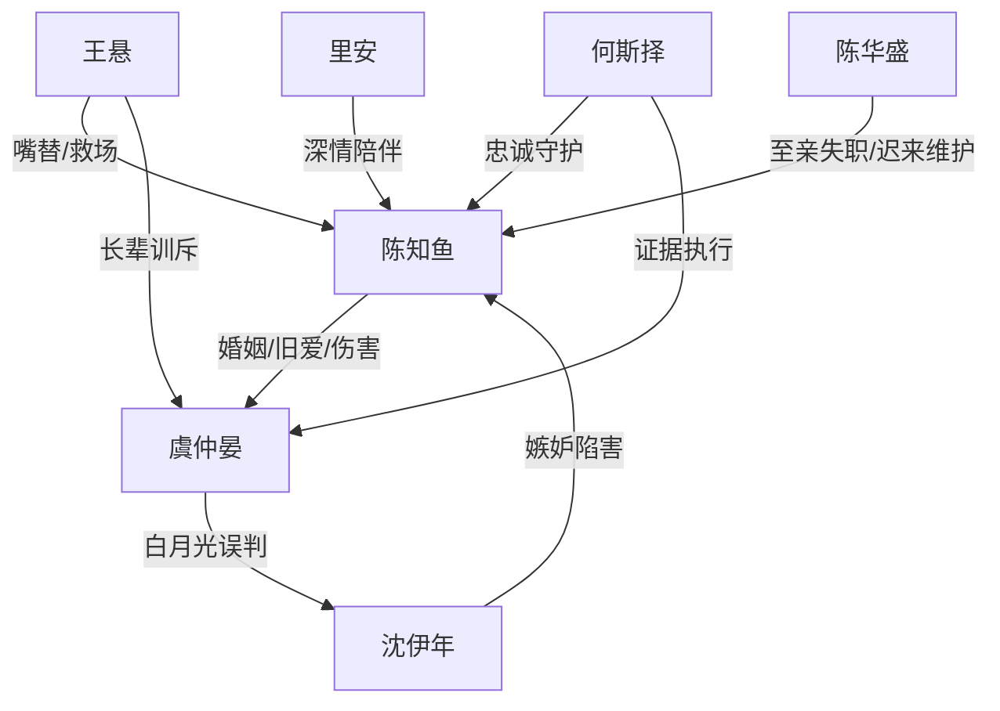

# 角色标签图谱

## 角色清单

### 陈知鱼 — 疯批清醒女强/濒死退场者
- 叙事功能: 核心受害者、主动退场者、情绪债承载体。
- 核心标签: 女魔头、清醒、绝症、重情但不乞求。
- 弧光: 强留爱人 → 主动放手 → 等死退场 → 被新生牵回 → 接受手术与余生。
- 台词风格: 冷、短、带刺，不解释，不求饶。
- 关键行为: 自断三指救人；递离婚协议；退出公司；藏身城中村；注射镇定剂；同意手术。
- 读者情绪关系: 心疼、敬佩、希望她被补偿。

### 虞仲晏 — 迟钝霸总/追妻火葬场男主
- 叙事功能: 最大施害者、误判执行者、后半赎罪者。
- 核心标签: 高傲、偏执、后知后觉。
- 弧光: 厌恶女主 → 纵容白月光 → 发现真相 → 崩溃求生 → 长期照护。
- 台词风格: 前半命令羞辱，后半哽咽乞求。
- 关键行为: 撕协议、灌白漆、火场抛弃、撕离婚证、审沈伊年、救自杀、求手术。
- 读者情绪关系: 前半恨，后半看他受报应与赎罪。

### 沈伊年 — 伪善白月光/误解制造机
- 叙事功能: 情绪债催化剂，制造误会和病情隐瞒。
- 核心标签: 装柔弱、嫉妒、恶毒。
- 弧光: 被保护的白月光 → 暴露无能 → 谎言揭穿 → 疯癫沉沦。
- 台词风格: 哭腔、装弱、推责。
- 关键行为: 装伤、自残、隐瞒病情、指使藏病例、挑衅陈知鱼。
- 读者情绪关系: 恨、期待清算。

### 王悬 — 毒舌叔父/读者嘴替
- 叙事功能: 见证者、真相推进者、道德审判者。
- 核心标签: 毒舌、护短、清醒。
- 弧光: 厌恶陈知鱼 → 理解她 → 帮她离婚 → 劝她活。
- 台词风格: 粗粝直接，骂人带爽感。
- 关键行为: 骂沈伊年、帮办离婚、揭病情、抱孙女上门。
- 读者情绪关系: 爽、信任、替读者出气。

### 何斯择 — 忠诚秘书/隐忍守护者
- 叙事功能: 女主阵营执行者，提供陪伴和证据链。
- 核心标签: 克制、忠诚、细致。
- 弧光: 秘书 → 受辱仍守护 → 帮传协议 → 参与救援。
- 台词风格: 恭敬、克制、少言。
- 关键行为: 照顾昏迷女主、传递协议、处理清算现场。
- 读者情绪关系: 心疼、认可。

### 里安 — 深情男二/外部对照组
- 叙事功能: 证明女主值得被爱，衬托男主眼瞎。
- 核心标签: 热烈、真诚、异国贵公子。
- 弧光: 倾慕女主 → 火场救人 → 城中村陪伴 → 手术后仍陪聊。
- 台词风格: 蹩脚中文，直接热情。
- 关键行为: 晚会维护、火场救人、送药送粥、献血。
- 读者情绪关系: 惋惜、暖意。

### 陈华盛 — 失职至亲/迟来维护者
- 叙事功能: 补足女主亲缘孤绝，制造家族层面的伤害。
- 核心标签: 强硬、偏心、老派。
- 弧光: 架空外孙女 → 迟来维护 → 仍粗暴。
- 台词风格: 粗暴、权威。
- 关键行为: 曾架空陈知鱼；后来打沈伊年。
- 读者情绪关系: 复杂、不完全原谅。

## 关系网络

## 角色功能对照表（供改编参考）

| 原角色 | 极致标签 | 叙事功能 | 读者情绪功能 | 改编时必须保留的 |
|--------|---------|---------|-------------|---------------|
| 陈知鱼 | 疯批清醒女强 | 承债与退场 | 心疼、敬佩 | 不解释、不乞求、主动选择死/活 |
| 虞仲晏 | 迟钝霸总 | 施害与赎罪 | 恨后看报应 | 后悔必须迟且重 |
| 沈伊年 | 伪善白月光 | 制造误会 | 恨、等清算 | 装弱与证据链 |
| 王悬 | 毒舌嘴替 | 道德审判 | 爽 | 骂醒男主、替女主留机会 |
| 何斯择 | 忠诚秘书 | 执行保护 | 安全感 | 沉默守护 |
| 里安 | 深情男二 | 价值对照 | 暖、惋惜 | 证明女主值得爱 |
