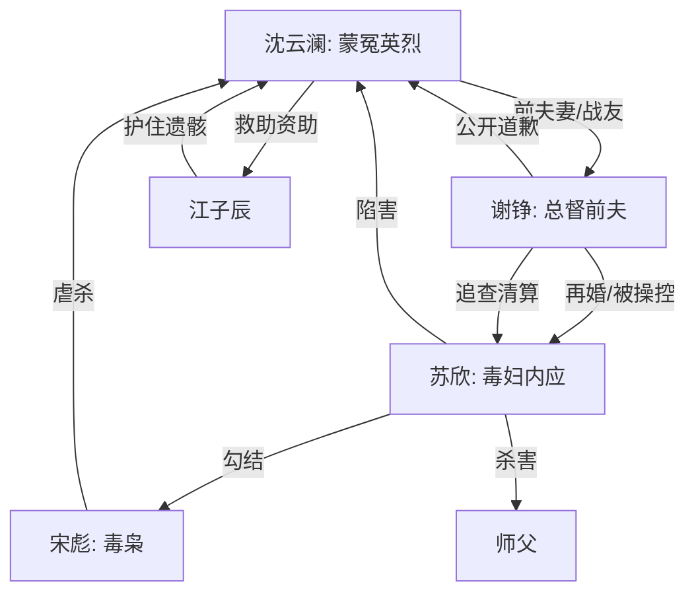

# 角色标签图谱

## 角色清单

### 沈云澜 — 蒙冤英烈 / 死后旁观女主
- 叙事功能: 情绪核心、道德坐标、真相受害者。
- 核心标签: 缉毒女警、卧底英雄、死后蒙冤。
- 弧光: 被定为叛徒的亡魂 → 被全港承认为英雄 → 放下前夫向光离开。
- 台词风格: 几乎无现实台词，以内心独白为主，克制冷痛。
- 关键行为: 生前卧底、救江子辰、保护同袍；死后旁观真相回流。
- 读者情绪关系: 心疼、敬重、盼她昭雪，最后支持她不原谅。

### 谢铮 — 悔疯总督前夫 / 迟来赎罪者
- 叙事功能: 误判执行者、真相追查者、悔恨偿债者。
- 核心标签: 最高警署总督、前夫、被操控的权力者。
- 弧光: 坚信女主叛逃 → 被证据击碎 → 公开道歉 → 辞职捐产自尽。
- 台词风格: 前期官方冷硬，后期破碎忏悔。
- 关键行为: 拒绝钻探、批准爆破、发现白骨、重启旧案、诈供苏欣、公开道歉。
- 读者情绪关系: 前期恨其愚蠢，中期看其崩溃，后期接受赎罪但不要求女主原谅。

### 苏欣 — 伪善毒妇 / 身份窃取型内应
- 叙事功能: 真凶、情绪债源头、温柔外壳下的极恶反派。
- 核心标签: 假烈士遗孤、总督夫人、警署内应。
- 弧光: 温柔孕妻 → 被调查锁定 → 被诈供自爆 → 庭审崩溃死亡。
- 台词风格: 软声哭诉、道德绑架、遇险后尖叫失控。
- 关键行为: 泄露情报、杀师父、陷害沈云澜、骗谢铮入爆炸局、持续操控谢铮。
- 读者情绪关系: 强恨点，期待其被公开剥皮和法律清算。

### 宋彪 — 疯批毒枭 / 恶意真相触发器
- 叙事功能: 开篇 Hook 发动者、真相裂缝制造者、反讽审判者。
- 核心标签: 毒枭、杀人犯、临死爆料者。
- 弧光: 公审挑衅 → 引出真相 → 最后点破谢铮永远亏欠。
- 台词风格: 散漫、恶毒、嘲弄。
- 关键行为: 公审承认杀沈云澜，提供桥墩和庄园线索。
- 读者情绪关系: 恨，但也被用作撕开伪真相的工具。

### 江子辰 — 被救少年 / 迟来的守护者
- 叙事功能: 外部救援变量，证明沈云澜的善因回报。
- 核心标签: 工程师、幸存孤儿、知恩守信。
- 弧光: 当年被沈云澜救下 → 成为桥梁工程师 → 护住她最后遗骸。
- 台词风格: 间接呈现，无大量台词。
- 关键行为: 抢在爆破前非破坏性破拆桥墩。
- 读者情绪关系: 让读者获得“至少有人从未不信她”的补偿。

### 师父 — 被杀导师 / 清白线索锚点
- 叙事功能: 牺牲同袍代表、苏欣罪证关键。
- 核心标签: 缉毒队长、导师、最早发现内应者。
- 弧光: 生前保护沈云澜 → 被苏欣灭口 → 死后成为翻案证据链核心。
- 台词风格: 回忆中庄重。
- 关键行为: 用命替沈云澜争取潜伏机会，留下“撑下去”的精神遗言。
- 读者情绪关系: 心疼、敬重，加重苏欣罪恶。

## 关系网络

## 角色功能对照表（供改编参考）

| 原角色 | 极致标签 | 叙事功能 | 读者情绪功能 | 改编时必须保留的 |
|--------|---------|---------|-------------|---------------|
| 沈云澜 | 蒙冤英烈亡魂 | 道德中心 | 心疼与昭雪期待 | 死亡前置、不能行动、清白必须由证据恢复 |
| 谢铮 | 悔疯权力前夫 | 误判与赎罪 | 先恨后看他崩溃 | 前期二次伤害、后期公开道歉和极端赎罪 |
| 苏欣 | 伪善毒妇 | 真凶 | 强恨点 | 温柔外壳、持续操控、自爆崩塌 |
| 宋彪 | 疯批毒枭 | 真相触发器 | 恐惧和恶心 | 公审爆料、临死嘲讽 |
| 江子辰 | 知恩守护者 | 善因回报 | 补偿感 | 外部专业能力护住关键遗骸 |
| 师父 | 牺牲导师 | 旧案锚点 | 悲壮 | 被真凶灭口、证据能反指真凶 |
