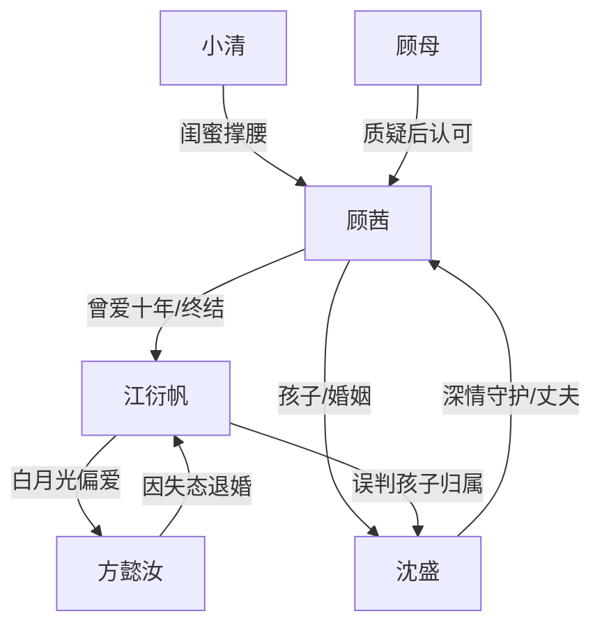

# 角色标签图谱

## 角色清单

### 顾茜 — 十年舔狗清醒大女主
- 叙事功能: 情绪承受者与终局裁决者。
- 核心标签: 长情、清醒、克制反击。
- 弧光: 卑微追逐竹马 → 怀孕后断联 → 公开真相 → 彻底不回头。
- 台词风格: 冷静、短句、反复澄清。
- 关键行为: 宣布怀孕非江衍帆、扔掉旧物、公开沈盛、播放监控、婚礼拒绝。
- 读者情绪关系: 前半心疼，后半爽和释然。

### 江衍帆 — 迟来深情自恋竹马
- 叙事功能: 情绪债制造者、火葬场承受者。
- 核心标签: 傲慢、误判、占有欲。
- 弧光: 轻视顾茜 → 否认孩子 → 强行干涉 → 真相崩塌 → 抢婚求复合失败。
- 台词风格: 命令式、质疑式、后期哀求式。
- 关键行为: 生日夜羞辱、拉黑扔物、堵车逼打胎、遗弃孕妇、同学会闹场、婚礼抢亲。
- 读者情绪关系: 前半恨，后半看他崩溃获得爽感。

### 沈盛 — 逆袭深情沈总/补偿型真男主
- 叙事功能: 补偿女主、打破江衍帆唯一性。
- 核心标签: 深情、可靠、反差逆袭。
- 弧光: 曾被嘲笑的小胖 → 回国创业者 → 女主丈夫与保护者。
- 台词风格: 温柔、郑重、行动派。
- 关键行为: 转账一百万、准备宝宝用品、同学会公开身份、见家长下跪、婚礼保护。
- 读者情绪关系: 安心、甜、替女主被珍视。

### 方懿汝 — 骄傲白月光
- 叙事功能: 刺激江衍帆偏爱对照，并推动他婚约崩盘。
- 核心标签: 骄傲、体面、白月光。
- 弧光: 被江衍帆捧在手心 → 目睹失态 → 退婚离场。
- 台词风格: 体面、含蓄、要面子。
- 关键行为: 医院探望、同学会拉江衍帆坐下、退场、解除婚约。
- 读者情绪关系: 不主要被恨，承担反讽镜面。

### 小清 — 嘴替闺蜜
- 叙事功能: 替读者骂人、制造外部支持。
- 核心标签: 仗义、直接、网感。
- 弧光: 担心顾茜 → 公开撑腰 → 婚礼斥责江衍帆。
- 台词风格: 爽快、怼人、接地气。
- 关键行为: 朋友圈宣布当干妈、评论区怼江、同学会骂醒众人。
- 读者情绪关系: 爽、解气。

### 顾母 — 传统母亲/现实校验者
- 叙事功能: 家庭压力与后期认可。
- 核心标签: 急躁、现实、护女。
- 弧光: 质疑未婚怀孕 → 心疼女儿 → 接纳沈盛 → 看清江家。
- 台词风格: 唠叨、现实、带市井感。
- 关键行为: 质问孩子父亲、医院护女、认可沈盛。
- 读者情绪关系: 前期压力，后期亲情补偿。

## 关系网络

## 角色功能对照表（供改编参考）

| 原角色 | 极致标签 | 叙事功能 | 读者情绪功能 | 改编时必须保留的 |
|--------|---------|---------|-------------|---------------|
| 顾茜 | 十年舔狗清醒女主 | 承债与裁决 | 心疼→爽 | 真的不爱了，不是欲擒故纵 |
| 江衍帆 | 自恋迟来深情竹马 | 制造羞辱债 | 恨→看崩溃 | 傲慢误判与后期哀求 |
| 沈盛 | 逆袭深情真男主 | 补偿与保护 | 甜、安心 | 曾被低估，后期高价值且珍视女主 |
| 方懿汝 | 骄傲白月光 | 偏爱对照 | 讽刺 | 因男主失态而退场 |
| 小清 | 嘴替闺蜜 | 外部声援 | 解气 | 公开怼人 |
| 顾母 | 现实母亲 | 家庭压力/认可 | 亲情补偿 | 先质疑后看清 |
