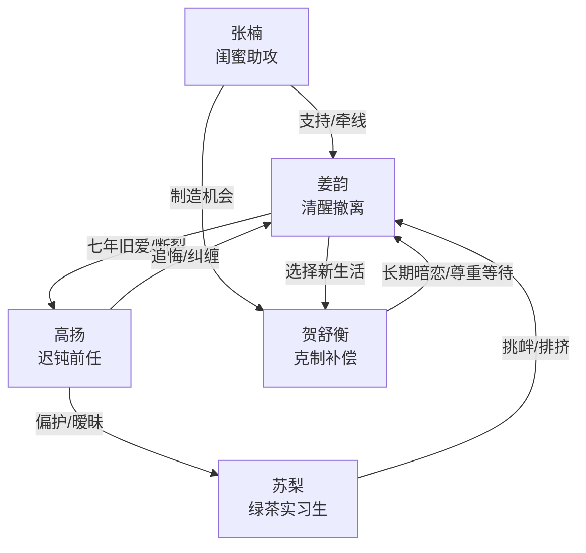

# 角色标签图谱

## 角色清单

### 姜韵 — 清醒撤离型大女主
- 叙事功能: 第一视角承压者与清算者，负责完成从旧关系抽离到新生活建立。
- 核心标签: 清醒、决绝、重情但不回头
- 弧光: 七年依恋中的反复妥协 → 退票搬家拉黑 → 接受被珍视的新关系
- 台词风格: 短句、直接、冷静，“对”“至于”“舍得”
- 关键行为: 提分手、退票改目的地、搬空旧家、退群拉黑、播放录音、扔掉钻戒
- 读者情绪关系: 心疼她被轻视，爽于她不再内耗，期待她获得补偿

### 高扬 — 迟钝自负型前任
- 叙事功能: 情绪债制造者与火葬场承受者。
- 核心标签: 吃定、迟钝、自我中心
- 弧光: 以为女主舍不得 → 发现失控 → 追悔崩溃 → 迟到补偿无效
- 台词风格: 轻飘飘、哄小孩式、先指责后求和
- 关键行为: 录音、把邻座留给苏梨、追苏梨、公开偏护、发现退票、追到上海、送迟到钻戒
- 读者情绪关系: 前半招恨，后半提供火葬场爽点

### 苏梨 — 装无辜绿茶实习生
- 叙事功能: 催化旧关系裂缝，让高扬的失职显影。
- 核心标签: 越界、装弱、挑衅
- 弧光: 以“实习生没能耐”占便宜 → 享受高扬偏护 → 病房被迁怒推开
- 台词风格: 甜腻、委屈、以弱者身份索取
- 关键行为: 抢邻座、买咖啡漏女主、漏订房、发照片刺激、病房献梨汤
- 读者情绪关系: 激发厌恶和打脸期待

### 贺舒衡 — 克制直球型补偿男主
- 叙事功能: 正向关系坐标，证明女主值得被长期珍视。
- 核心标签: 克制、稳定、长期守候
- 弧光: 暗中关注 → 上海接住女主 → 尊重边界等待 → 订婚兑现甜味承诺
- 台词风格: 简短、坦白、不逼迫
- 关键行为: 深夜接电话救女主、虹桥接站、坦白暗恋、挡住高扬、订婚台上揭示十年糖
- 读者情绪关系: 提供安全感、补偿感、心动感

### 张楠 — 助攻闺蜜
- 叙事功能: 推动女主到上海，并制造贺舒衡独处机会。
- 核心标签: 机灵、嘴快、护短
- 弧光: 接应女主 → 助攻新关系 → 泄露上海位置
- 台词风格: 轻松、调侃、带心虚
- 关键行为: 电话确认行程、托贺舒衡接人、告知高扬发疯
- 读者情绪关系: 缓冲压抑氛围，提供友谊支持

## 关系网络

## 角色功能对照表（供改编参考）

| 原角色 | 极致标签 | 叙事功能 | 读者情绪功能 | 改编时必须保留的 |
|--------|---------|---------|-------------|---------------|
| 姜韵 | 清醒撤离型大女主 | 承压、抽离、清算 | 心疼、爽、认同 | 不吵到失控，用行动离开 |
| 高扬 | 吃定女友的迟钝前任 | 制造情绪债、承受火葬场 | 恨、看他追悔 | “以为她还会回来”的误判 |
| 苏梨 | 装无辜绿茶 | 催化背叛与偏护 | 厌恶、打脸期待 | 用弱者话术占便宜 |
| 贺舒衡 | 克制直球补偿男主 | 建立正向关系 | 安全感、甜爽 | 尊重边界和长期伏笔 |
| 张楠 | 助攻闺蜜 | 转场、信息桥 | 轻松、支持 | 友谊托底女主撤离 |
