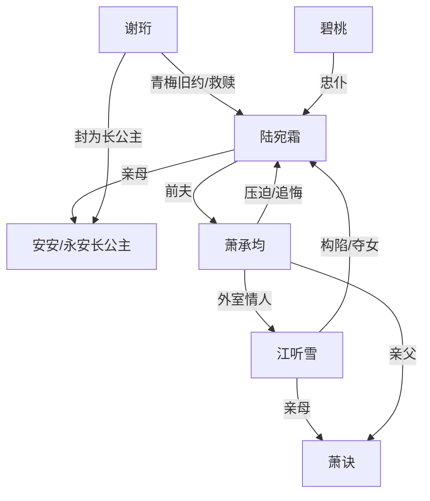

# 角色标签图谱

## 角色清单

### 陆宛霜 — 重生护女主母
- 叙事功能: 第一视角承压者、复仇与救赎的核心。
- 核心标签: 母性、隐忍、清醒
- 弧光: 被欺瞒三十年的侯府主母 → 夺回女儿的宸妃/皇后
- 台词风格: 短句、质问、护女优先
- 关键行为: 砸产婆抢女、取心头血护女、送玉佩入宫、宫宴揭穿萧承均。
- 读者情绪关系: 心疼、代入、期待她被补偿。

### 萧承均 — 负心悔恨侯爷
- 叙事功能: 主要施压者与后期追悔对象。
- 核心标签: 伪深情、偏听偏信、迟来悔恨
- 弧光: 自以为爱江听雪 → 失去宛霜后悔 → 放逐江听雪但已不可挽回
- 台词风格: 前期命令与指责，后期哀求与失控
- 关键行为: 换子、逼取心头血、鞭打宛霜、悬崖选择江听雪母子。
- 读者情绪关系: 恨、恶心、想看他追悔无门。

### 江听雪 — 绿茶外室/夺位者
- 叙事功能: 直接反派、换子阴谋执行者。
- 核心标签: 柔弱伪装、恶毒、贪婪
- 弧光: 受宠义妹 → 侯府实质女主人 → 阴谋败露被放逐
- 台词风格: 哭诉、装善、道德绑架
- 关键行为: 调换孩子、污蔑宛霜疯癫、安排绑架、泄露万两黄金细节。
- 读者情绪关系: 强恨点，清算对象。

### 谢珩 — 帝王白月光/救赎者
- 叙事功能: 身份反转载体、权力清算者、情感补偿者。
- 核心标签: 深情、克制、权力
- 弧光: 错过宛霜的青梅竹马 → 等她回头的皇帝 → 守护母女的夫君
- 台词风格: 温柔短句，对敌人冷厉
- 关键行为: 守后位、接到玉佩赶来、救下母女、杖责萧承均。
- 读者情绪关系: 爽、安心、补偿感。

### 安安 — 被夺回的亲女/长公主
- 叙事功能: 情绪锚点与母爱动机。
- 核心标签: 无辜、珍贵、补偿
- 弧光: 被调换的小女婴 → 被救下的永安长公主
- 台词风格: 无
- 关键行为: 高烧、悬崖濒危、宫宴亮相。
- 读者情绪关系: 心疼、保护欲。

### 萧诀 — 外室子/白眼狼种子
- 叙事功能: 前世毒害者，今生压迫工具。
- 核心标签: 非亲生、篡位、罪证
- 弧光: 前世养子 → 今生被收养失败 → 被放逐
- 台词风格: 婴儿期无；前世一句冷酷下毒真相。
- 关键行为: 前世下毒，今生成为换子阴谋中心。
- 读者情绪关系: 厌恶、警惕。

### 碧桃 — 忠仆/行动辅助
- 叙事功能: 传递玉佩、见证女主痛苦。
- 核心标签: 忠心、执行、陪伴
- 弧光: 侯府侍女 → 宫中陪伴宛霜
- 台词风格: 恭敬、急切
- 关键行为: 挖出桃树下旧物，送进宫。
- 读者情绪关系: 安心、信任。

## 关系网络

## 角色功能对照表（供改编参考）

| 原角色 | 极致标签 | 叙事功能 | 读者情绪功能 | 改编时必须保留的 |
|--------|---------|---------|-------------|---------------|
| 陆宛霜 | 重生护女主母 | 承压与反击 | 心疼、代入 | 为女儿可屈可狠 |
| 萧承均 | 负心侯爷 | 施压与追悔 | 恨、爽 | 前期偏袒外室，后期追悔无门 |
| 江听雪 | 绿茶外室 | 阴谋制造者 | 强恨点 | 柔弱伪装与自证其罪 |
| 谢珩 | 帝王白月光 | 身份反转和补偿 | 爽、安心 | 旧约伏笔与权力保护 |
| 安安 | 被夺亲女 | 情绪锚点 | 心疼 | 必须是女主底线 |
| 萧诀 | 外室子 | 篡夺载体 | 厌恶 | 前世/今生都与换子绑定 |
