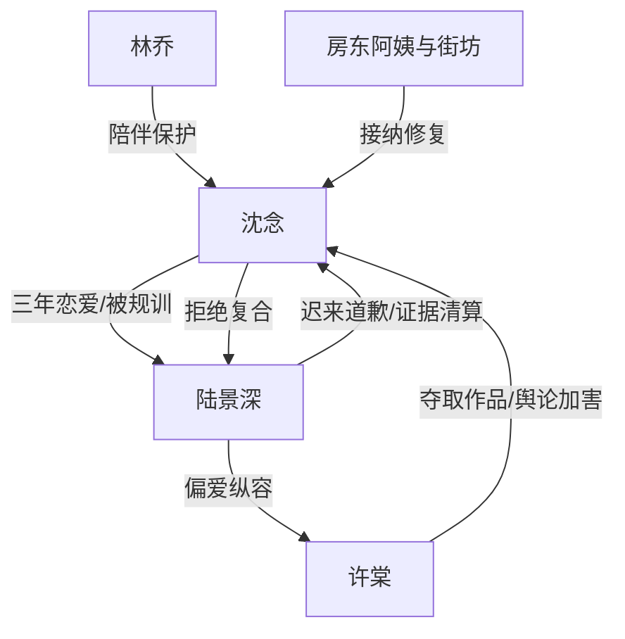

# 角色标签图谱

## 角色清单

### 沈念 — 清醒自救型虐恋女主
- 叙事功能: 承受压迫、完成断联、自我重建、拒绝复合
- 核心标签: 设计师、隐忍、清醒
- 弧光: 被规训的恋人 → 被夺走作品的受害者 → 修旧衣的小店主 → 不再证明自己的自由人
- 台词风格: 短句、克制、后半更锋利
- 关键行为: 提分手、解散工作室、折断旧卡、拒绝补偿、删掉道歉短信
- 读者情绪关系: 心疼、代入、爽

### 陆景深 — 创伤型控制者/迟来追悔男主
- 叙事功能: 前半压迫源，后半悔恨与清算工具
- 核心标签: 洁癖谎言、虚荣保护欲、迟来认错
- 弧光: 以洁癖规训沈念 → 纵容许棠 → 追悔找布 → 承认罪责但失去资格
- 台词风格: 前半命令式，后半低姿态
- 关键行为: 不拿药、删监控、撤署名、找证据、公开道歉
- 读者情绪关系: 恨、审判、有限怜悯

### 许棠 — 白莲夺取型反派
- 叙事功能: 具体加害者，放大男主偏爱造成的伤害
- 核心标签: 装弱、剽窃、舆论加害
- 弧光: 实习生受害者姿态 → 夺稿获奖 → 二次网暴 → 被公开清算
- 台词风格: 茶言茶语、弱者叙事、道德绑架
- 关键行为: 穿拖鞋、毁样衣、偷原稿、毁布片、买水军
- 读者情绪关系: 强恨点

### 林乔 — 护短闺蜜/读者嘴替
- 叙事功能: 支撑女主离开，替读者表达愤怒
- 核心标签: 仗义、清醒、陪伴
- 弧光: 医院救场 → 陪去南城 → 见证清白恢复
- 台词风格: 直接、情绪外放
- 关键行为: 急诊陪护、劝离、提醒报警
- 读者情绪关系: 安全感、代偿陪伴

### 房东阿姨/街坊老人 — 修复性社会关系
- 叙事功能: 对照陆景深的伤害，证明沈念可被正常世界接纳
- 核心标签: 温情、朴素、公道
- 弧光: 陌生人 → 认可沈念手艺 → 保护她的生活
- 台词风格: 生活化、朴素金句
- 关键行为: 劝陆景深别添乱、介绍客人、送来旧旗袍
- 读者情绪关系: 暖、补偿

## 关系网络

## 角色功能对照表（供改编参考）

| 原角色 | 极致标签 | 叙事功能 | 读者情绪功能 | 改编时必须保留的 |
|--------|---------|---------|-------------|---------------|
| 沈念 | 清醒自救女主 | 承受、断联、重建 | 心疼+爽 | 不复合、不收资源补偿 |
| 陆景深 | 迟来追悔控制者 | 制造压迫并承担公开清算 | 恨转审判 | 必须承认核心罪责，不可洗成误会 |
| 许棠 | 白莲剽窃者 | 夺爱夺作品，二次伤害 | 纯恨点 | 必须主动作恶且被证据清算 |
| 林乔 | 护短闺蜜 | 支撑女主 | 安全感 | 见证女主离开和洗清 |
| 街坊老人 | 温情社会 | 修复女主 | 情绪补偿 | 旧物修复意象不能丢 |
