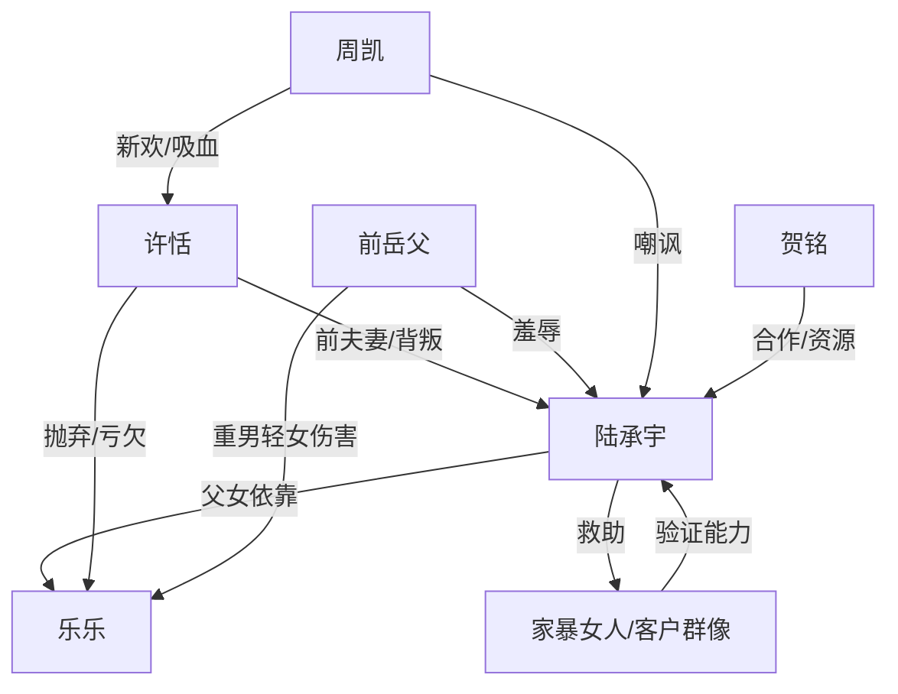

# 角色标签图谱

## 角色清单

### 陆承宇 — 克制复仇型单亲父亲

- 叙事功能: 主角、能力持有者、伦理选择者
- 核心标签: 单亲爸爸、底层逆袭、有限救赎
- 弧光: 被离婚羞辱的外卖员 → 能力变现的健康顾问 → 保留人性边界的父亲
- 台词风格: 短句、冷淡、边界清晰
- 关键行为: 删除提醒短信、救家暴女、救贺铭儿子、拒绝前妻借钱、救下自杀前妻
- 读者情绪关系: 心疼、爽、敬佩、复杂

### 乐乐 — 道德锚点型女儿

- 叙事功能: 男主所有选择的情绪核心
- 核心标签: 早熟、懂事、被亏欠
- 弧光: 被母亲抛弃的孩子 → 保护爸爸的小孩 → 促成男主救母亲的伦理理由
- 台词风格: 童真但扎心
- 关键行为: 给爸爸夹肉、记得外公骂她赔钱货、生日许愿爸爸永远不累
- 读者情绪关系: 心疼、保护欲

### 许恬 — 功利背叛型前妻

- 叙事功能: 主要情绪债来源，后期悔恨对象
- 核心标签: 婚内背叛、贪得无厌、自食其果
- 弧光: 抛夫弃女的新生活赢家 → 债务缠身的弃妇 → 自杀边缘被救者
- 台词风格: 现实算计、求助时软化
- 关键行为: 马尔代夫官宣、索要医保卡、拖欠抚养费、借三十万、求复合、自杀
- 读者情绪关系: 恨、爽、后期复杂怜悯

### 前岳父 — 势利吸血型长辈

- 叙事功能: 家庭伦理压迫放大器
- 核心标签: 重男轻女、势利、刻薄
- 弧光: 骂男主没用 → 煤气中毒半瘫 → 仍旧嘴硬
- 台词风格: 侮辱性强、粗暴
- 关键行为: 辱骂男主、剪坏乐乐玩偶、要求少给抚养费
- 读者情绪关系: 厌恶、等报应

### 周凯 — 软饭新欢型反派

- 叙事功能: 前妻功利选择的反噬载体
- 核心标签: 年轻、虚荣、无责任
- 弧光: 被前妻炫耀的新男友 → 消费吸血者 → 破产后跑路
- 台词风格: 轻佻、嘲讽
- 关键行为: 嘲笑男主、嫌医院晦气、催信用卡、连夜跑路
- 读者情绪关系: 鄙夷、爽感对照

### 贺铭 — 贵人型 CEO

- 叙事功能: 男主能力商业化入口
- 核心标签: 理性、资源、人脉
- 弧光: 被救儿子的客户 → 识破能力的合作人 → 道德提问者
- 台词风格: 直接、成熟、试探
- 关键行为: 给红包、安排岗位、介绍客户、点破男主救前妻原因
- 读者情绪关系: 信任、助爽

### 家暴女人 / 客户群像 — 能力验证样本

- 叙事功能: 证明死法可改变，扩展能力规则
- 核心标签: 被害者、可救者、社会切片
- 弧光: 死亡预告对象 → 被干预后改变命运
- 台词风格: 少量现实对话
- 关键行为: 被家暴、被误食风险、被疾病风险、被赌债风险牵连
- 读者情绪关系: 紧张、释然

## 关系网络

## 角色功能对照表（供改编参考）

| 原角色 | 极致标签 | 叙事功能 | 读者情绪功能 | 改编时必须保留的 |
|--------|---------|---------|-------------|---------------|
| 陆承宇 | 克制复仇型单亲父亲 | 主角与伦理选择者 | 心疼、爽、复杂认同 | 先被压到底，再靠能力翻身，但不越界害人 |
| 乐乐 | 早熟女儿 | 道德锚点 | 心疼、保护欲 | 至少 3 个懂事扎心细节 |
| 许恬 | 功利背叛前妻 | 情绪债来源和最终抉择对象 | 恨到复杂 | 先背叛、再求助、最后被救但不复合 |
| 前岳父 | 势利吸血长辈 | 压迫放大器 | 厌恶、等报应 | 具体羞辱孩子和男主 |
| 周凯 | 软饭新欢 | 反噬载体 | 鄙夷、痛快 | 必须在前妻落难时跑路 |
| 贺铭 | 资源贵人 | 能力商业化通道 | 助爽 | 必须理性识破并提供圈层入口 |
