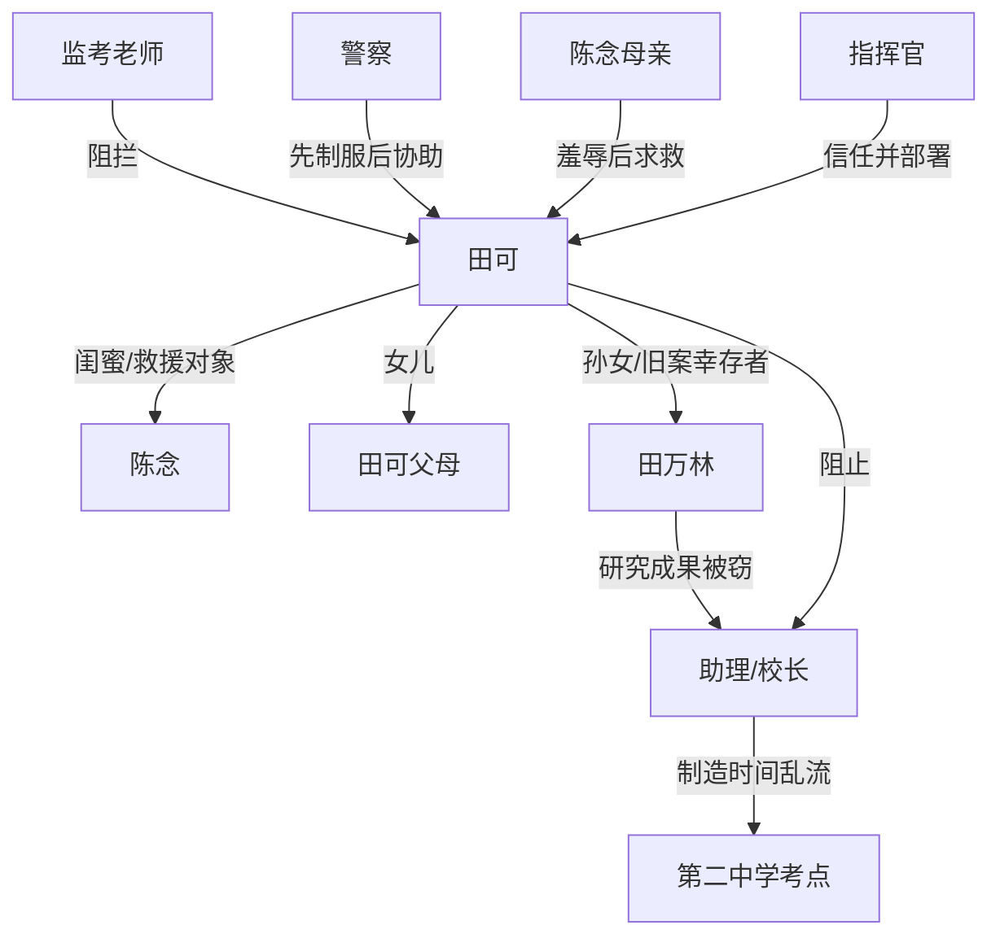

# 角色标签图谱

## 角色清单

### 田可 — 清醒规则型救世大女主
- 叙事功能: 主视角、危机预警者、规则记忆者、最终行动者。
- 核心标签: 清醒、孤勇、救世任务者
- 弧光: 被当成疯子放弃高考 → 被众人求救 → 重返考场救全体 → 进入下个任务
- 台词风格: 短促、急迫、反复强调关键信息
- 关键行为: 放弃高考、撕闺蜜卷子、跳窗逃出、解释时间乱流、重返考场
- 读者情绪关系: 心疼、替她憋屈、期待她被证明正确

### 陈念 — 被救却不信的亲密背刺者
- 叙事功能: 把群体误解升级为亲密关系伤害。
- 核心标签: 闺蜜、动摇者、现实利益优先
- 弧光: 初相信田可 → 因无法解释而反目 → 被困等待救援
- 台词风格: 前期温和，后期刺痛直接
- 关键行为: 相信田可、回座答题、掌掴田可、断交
- 读者情绪关系: 先期待，后失望和愤怒

### 监考老师 — 秩序压迫者
- 叙事功能: 代表高考秩序和规则惯性，阻止主角逃生。
- 核心标签: 权威、刻板、秩序至上
- 弧光: 警告田可 → 强制按回座位 → 在时间乱流中重复旧动作
- 台词风格: 命令式、训诫式
- 关键行为: 威胁取消资格、叫巡考、压住田可肩膀
- 读者情绪关系: 憋屈、厌烦

### 闺蜜妈妈 — 群体误解和迟来求救的代表
- 叙事功能: 前半制造羞辱债，后半完成态度反转。
- 核心标签: 护女、偏执、崩溃求救
- 弧光: 踹倒田可 → 威胁起诉 → 撞见空气墙 → 跪求田可救女儿
- 台词风格: 尖锐、指责、情绪爆裂
- 关键行为: 殴打田可、拒绝原谅、发现空气墙、跪求救援
- 读者情绪关系: 前恨后复杂，打脸爽点承载者

### 田可父母 — 亲情误解与补偿位
- 叙事功能: 加深女主孤立，结尾提供迟来的认可。
- 核心标签: 爱女、失望、后悔
- 弧光: 求警察让女儿回考场 → 逼她道歉 → 得知真相后以她为骄傲
- 台词风格: 哀求、责备、后期温情
- 关键行为: 替田可求情、逼她下跪、最终拥抱
- 读者情绪关系: 心酸、期待补偿

### 爷爷田万林 — 牺牲型科学家
- 叙事功能: 提供旧案根源和道德坐标。
- 核心标签: 天才、慈爱、牺牲
- 弧光: 成功发明时光机 → 目睹助理偷用 → 咬舌自尽阻断灾难
- 台词风格: 回忆中少对白，以行动定性
- 关键行为: 研究时光机、带田可逃、牺牲自己
- 读者情绪关系: 敬意、悲伤

### 校长/助理 — 贪婪越界反派
- 叙事功能: 灾难源头，科学伦理反面。
- 核心标签: 窃取者、贪婪、漠视生命
- 弧光: 抢用时光机 → 十年布局 → 高考日重启实验 → 被击杀
- 台词风格: 中后段少对白，靠行为定罪
- 关键行为: 偷研究报告、私启时光机、建立地下实验室
- 读者情绪关系: 恨、期待清算

### 同行警察 — 专业清算者
- 叙事功能: 替主角完成杀人边界外的执行。
- 核心标签: 怀疑者、见证者、执行者
- 弧光: 制服田可 → 亲历空气墙 → 随她入局 → 击杀罪犯
- 台词风格: 冷硬、专业
- 关键行为: 按住田可、接到失联电话、重返考场、开枪
- 读者情绪关系: 后期安心与释放

## 关系网络

## 角色功能对照表（供改编参考）

| 原角色 | 极致标签 | 叙事功能 | 读者情绪功能 | 改编时必须保留的 |
|--------|---------|---------|-------------|---------------|
| 田可 | 清醒救世大女主 | 预警+行动+规则破解 | 心疼、爽、敬佩 | 前半被误解仍坚持正确选择 |
| 陈念 | 亲密背刺者 | 把误解私人化 | 心痛、愤怒 | 必须有“先信后背叛” |
| 闺蜜妈妈 | 迟来求救者 | 态度回旋 | 打脸爽点 | 前半羞辱，后半跪求 |
| 监考老师 | 秩序压迫者 | 阻止逃生 | 憋屈 | 用制度逻辑压主角 |
| 爷爷 | 牺牲科学家 | 旧案锚点 | 悲壮 | 牺牲必须与规则破解有关 |
| 校长/助理 | 贪婪科学反派 | 灾难源头 | 恨 | 明知代价仍牺牲无辜 |
| 警察 | 专业执行者 | 合法清算 | 释放 | 替主角完成杀人边界 |
