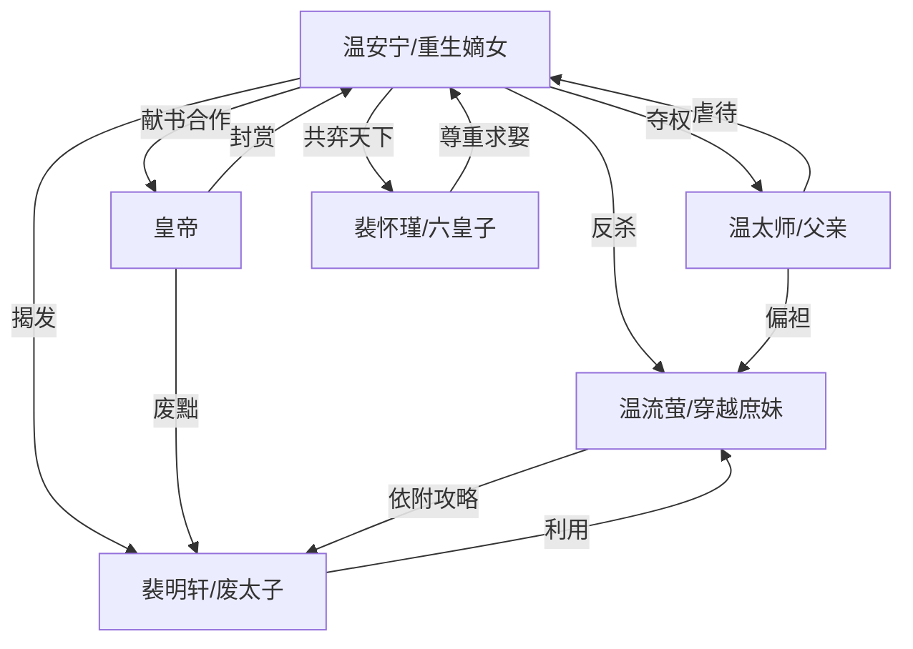

# 角色标签图谱

## 角色清单

### 温安宁 — 重生清醒女诸葛
- 叙事功能: 主角、复仇执行者、规则重写者
- 核心标签: 重生、冷静、经世之才
- 弧光: 被设计惨死的嫡女 → 抢先献书的复仇者 → 安平县主/皇后
- 台词风格: 短句冷讽，关键时刻直刺权力要害
- 关键行为: 默写攻略献给皇帝、点破太子结党、扶持六皇子、夺回温家
- 读者情绪关系: 心疼她前世与前半受辱，爽于她冷静清算

### 温流萤 — 穿越伪女主/攻略依赖者
- 叙事功能: 主要女反派、错误规则的代表
- 核心标签: 自大、绿茶、女主光环妄想
- 弧光: 自信攻略登后位 → 天牢崩溃 → 宗人府互噬
- 台词风格: 撒娇装委屈与现代穿越词混杂
- 关键行为: 借攻略勾搭太子、夺玉佩、构陷长姐、崩溃喊 NPC
- 读者情绪关系: 招恨，最终精神破防提供爽点

### 裴明轩 — 傲慢废太子/伪男主
- 叙事功能: 权力压迫者、庶妹攻略对象、被废清算对象
- 核心标签: 道貌岸然、结党营私、利用型伪君子
- 弧光: 储君傲慢羞辱女主 → 圣旨废黜 → 宗人府困兽
- 台词风格: 高高在上，自称“孤”，习惯用储君身份压人
- 关键行为: 利用温流萤知识、辱骂温安宁、下令乱棍打死、抗旨
- 读者情绪关系: 恨其傲慢，爽于其金冠落地

### 温太师/父亲 — 偏心昏聩父权
- 叙事功能: 家庭压迫源、情绪债累积器
- 核心标签: 偏心、趋炎附势、懦弱
- 弧光: 掌控温家打压嫡女 → 圣旨后吓尿求饶 → 被软禁
- 台词风格: 怒骂、训诫、快速变脸谄媚
- 关键行为: 扇巴掌、关柴房、踹伤女主、当众逐出温家
- 读者情绪关系: 强恨点，清算后痛快

### 裴怀瑾 — 明君型平等伴侣
- 叙事功能: 正向权力承接者、女主终局补偿
- 核心标签: 贤明、谦逊、心怀天下
- 弧光: 不受重视的六皇子 → 新太子 → 盛世帝王
- 台词风格: 谦和郑重，尊称女主为县主
- 关键行为: 登门请教治国、求娶女主、与女主共治天下
- 读者情绪关系: 提供尊重型甜爽与价值补偿

### 皇帝 — 多疑皇权/降维清算者
- 叙事功能: 最高规则执行者、反杀背书
- 核心标签: 猜忌、多疑、识才
- 弧光: 质疑女主 → 查证太子 → 封赏女主并改立储君
- 台词风格: 威严、试探、赏罚分明
- 关键行为: 查太子、废太子、封县主、关押反派
- 读者情绪关系: 提供权力碾压的可信度

## 关系网络

## 角色功能对照表（供改编参考）

| 原角色 | 极致标签 | 叙事功能 | 读者情绪功能 | 改编时必须保留的 |
|--------|---------|---------|-------------|---------------|
| 温安宁 | 重生女诸葛 | 设局与清算 | 心疼+爽 | 冷静抢先定义关键道具 |
| 温流萤 | 穿越伪女主 | 错误优越感 | 恨+嘲讽爽 | “我是女主/光环”认知崩塌 |
| 裴明轩 | 傲慢废太子 | 权力反派 | 厌恶+打脸爽 | 公开羞辱后被当众废黜 |
| 温太师 | 偏心父权 | 家庭压迫 | 憋屈+清算爽 | 打女主、夺权后谄媚 |
| 裴怀瑾 | 明君伴侣 | 终局补偿 | 尊重型甜爽 | 平等共治，不把女主收编成附庸 |
| 皇帝 | 多疑皇权 | 降维执行 | 爽点背书 | 查证并用圣旨公开清算 |
