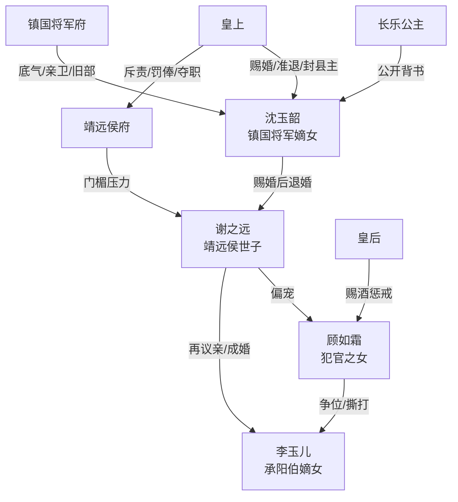

# 角色标签图谱

## 角色清单

### 沈玉韶 — 清醒将门大女主
- 叙事功能: 主视角、规则反杀执行者、价值观承载者。
- 核心标签: 将门嫡女、清醒不争宠、事业升维。
- 弧光: 被新婚羞辱的新妇 → 夜跪宫门退婚 → 开女子马场 → 获封县主婚配自主。
- 台词风格: 冷静反问，善于把私怨升格为礼法与皇权问题。
- 关键行为: 跪宫门、揭穿顾如霜怀孕威胁、退婚搬嫁妆、开马场、捐良驹。
- 读者情绪关系: 爽、敬佩、替她扬眉吐气。

### 谢之远 — 恋爱脑宠妾灭妻世子
- 叙事功能: 初始压迫者、反复自毁的男反派。
- 核心标签: 自私、虚伪、贪心。
- 弧光: 高高在上的世子 → 新婚夜丑闻主角 → 被皇权敲打 → 被夺职逐回老家。
- 台词风格: 道德绑架、理直气壮、见风转舵。
- 关键行为: 新婚夜抛下女主、公开维护顾如霜、求取消婚约、求复合、婚后再宠妾灭妻。
- 读者情绪关系: 恨、鄙夷、期待他被反噬。

### 顾如霜 — 白莲外室/犯官之女
- 叙事功能: 挑衅者、激化矛盾者、报应承受者。
- 核心标签: 白莲、贪位分、心机。
- 弧光: 被世子如珠似宝 → 宫门威胁女主 → 被皇后绝嗣 → 流放苦役。
- 台词风格: 表面柔弱自贬，私下尖锐威胁。
- 关键行为: 绝食逼世子、新婚夜抢人、用喜脉威胁、挑衅“你输了”、与李玉儿撕打。
- 读者情绪关系: 恨、想看她翻车。

### 靖远侯与侯夫人 — 失控权贵父母
- 叙事功能: 侯府权力结构代表，展示谢之远行为的政治后果。
- 核心标签: 爱惜门楣、现实、压制失败。
- 弧光: 喜堂得意 → 宫门惊慌 → 赔罪受辱 → 侯府没落。
- 台词风格: 训斥、请罪、利益计算。
- 关键行为: 试图拦女主、进宫请罪、打谢之远、安排新亲事。
- 读者情绪关系: 看他们被牵连受罚获得连坐爽感。

### 皇上 — 规则最高裁判
- 叙事功能: 将女主反击合法化，惩罚抗旨失仪。
- 核心标签: 皇权、制衡、威严。
- 弧光: 赐婚者 → 被侯府打脸的裁判 → 准退婚并罚侯府 → 后续惩戒谢家。
- 台词风格: 威严简短。
- 关键行为: 允退婚、命赔银、斥责靖远侯、封女主县主。
- 读者情绪关系: 提供制度爽点和清算背书。

### 皇后 — 冷面内宅裁判
- 叙事功能: 对顾如霜进行后宅规则清算。
- 核心标签: 慢条斯理、锋利、护礼法。
- 弧光: 听案者 → 表面成全 → 赐酒绝嗣。
- 台词风格: 温和带刀，反讽强。
- 关键行为: 讽刺靖远侯府、赐酒、定顾如霜妾室身份。
- 读者情绪关系: 暗爽、寒意。

### 李玉儿 — 骄纵贵女/第二轮照妖镜
- 叙事功能: 后半冲突推动者，复制“争世子”的失败循环。
- 核心标签: 骄纵、嫉妒、势利。
- 弧光: 嘲讽女主 → 春日宴被打脸 → 嫁入侯府 → 小产和离。
- 台词风格: 尖酸、争强好胜。
- 关键行为: 春日宴辱骂女主、逼问谢之远、婚后与顾如霜撕打。
- 读者情绪关系: 初期讨厌，后期作为反派循环牺牲品推动谢家覆灭。

### 长乐公主 — 女主价值背书者
- 叙事功能: 揭示女主马场捐马义举，完成身份反差。
- 核心标签: 公主、维护、权威证人。
- 弧光: 宴会主人 → 出面护女主 → 揭露家国义举。
- 台词风格: 直接压场。
- 关键行为: 赶李玉儿、公开女主捐马。
- 读者情绪关系: 助攻爽。

## 关系网络

## 角色功能对照表（供改编参考）

| 原角色 | 极致标签 | 叙事功能 | 读者情绪功能 | 改编时必须保留的 |
|--------|---------|---------|-------------|---------------|
| 沈玉韶 | 清醒将门大女主 | 反击者/升维者 | 爽、敬佩 | 不争宠，借规则反杀，最终自由 |
| 谢之远 | 恋爱脑世子 | 主压迫者 | 恨、鄙夷 | 新婚夜抛弃正妻，后续自毁 |
| 顾如霜 | 白莲外室 | 挑衅与报应载体 | 恨、期待翻车 | 表面柔弱私下威胁，绝嗣报应 |
| 皇上 | 最高规则裁判 | 合法化清算 | 制度爽 | 赐婚规则被反用 |
| 皇后 | 后宅清算者 | 惩罚外室 | 暗爽 | 表面成全，实则重罚 |
| 李玉儿 | 骄纵贵女 | 后半循环冲突 | 看反派互害 | 她必须复制争宠失败循环 |
| 长乐公主 | 权威助攻 | 女主事业背书 | 扬眉吐气 | 公共场合揭示女主价值 |
