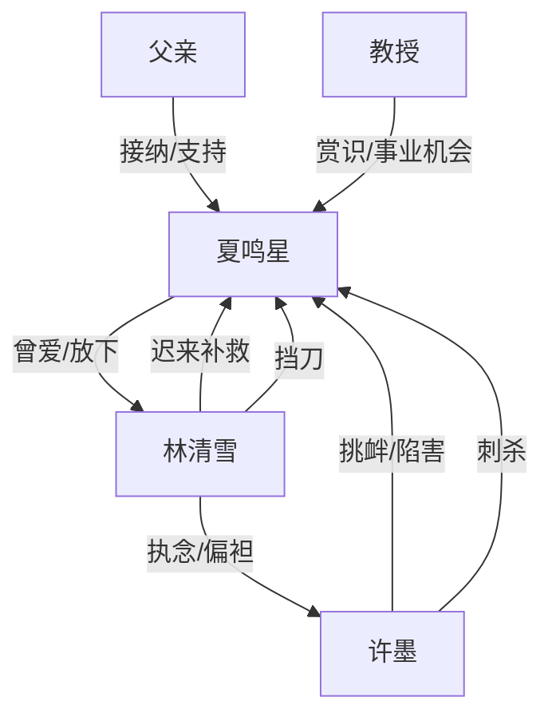

# 角色标签图谱

## 角色清单

### 夏鸣星 — 清醒离场型替身丈夫
- 叙事功能: 受害者、情绪承载者、最终裁判者
- 核心标签: 替身、画家、清醒离开
- 弧光: 依赖婚姻与家庭感 → 被背叛毁掉右手 → 左手重建人生
- 台词风格: 克制、礼貌、冷淡，后期称呼“林小姐”
- 关键行为: 保存证据、倒计时离开、留下离婚协议、拒绝补救
- 读者情绪关系: 心疼、代入、爽感投射

### 林清雪 — 失控追悔女总裁
- 叙事功能: 爱与伤害的双重来源，火葬场承载者
- 核心标签: 京圈女大佬、白月光执念、迟来悔悟
- 弧光: 宠爱丈夫但心有初恋 → 偏袒许墨 → 失去男主后崩溃追悔
- 台词风格: 前期哄劝式，后期哀求式
- 关键行为: 挂电话、亲吻许墨、逼道歉、夺奖、追到新西兰、挡刀
- 读者情绪关系: 前半恨，后半看她受惩罚

### 许墨 — 白月光绿茶初恋
- 叙事功能: 外部反派、羞辱制造机、最终刺杀触发器
- 核心标签: 初恋、挑衅、伪弱陷害
- 弧光: 回国争夺林清雪 → 炫耀挑衅 → 失势赌博 → 持刀报复
- 台词风格: 阴阳怪气、炫耀、威胁
- 关键行为: 发照片、发信息、咖啡陷害、抢奖署名、发怀孕报告、刺杀
- 读者情绪关系: 纯恨点，承担主要报应期待

### 父亲 — 迟来但有效的家庭补偿
- 叙事功能: 给男主提供新归宿和重建支点
- 核心标签: 疏离父亲、补偿、支持
- 弧光: 多年疏远 → 接纳儿子 → 支持左手画画
- 台词风格: 朴素、直接
- 关键行为: 接机、找医生、鼓励左手作画
- 读者情绪关系: 安慰、补偿

### 退休美术教授 — 事业新生引路人
- 叙事功能: 证明男主价值不依附林清雪
- 核心标签: 伯乐、专业认可、未来入口
- 弧光: 偶遇赏识 → 邀请任职
- 台词风格: 简洁肯定
- 关键行为: 认可画作，邀请男主去大学
- 读者情绪关系: 替男主松一口气

## 关系网络

## 角色功能对照表（供改编参考）

| 原角色 | 极致标签 | 叙事功能 | 读者情绪功能 | 改编时必须保留的 |
|--------|---------|---------|-------------|---------------|
| 夏鸣星 | 清醒离场替身 | 主角与裁判 | 心疼、代入、爽 | 不纠缠、不复合、自我重建 |
| 林清雪 | 追悔女总裁 | 施害者兼悔恨者 | 先恨后看火葬场 | 前期宠爱与后期偏袒并存 |
| 许墨 | 绿茶白月光 | 外部反派 | 恨点集中 | 炫耀、陷害、最终失控 |
| 父亲 | 迟来亲情 | 补偿线 | 安慰 | 给主角新家 |
| 教授 | 事业伯乐 | 价值证明 | 爽点补偿 | 认可主角专业能力 |
