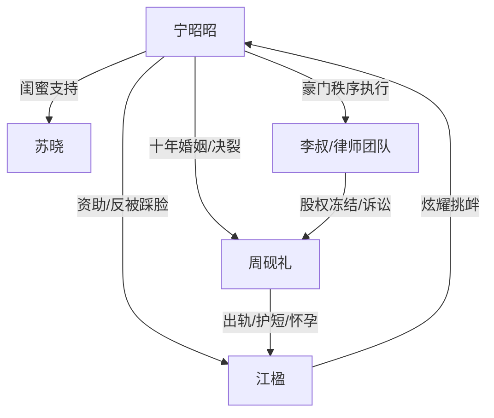

# 角色标签图谱

## 角色清单

### 宁昭昭 — 清醒豪门原配 / 克制复仇者
- 叙事功能: 受害者、规则掌控者、清算执行者。
- 核心标签: 豪门千金、旧爱伤者、冷静反击。
- 弧光: 被羞辱的原配 → 看清背叛 → 法律和资源清算 → 带余痛切割过去。
- 台词风格: 短句、冷淡、带反讽。
- 关键行为: 调人带走江楹、订一百个猪肉戳、冻结股权、董事会公开离婚。
- 读者情绪关系: 心疼她的旧爱损失，爽她的清醒反击。

### 周砚礼 — 忘恩负义凤凰男 / 失温丈夫
- 叙事功能: 背叛者、温度反转核心、清算对象。
- 核心标签: 曾经深情、原则崩坏、自负侥幸。
- 弧光: 深情丈夫记忆 → 护短出轨者 → 试图转移财产 → 净身出户 → 悔恨崩塌。
- 台词风格: 前期安抚式命令，后期狡辩求饶。
- 关键行为: 纵容江楹盖章、带江楹穿“星海”、抱怀孕江楹离开、董事会逼宫失败。
- 读者情绪关系: 先让人心寒，再让人恨，最后给迟来悔恨的反讽快感。

### 江楹 — 绿茶秘书 / 恩将仇报者
- 叙事功能: 直接挑衅者、丈夫变心催化剂、镜像报应对象。
- 核心标签: 装弱、贪婪、炫耀。
- 弧光: 被资助女孩 → 上位秘书 → 怀孕小三 → 失去金钱后原形毕露 → 抛弃病儿逃跑。
- 台词风格: 娇憨装弱、普通人受害话术、真爱宣言。
- 关键行为: 给宁昭昭盖猪肉戳、穿“星海”、社交平台嘲讽、深夜发同居照、董事会装不图钱。
- 读者情绪关系: 稳定恨点，承担“必须被反打”的情绪债。

### 苏晓 — 嘴替闺蜜 / 情绪放大器
- 叙事功能: 替读者骂人，确认宁昭昭的反击正当性。
- 核心标签: 护短、直爽、外部见证。
- 弧光: 愤怒担忧 → 见证清算 → 转述恶果。
- 台词风格: 直白、情绪强。
- 关键行为: 转发舆论、劝宁昭昭、讲述周江结局。
- 读者情绪关系: 代读者出气，补充旁观视角。

### 李叔 / 李律师 — 秩序执行者
- 叙事功能: 提供证据、执行法律和豪门资源。
- 核心标签: 忠诚、专业、冷静。
- 弧光: 报告礼服被夺 → 执行冻结与诉讼。
- 台词风格: 克制、程序化。
- 关键行为: 告知“星海”被拿、董事会宣读协议。
- 读者情绪关系: 增强女主不是胡闹而是合法清算的爽感。

## 关系网络

## 角色功能对照表（供改编参考）

| 原角色 | 极致标签 | 叙事功能 | 读者情绪功能 | 改编时必须保留的 |
|--------|---------|---------|-------------|---------------|
| 宁昭昭 | 清醒豪门原配 | 受害与清算主体 | 心疼+爽 | 克制姿态、资源合法化、不要哭求 |
| 周砚礼 | 忘恩负义凤凰男 | 背叛与悔恨对象 | 恨+迟来报应 | 曾经真爱、现在护短、最终求复合 |
| 江楹 | 绿茶受助者 | 挑衅与报应对象 | 恨点制造 | 恩将仇报、装弱、真爱不图钱话术 |
| 苏晓 | 嘴替闺蜜 | 外部情绪放大 | 替读者骂 | 直白站队 |
| 律师团队 | 秩序工具 | 清算落地 | 安全爽感 | 文件、协议、冻结等硬证据 |
