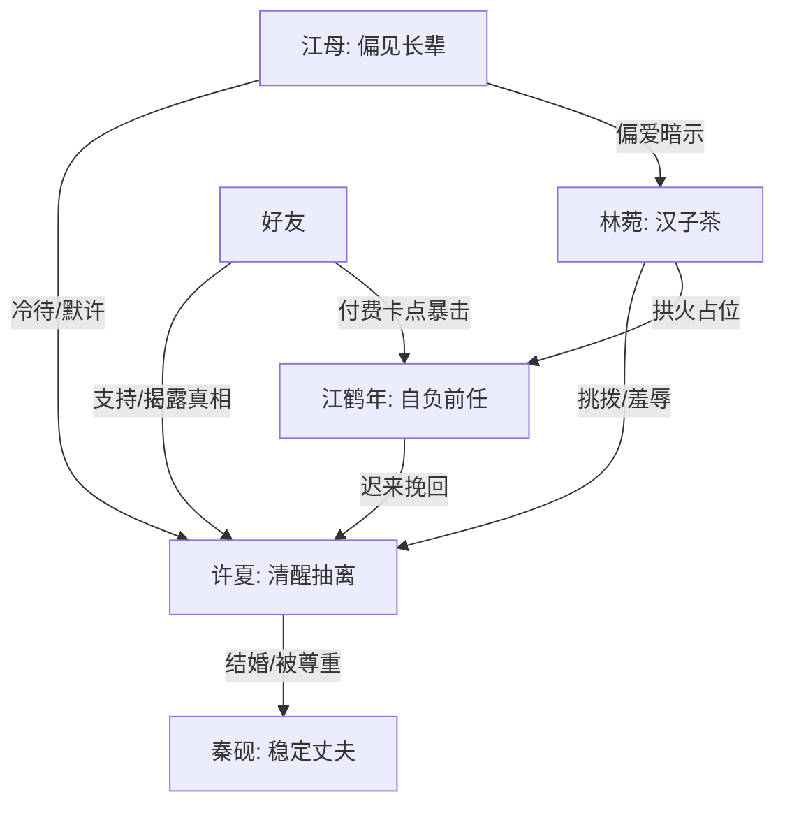

# 角色标签图谱

## 角色清单

### 许夏 — 清醒抽离型女主

- 叙事功能: 承受长期情绪消耗后完成离开，并用既成事实反杀前任误判。
- 核心标签: 清醒、克制、向前走
- 弧光: 等待解释的恋人 → 默认分手的前任 → 已婚且坚定的新娘
- 台词风格: 短句、平静、判决式
- 关键行为: 拒绝伴娘、无视电话、卖房、结婚、化妆间清算、结尾回旋金句
- 读者情绪关系: 心疼转爽，读者期待她彻底不回头

### 江鹤年 — 自负迟钝型前任

- 叙事功能: 误判女主会永远等待，并在事实层层钉死后崩塌。
- 核心标签: 自负、迟钝、迟来悔恨
- 弧光: 居高临下指责 → 认为女主赌气 → 目击婚礼崩塌 → 求而不得
- 台词风格: 前期傲慢，后期发哑、破碎、重复确认
- 关键行为: 群里偏袒林菀、三个月冷处理、拿钻戒迟到求和、婚礼现场失控、化妆间求挽回
- 读者情绪关系: 恨其自负，爽其悔恨

### 林菀 — 汉子茶拱火器

- 叙事功能: 制造女主长期受辱的外部压力，并持续误导江鹤年。
- 核心标签: 挑拨、伪无辜、越界
- 弧光: 阴阳怪气 → 私下拱火 → 现场破防告白 → 被江家切割
- 台词风格: “为你好”包装下的贬低和挑拨
- 关键行为: 群里羞辱许夏、酒吧诋毁戒指、劝江鹤年继续晾着许夏、化妆间失控
- 读者情绪关系: 讨厌、想看被拆穿

### 秦砚 — 稳定尊重型新欢

- 叙事功能: 作为正向亲密关系模板，对照江鹤年的缺席和自负。
- 核心标签: 稳重、尊重、体贴
- 弧光: 幕后安排婚礼 → 正式成为丈夫 → 温柔兜底
- 台词风格: 稳、短、不压迫
- 关键行为: 安排婚礼、在化妆间询问许夏状态、把处理权交给她、度蜜月披外套
- 读者情绪关系: 安心、补偿、替女主值得

### 江母 — 偏见型长辈

- 叙事功能: 强化女主在旧关系里的不被接纳，并在结尾失去挽回立场。
- 核心标签: 偏见、默许、迟到
- 弧光: 不接纳许夏 → 默许林菀越界 → 发现失控但无力挽回
- 台词风格: 后期低声、迟疑、无立场
- 关键行为: 长期偏向林菀，婚礼后台让江鹤年别闹
- 读者情绪关系: 不满，但主要作为系统性冷待的代表

### 好友 — 真相递送者

- 叙事功能: 替女主提供外部支持，并在付费卡点揭露“许夏也是新娘”。
- 核心标签: 支持、清醒、递刀
- 弧光: 替许夏解释 → 发视频 → 婚礼现场揭露真相
- 台词风格: 直接、护短
- 关键行为: 群里维护许夏，发送酒吧视频，在酒店告诉江鹤年许夏结婚
- 读者情绪关系: 代替读者出声，增强爽感

## 关系网络

## 角色功能对照表（供改编参考）

| 原角色 | 极致标签 | 叙事功能 | 读者情绪功能 | 改编时必须保留的 |
|--------|---------|---------|-------------|---------------|
| 许夏 | 清醒抽离女主 | 完成离开和最终判决 | 心疼、爽、释然 | 不回头、不哭求、用事实说话 |
| 江鹤年 | 自负迟钝前任 | 误判与悔恨载体 | 恨、痛快 | 先傲慢后崩塌 |
| 林菀 | 汉子茶拱火器 | 制造误会和羞辱 | 厌恶、等拆穿 | “为你好”式挑拨 |
| 秦砚 | 稳定尊重新欢 | 正向补偿与对照 | 安心、值得 | 尊重选择权，不争高低 |
| 江母 | 偏见长辈 | 旧关系压力来源 | 不满 | 迟到后悔但无立场 |
| 好友 | 递刀支持者 | 揭露信息、推动卡点 | 代偿、助攻 | 付费节点揭真相 |
