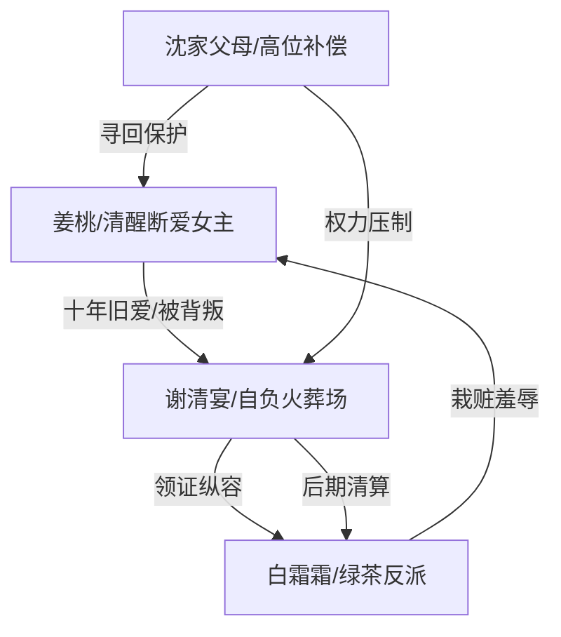

# 角色标签图谱

## 角色清单

### 姜桃 — 清醒断爱虐爽女主
- 叙事功能: 承受前半情绪债，后半通过身份归位与情感撤回完成清算。
- 核心标签: 十年陪伴、失孤大小姐、冷漠新生
- 弧光: 满心期待婚礼 → 被压迫至流产 → 回归沈家 → 拒绝旧爱
- 台词风格: 前期少言忍痛，后期短句砸脸。
- 关键行为: 压回孕检单、拨电话、忍下羞辱、流产后离开、拒绝复合。
- 读者情绪关系: 心疼、替她憋屈，后期为她痛快。

### 谢清宴 — 自信掌控型追妻火葬场男主
- 叙事功能: 最大施害者和悔恨载体，负责制造温度反转。
- 核心标签: 曾经深情、现在背叛、自负悔疯
- 弧光: 温柔背叛 → 偏听偏信 → 亲手失去孩子 → 疯狂求回
- 台词风格: 前期温柔残忍、理所当然；后期断裂哀求。
- 关键行为: 另娶、赶人、报警、逼酒、掰开求救的手、寻找姜桃。
- 读者情绪关系: 恨、怒、期待他崩溃。

### 白霜霜 — 绿茶夺位型反派
- 叙事功能: 引爆男主背叛、制造栽赃误判、推动流产触底。
- 核心标签: 装纯、贪婪、恶毒
- 弧光: 清高小姑娘 → 登堂入室 → 露出市侩 → 被清算拖走
- 台词风格: 当面尖酸，男主面前委屈自责。
- 关键行为: 夺家、夺礼服、扇巴掌、栽赃、逼酒、阻止急救。
- 读者情绪关系: 强恨点，期待被报应。

### 沈家父母 — 补偿型高位亲情
- 叙事功能: 承接女主退路与身份反转，提供后半权力坐标。
- 核心标签: 富可敌国、寻女二十年、护短
- 弧光: 传闻中出现 → 救回女主 → 阻止谢清宴靠近
- 台词风格: 动作多于台词，强势护女。
- 关键行为: 百亿接风宴、救治姜桃、让保镖打退谢清宴。
- 读者情绪关系: 补偿爽、安心感。

## 关系网络

## 角色功能对照表（供改编参考）

| 原角色 | 极致标签 | 叙事功能 | 读者情绪功能 | 改编时必须保留的 |
|--------|---------|---------|-------------|---------------|
| 姜桃 | 清醒断爱女主 | 情绪债承载者/终局审判者 | 心疼转痛快 | 不回头、不求爱、后期冷漠 |
| 谢清宴 | 自负悔疯男 | 压迫源/悔恨载体 | 恨与看火葬场 | 曾经深情、现在亲手毁掉 |
| 白霜霜 | 绿茶夺位者 | 外部诱因/栽赃工具 | 强恨点 | 双面演技、恶毒具体动作 |
| 沈家父母 | 高位亲情补偿 | 身份反转资源 | 补偿爽 | 足够强势，能压倒男主 |
