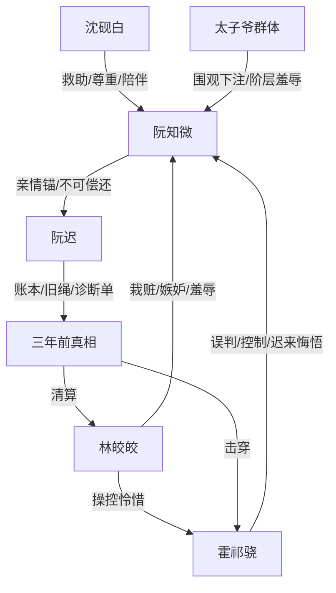

# 角色标签图谱

## 角色清单

### 阮知微 — 冷痛退场型大女主
- 叙事功能: 受害者、真相承载者、关系终止者、道德坐标中心。
- 核心标签: 被冤赎罪、亲情锚定、不可挽回。
- 弧光: 求原谅的赎罪者 → 放弃解释的幸存者 → 重建生活的守护者。
- 台词风格: 短、冷、少解释；后半每句话都是边界。
- 关键行为: 扔佛珠、拒绝名分、抱骨灰跳崖、用原话回敬霍祁骁、拒绝复合。
- 读者情绪关系: 心疼、憋屈、替她解脱，后期尊重她不原谅。

### 霍祁骁 — 迟来悔悟的京圈施害者
- 叙事功能: 核心误判者、资源控制者、火葬场承担者、最终因果偿还者。
- 核心标签: 傲慢、迟钝、施舍式爱。
- 弧光: 居高临下审判 → 真相击穿 → 长头赎罪 → 割绳救人身亡。
- 台词风格: 前期训诫、施舍、命令；后期破碎、低声、无力。
- 关键行为: 逼她磕长头、夺旧绳、逼道歉、查真相、跪寺磕头、割副绳救孩子。
- 读者情绪关系: 前期恨，后期复杂；不是被洗白，而是被迫付出等价代价。

### 林皎皎 — 轮椅绿茶/伪受害者
- 叙事功能: 栽赃者、嫉妒源、羞辱执行者、反转引爆对象。
- 核心标签: 装柔弱、以残疾为武器、先发制人。
- 弧光: 众人捧在掌心的受害者 → 伪造鉴定的诈骗者。
- 台词风格: 人前柔弱，人后带刺；善用“担心你”包装伤害。
- 关键行为: 栽赃割绳、逼跪、碾骨灰、伪造伤残、假坐轮椅。
- 读者情绪关系: 恨点集中，承担“必须清算”的明确反派功能。

### 阮迟 — 死亡亲情锚/不可偿还的债
- 叙事功能: 情绪债根基、女主决绝理由、真相保存者。
- 核心标签: 卖血弟弟、姐姐守护者、死后证人。
- 弧光: 幕后承债者 → 死亡引爆者 → 账本和诊断单留下真相。
- 台词风格: 几乎通过遗言、账本和小票出现，朴素克制。
- 关键行为: 卖血还债、保存旧绳和诊断单、跳楼、留下“姐姐不是罪人”。
- 读者情绪关系: 极致心疼；他的死亡决定霍祁骁永远不可能被完全原谅。

### 沈砚白 — 沉默守护型男配
- 叙事功能: 救援者、证据保护者、边界尊重者、女主新生活支撑。
- 核心标签: 稳、尊重、实际。
- 弧光: 旧识救助者 → 陪伴重建生活的人。
- 台词风格: 少，具体，解决问题；不替女主做决定。
- 关键行为: 领骨灰、救下女主、处理伤口、封存诊断单、守护孤儿院。
- 读者情绪关系: 安全感和补偿感。

### 赵公子/太子爷群体 — 围观暴力放大器
- 叙事功能: 群体羞辱、赌局氛围、阶层压迫具象化。
- 核心标签: 下注、起哄、无同理心。
- 弧光: 雪山赌局围观者 → 被派去孤儿院义工还债。
- 台词风格: 口嗨、轻佻、金额化羞辱。
- 关键行为: 黑卡下注、嘲笑骨灰、后期搬煤修墙。
- 读者情绪关系: 厌恶；后期轻微清算但非核心。

## 关系网络

## 角色功能对照表（供改编参考）

| 原角色 | 极致标签 | 叙事功能 | 读者情绪功能 | 改编时必须保留的 |
|--------|---------|---------|-------------|---------------|
| 阮知微 | 冷痛退场型大女主 | 承债与终止关系 | 心疼、尊重、爽 | 不解释、不复合、不用暴力复仇 |
| 霍祁骁 | 迟来悔悟施害者 | 误判与偿还 | 恨、复杂、火葬场爽 | 前期傲慢够深，后期偿还等价但无回报 |
| 林皎皎 | 轮椅绿茶 | 虚假受害者 | 恨点 | 柔弱外壳+主动栽赃+利益获益 |
| 阮迟 | 死亡亲情锚 | 不可偿还债务 | 心疼、破防 | 死亡不可逆，遗物必须成为证据 |
| 沈砚白 | 沉默守护者 | 安全区 | 安慰、补偿 | 尊重女主选择，不抢主线 |
| 太子爷群体 | 围观暴力 | 羞辱放大器 | 厌恶 | 下注/起哄/阶层轻慢 |
