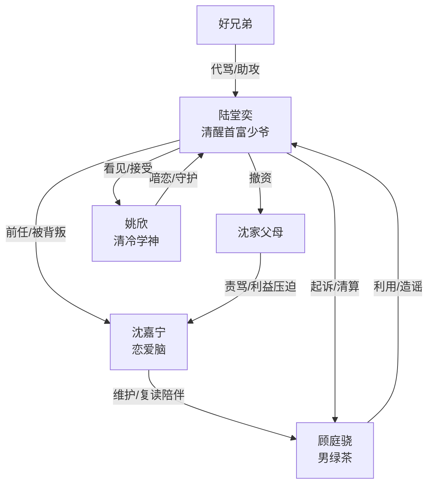

# 角色标签图谱

## 角色清单

### 陆堂奕 — 清醒首富少爷 / 被背叛的高材生
- 叙事功能: 主视角、反击执行者、价值坐标中心
- 核心标签: 清北学霸、隐形富二代、克制反杀
- 弧光: 为爱自证不靠家世 → 发现背叛后切割 → 动用资源清算 → 与同频伴侣成长
- 台词风格: 短句、反问、冷静打脸
- 关键行为: 试探沈嘉宁、拒绝澄清、起诉顾庭骁、撤掉沈家资源、接受姚欣
- 读者情绪关系: 心疼、爽、替他释然

### 沈嘉宁 — 恋爱脑天之骄子 / 自毁型背叛者
- 叙事功能: 背叛源、情绪债制造者、反面命运样本
- 核心标签: 清北退学、恋爱脑、迁怒
- 弧光: 高材生女友 → 为竹马复读 → 帮施害者反咬男主 → 家族坠落 → 悔恨求复合 → 长期颓废
- 台词风格: 理直气壮、道德绑架、甩锅
- 关键行为: 退学复读、要求男主澄清、维护顾庭骁、动手打男主、跪求复合
- 读者情绪关系: 恨、厌烦、看报应

### 顾庭骁 — 男绿茶竹马 / 利用型小三
- 叙事功能: 直接反派、造谣者、沈嘉宁自毁的诱因
- 核心标签: 落榜、装可怜、海王
- 弧光: 被沈嘉宁保护的“小可怜” → 朋友圈炫耀 → 造谣男主 → 被起诉坐牢 → 真面目曝光
- 台词风格: 装无辜、茶言茶语
- 关键行为: 炫耀十指紧扣、买水军造谣、挑衅男主、私下玩弄沈嘉宁
- 读者情绪关系: 恨、恶心、期待被揭穿

### 姚欣 — 清冷学神 / 长情正缘
- 叙事功能: 后半情感补偿、真正同频者、主题价值代言
- 核心标签: 清冷、学神、暗恋多年
- 弧光: 高中沉默同学 → 聚会护男主 → 暗恋浮出 → 主动告白 → 与男主共同成长
- 台词风格: 冷静、直接、温柔克制
- 关键行为: 拦下沈嘉宁巴掌、关心男主到家、改签航班、表白、说出“路都是自己选的”
- 读者情绪关系: 甜、欣慰、补偿

### 好兄弟 — 读者嘴替 / 气氛助推器
- 叙事功能: 代骂反派、点破姚欣暗恋、传递沈嘉宁下场
- 核心标签: 仗义、嘴快、CP 粉
- 弧光: 替男主愤怒 → 调侃姚欣 → 告知沈嘉宁结局
- 台词风格: 网感、夸张、口语化
- 关键行为: 打电话骂顾庭骁、提醒班长喜欢男主、转述沈嘉宁高考失败
- 读者情绪关系: 代入、轻松、爽感补充

### 沈父沈母 — 利益型父母 / 现实清算器
- 叙事功能: 揭示沈家依赖陆家，推动沈嘉宁崩塌
- 核心标签: 现实、功利、失控
- 弧光: 求男主劝女儿 → 因撤资打骂沈嘉宁 → 家族破产焦虑
- 台词风格: 责骂、崩溃、现实利益导向
- 关键行为: 到学校求劝、当众打沈嘉宁、哭诉全家被害
- 读者情绪关系: 现实讽刺、加深沈嘉宁自毁感

## 关系网络

## 角色功能对照表（供改编参考）

| 原角色 | 极致标签 | 叙事功能 | 读者情绪功能 | 改编时必须保留的 |
|--------|---------|---------|-------------|---------------|
| 陆堂奕 | 清醒隐富学霸 | 主角反击执行者 | 心疼、爽、释然 | 先克制后动用资源，不能无故霸凌 |
| 沈嘉宁 | 恋爱脑背叛者 | 情绪债来源 | 恨、厌恶、看报应 | 自毁前程+迁怒男主 |
| 顾庭骁 | 男绿茶海王 | 直接反派 | 恶心、期待揭穿 | 装可怜与私下利用的反差 |
| 姚欣 | 清冷长情正缘 | 情感补偿 | 甜、安心 | 早有伏笔，主动守护 |
| 好兄弟 | 读者嘴替 | 情绪放大器 | 代骂、轻松 | 吐槽节奏与信息传递 |
| 沈父母 | 利益现实派 | 家族压力显影 | 讽刺、清算 | 揭露沈家靠男主资源 |
