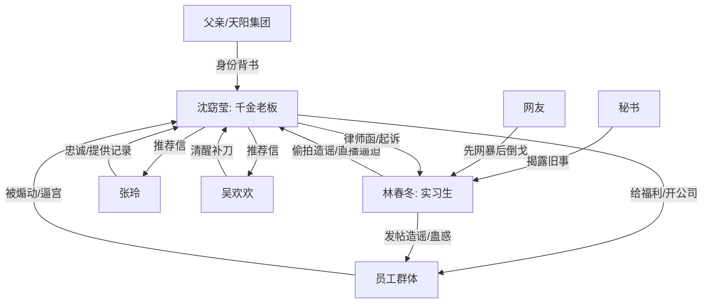

# 角色标签图谱

## 角色清单

### 沈窈莹 — 摆烂千金型清醒老板

- 叙事功能: 主角、规则制定者、最终清算者。
- 核心标签: 有钱、冷静、不惯人。
- 弧光: 想做理想公司 → 被员工背刺 → 直接退出游戏。
- 台词风格: 短句反问，少解释，多执行。
- 关键行为: 转发帖子、召开会议、结清工资、关公司、发律师函、拒绝复职。
- 读者情绪关系: 让读者爽、代入“我有退路所以不受气”。

### 林春冬 — 嫉妒型挑事实习生

- 叙事功能: 引爆冲突、制造舆论、诱导群体贪心、承接最终打脸。
- 核心标签: 造谣、煽动、又蠢又坏。
- 弧光: 打假者姿态 → 舆论操盘者 → 直播翻车者 → 被起诉赔偿。
- 台词风格: 网暴式扣帽子，情绪化质问。
- 关键行为: 发帖打假、要求双重福利、偷拍造谣、蛊惑离职、直播逼宫。
- 读者情绪关系: 主要恨点，越跳越给后续清算加爽感。

### 前员工群体 — 贪心被煽动者

- 叙事功能: 放大背刺感，证明“好人不能无底线惯着”。
- 核心标签: 贪心、摇摆、甩锅。
- 弧光: 感恩员工 → 被挑拨索取 → 集体离职逼宫 → 失业后悔。
- 台词风格: 先附和林春冬，后求原谅。
- 关键行为: 支持包住还想保留补贴、提交离职、逼老板妥协、甩锅林春冬。
- 读者情绪关系: 前期憋屈，后期看他们后悔很爽。

### 张玲 — 清醒忠诚员工

- 叙事功能: 提供道德参照，证明女主不是无差别报复。
- 核心标签: 真诚、清醒、感恩。
- 弧光: 沉默少数派 → 获得推荐信 → 反向证明选择有回报。
- 台词风格: 软但坚定。
- 关键行为: 不参与逼宫，给女主看小群记录，拒绝替前员工求情。
- 读者情绪关系: 让读者获得补偿感，善良者被善待。

### 吴欢欢 — 反讽补刀者

- 叙事功能: 在会议室崩盘段替女主补刀。
- 核心标签: 内向、清醒、会反讽。
- 弧光: 少数沉默者 → 被女主托底 → 当面回怼背刺者。
- 台词风格: 轻讽、精准。
- 关键行为: 拒绝同流合污，揭穿老板不是下马威。
- 读者情绪关系: 替读者骂出憋屈。

### 女主父亲/秘书 — 身份坐实者

- 叙事功能: 第三方权威，完成大小姐身份反转与林春冬动机揭露。
- 核心标签: 豪门背景、证人、权威背书。
- 弧光: 被造谣为金主 → 被证明是父亲/总裁关联 → 反杀造谣。
- 台词风格: 秘书直白爆料。
- 关键行为: 父亲接女主下班；秘书直播现场认出林春冬。
- 读者情绪关系: 提供“不是自证，是别人打脸”的爽感。

## 关系网络

## 角色功能对照表（供改编参考）

| 原角色 | 极致标签 | 叙事功能 | 读者情绪功能 | 改编时必须保留的 |
|--------|---------|---------|-------------|---------------|
| 沈窈莹 | 摆烂千金清醒老板 | 主角/清算者 | 爽、代入、解气 | 不缺钱、不自证、不求和 |
| 林春冬 | 嫉妒型挑事新人 | 反派/引爆器 | 恨、等打脸 | 发帖造谣+煽动群体+动机翻车 |
| 前员工 | 贪心群体 | 背刺压力源 | 憋屈后爽 | 主动选择站错队 |
| 张玲 | 忠诚少数派 | 道德参照 | 安慰、补偿 | 不参与逼宫并被奖励 |
| 吴欢欢 | 清醒补刀者 | 读者嘴替 | 爽、讽刺 | 会议室反讽段 |
| 秘书 | 第三方证人 | 真相揭露 | 高潮打脸 | 公开场合坐实反派黑历史 |
