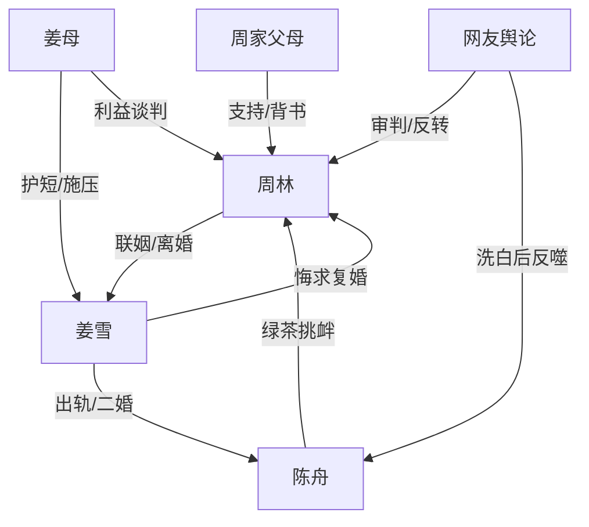

# 角色标签图谱

## 角色清单

### 周林 — 清醒止损型豪门男主
- 叙事功能: 第一视角主角，承担判断、反杀、价值观输出。
- 核心标签: 怕麻烦、冷静、掌权者
- 弧光: 以为联姻省心 → 发现婚姻制造巨大风险 → 切割婚姻并确认自我价值
- 台词风格: 短句、冷幽默、反问式打脸
- 关键行为: 让姜雪扫墓、医院抓现行、准备离婚协议、放截图反转舆论、拒绝复婚
- 读者情绪关系: 爽、代入、敬佩；读者期待他继续冷静清算

### 姜雪 — 拎不清豪门出轨妻
- 叙事功能: 背叛源与悔恨线承载者。
- 核心标签: 自负、越界、恋爱脑
- 弧光: 笃定丈夫不敢离婚 → 出轨怀孕二婚 → 被陈舟背叛 → 失势求复婚
- 台词风格: 前期理直气壮，中期自欺解释，后期哀求挽回
- 关键行为: 陪陈舟祭拜、缺席寿宴、妇产科被抓、签离婚、二婚、求复婚
- 读者情绪关系: 恨、膈应、后期报应爽

### 陈舟 — 寡夫绿茶男秘
- 叙事功能: 小三、舆论反转诱因、最终内部反噬源。
- 核心标签: 装弱、挑衅、贪婪
- 弧光: 无辜寡夫 → 男小三 → 纯爱战神假象 → 卖妻败露 → 被封杀驱逐
- 台词风格: “我没事”“别怪他”的绿茶话术，后期破防辱骂
- 关键行为: 发朋友圈挑衅、装病截走姜雪、妇产科陪同、二婚视频卖惨、卖妻牟利
- 读者情绪关系: 恨、恶心、看他破防很爽

### 姜母 / 岳母 — 势利家族利益维护者
- 叙事功能: 强化“周林不敢离婚”的外部压迫，代表豪门面子逻辑。
- 核心标签: 势利、精明、护短
- 弧光: 轻视周林 → 求周林压事 → 接受陈舟 → 姜家失控
- 台词风格: 表面亲热，背后算计
- 关键行为: 寿宴强压姜雪道歉、背后说周林知趣、电话逼和
- 读者情绪关系: 讨厌、讽刺对象

### 周父周母 — 主角权力背书
- 叙事功能: 提供家族权力与情感支持，让周林“不敢离婚”的判断被打脸。
- 核心标签: 护短、体面、掌局
- 弧光: 寿宴受辱 → 合作施压 → 隐性支持离婚
- 台词风格: 平和但有威慑
- 关键行为: 寿宴谈合作重估，拒接姜母电话
- 读者情绪关系: 安全感、靠山爽

### 网友 / 舆论 — 可反转的公共审判场
- 叙事功能: 放大冲突，制造二次反转。
- 核心标签: 摇摆、吃瓜、道德审判
- 弧光: 骂陈舟 → 洗陈舟 → 被真相反杀
- 台词风格: 弹幕式、标签化
- 关键行为: 误判周林横刀夺爱，后转骂姜雪陈舟
- 读者情绪关系: 紧张与翻盘爽

## 关系网络

## 角色功能对照表（供改编参考）

| 原角色 | 极致标签 | 叙事功能 | 读者情绪功能 | 改编时必须保留的 |
|--------|---------|---------|-------------|---------------|
| 周林 | 清醒止损掌权者 | 反杀执行者 | 爽、代入 | 不争宠，只止损 |
| 姜雪 | 自负出轨妻 | 情绪债主要来源 | 恨、报应爽 | 从笃定到悔求 |
| 陈舟 | 寡夫绿茶男秘 | 小三与反噬源 | 恶心、破防爽 | 装弱挑衅和最终败露 |
| 姜母 | 势利岳母 | 外部压迫 | 膈应 | “你不敢离婚”的判断 |
| 周家 | 权力背书 | 清算合法性 | 安全感 | 周林能做主 |
| 网友 | 摇摆舆论 | 二次反转场 | 翻盘爽 | 先误判再打脸 |
