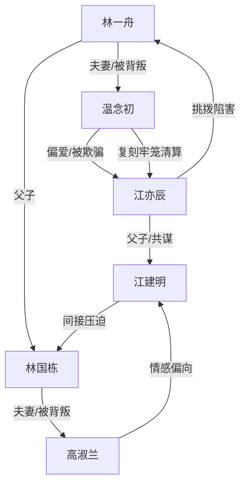

# 角色标签图谱

## 角色清单

### 林一舟 — 清醒亡魂/受虐献祭者
- 叙事功能: 第一人称承痛者与旁观者，承担读者共情入口。
- 核心标签: 隐忍、痴情、彻底清醒
- 弧光: 以为攻略失败 → 发现骗局 → 死后旁观 → 拒绝追随
- 台词风格: 少量、平静、终局一刀封喉
- 关键行为: 与系统献祭魂魄；死后旁观；结尾拒绝温念初。
- 读者情绪关系: 心疼、憋屈、最终替他解脱。

### 林国栋 — 护子父亲/共同受难者
- 叙事功能: 放大亲情债，使高淑兰的恶更不可原谅。
- 核心标签: 慈父、隐忍、牺牲
- 弧光: 被女帝折磨 → 魂魄离开 → 尸体揭露 → 墓碑承接高淑兰悔恨
- 台词风格: 回忆中温厚朴实。
- 关键行为: 为儿子求长命锁；受虐仍护子。
- 读者情绪关系: 心疼、愤怒、亲情补偿欲。

### 温念初 — 迟悔疯批妻/追妻火葬场女主
- 叙事功能: 第一施害者与悔恨主体，承载 M5 温度反转。
- 核心标签: 傲慢、误判、悔疯
- 弧光: 伪装公主折磨丈夫 → 否认死亡 → 婚礼真相崩塌 → 清算江亦辰 → 自杀追随被拒
- 台词风格: 前期冷嘲刻薄，后期破碎哀求。
- 关键行为: 策划三年惩罚；毁掉遗物；太平间自扇；复刻牢笼报复；饮鸩自尽。
- 读者情绪关系: 前期恨，后期看她痛苦但不希望她被原谅。

### 高淑兰 — 偏听偏信母亲/迟来忏悔者
- 叙事功能: 家庭伦理层面的施害者，和温念初形成妻母双重背叛。
- 核心标签: 偏心、冷酷、崩溃
- 弧光: 扮女帝折磨丈夫 → 否认死讯 → 太平间崩溃 → 死在丈夫墓前
- 台词风格: 前期粗暴笃定，后期失语。
- 关键行为: 参与骗局；拒接殡仪馆电话；婚礼上拒绝保释；墓园自尽。
- 读者情绪关系: 恨其凉薄，接受她以死偿债但不认为足够。

### 江亦辰 — 绿茶男小三/伪弱者真操盘
- 叙事功能: 挑拨者与最终被镜像清算对象。
- 核心标签: 伪善、贪婪、恶毒
- 弧光: 装病装弱 → 挑拨温念初 → 谎言曝光 → 被投入复刻牢笼 → 疯癫
- 台词风格: 茶言茶语、以退为进。
- 关键行为: 伪造照片和消费记录；编造破产重病；挑拨毁遗物；求饶。
- 读者情绪关系: 强恨点，清算爽点集中承载者。

### 江建明 — 江亦辰父亲/共谋受益者
- 叙事功能: 高淑兰情感出轨对象，承接父子镜像报应。
- 核心标签: 依附、共谋、报应
- 弧光: 婚礼父母席亲昵 → 被关牢狱 → 护子被打死
- 台词风格: 台词少，以存在关系制造羞辱。
- 关键行为: 与高淑兰亲密出席婚礼；在牢中护江亦辰。
- 读者情绪关系: 厌恶，死亡用于偿还林国栋被害债。

## 关系网络

## 角色功能对照表（供改编参考）

| 原角色 | 极致标签 | 叙事功能 | 读者情绪功能 | 改编时必须保留的 |
|--------|---------|---------|-------------|---------------|
| 林一舟 | 清醒亡魂 | 第一视角受难者 | 心疼与终局解脱 | 死后旁观、结尾不原谅 |
| 林国栋 | 护子父亲 | 亲情债源 | 加深愤怒 | 为子牺牲的旧物/旧事 |
| 温念初 | 迟悔疯批妻 | 悔恨主体 | 先恨后看火葬场 | 旧爱证据、毁物、追随被拒 |
| 高淑兰 | 偏心母亲 | 家庭伦理背叛 | 亲情痛点 | 否认死讯、墓前死亡 |
| 江亦辰 | 绿茶男小三 | 谎言与挑拨源 | 清算爽点 | 伪弱、造假、镜像报应 |
| 江建明 | 共谋父亲 | 父辈对照 | 补偿林国栋债 | 护子被罚，形成反讽 |
