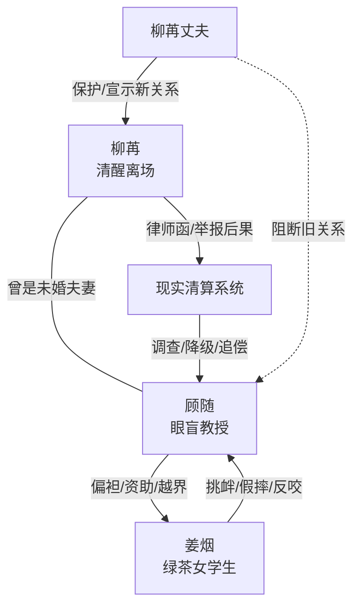

# 角色标签图谱

## 角色清单

### 柳苒 — 清醒离场大女主

- 叙事功能: 承担受害者、切割者、最终价值坐标。
- 核心标签: 克制、独立、决绝
- 弧光: 被长期忽视的未婚妻 -> 发现财产与情感双背叛 -> 出国切割 -> 高位回归且已婚
- 台词风格: 短句、冷淡、礼貌疏离
- 关键行为: 删除联系方式、同意出国、取证账户、发律师函、拒绝解释
- 读者情绪关系: 前半心疼，后半爽与释然

### 顾随 — 眼盲清冷教授/追妻火葬场男主

- 叙事功能: 施害者、悔恨承载者、报应展示对象。
- 核心标签: 自负、迟钝、边界感崩坏
- 弧光: 被簇拥的教授 -> 偏袒女学生 -> 失去未婚妻 -> 事业降级 -> 五年等待无果
- 台词风格: 前期不耐烦和说教，后期乞求和解释
- 关键行为: 让姜烟住进宿舍、转移共同账户、把姜烟带回家、扇柳苒、报警、等待五年
- 读者情绪关系: 前半恨，后半看其痛苦获得火葬场爽感

### 姜烟 — 绿茶女学生/边界入侵者

- 叙事功能: 催化顾随偏心，制造冲突，后期反噬顾随。
- 核心标签: 装弱、挑衅、功利
- 弧光: 被照顾的可怜学生 -> 挑衅未婚妻 -> 借势索取 -> 谣言反咬被抓
- 台词风格: 表面委屈，实际挑拨
- 关键行为: 住进宿舍、改造空间、假摔、求顾随帮忙、散布谣言
- 读者情绪关系: 明确恨点，推动读者期待她被清算

### 柳苒丈夫 — 新秩序守护者

- 叙事功能: 证明柳苒已拥有新生活，完成顾随不可挽回的终局打击。
- 核心标签: 保护者、合法伴侣、边界清晰
- 弧光: 末章登场 -> 挡住顾随 -> 宣示“我太太”
- 台词风格: 直接、礼貌、带警告
- 关键行为: 在会议上挡在柳苒身前
- 读者情绪关系: 提供补偿和安全感

### 律师/巡捕/校方 — 现实清算系统

- 叙事功能: 让女主的离场和惩罚具备现实权威。
- 核心标签: 冷静、公事公办、无情绪偏向
- 弧光: 分别介入失踪、财产、职业调查
- 台词风格: 程序化、冷静
- 关键行为: 确认柳苒自行离开、送达律师函、调查顾随
- 读者情绪关系: 增强报应可信度

## 关系网络

## 角色功能对照表（供改编参考）

| 原角色 | 极致标签 | 叙事功能 | 读者情绪功能 | 改编时必须保留的 |
|--------|---------|---------|-------------|---------------|
| 柳苒 | 清醒离场大女主 | 受害与切割主体 | 心疼后转爽 | 不争辩到底，直接行动切割 |
| 顾随 | 追妻火葬场教授 | 施害与悔恨主体 | 恨他、看他痛 | 前期偏心要具体，后期后悔要付现实代价 |
| 姜烟 | 绿茶入侵者 | 冲突催化剂 | 讨厌、期待清算 | 装弱挑拨与后期反噬 |
| 新丈夫 | 新归属保护者 | 终局补偿 | 安全感、痛快 | “合法新身份”必须明确 |
| 律师/校方 | 现实权威 | 清算执行 | 爽点落地 | 钱与职业惩罚不能虚化 |
