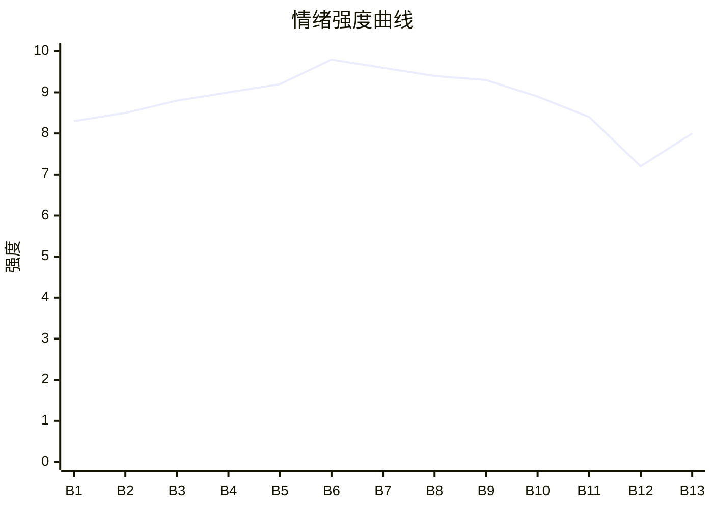

# Beat Sheet 节拍器

## 全文概况

- 总字数: 约 12800 字
- 节拍数: 13 幕
- 核心母题（Logline）: 隐退大佬林越为爱藏起权力，却被妻子和绿茶助理直播私刑羞辱；在亲情底线被践踏时，旧部降临揭开真相，完成资源、法律与价值层面的反杀。
- 情绪模式: 极致打压 → 亲情触底 → 身份爆发 → 资源清算 → 光明重建

## 节拍详表

### Beat 1: 高速直播惩罚开局 [开篇-“看够了就回来接我”]
- **字数**: 约 450 字（占比 3.5%）
- **核心事件**: 妻子为替贫困生出气，把林越扔上高速直播惩罚。
- **情绪标签**: 震惊、荒唐、憋屈
- **情绪强度**: 8.3/10
- **情绪方向**: ⚡突变
- **冲突类型**: 大转折
- **悬念钩子**: 林越为什么敢对直播镜头说“回来接我”？
- **叙事速度**: 快
- **对话占比**: 45%
- **reversal_mechanism**: [M3]
- **hook_strength**: 8.6/10
- **关键句**: “你不是说交通方便吗？自己走回去试试。”
- **原文摘录**: “五一假期，妻子苏晚资助的贫困生小周非要搭我的车回家。……再醒来，我站在烈日下的高速公路中，苏晚亲昵地靠在小周肩头，举着手机直播冷笑：‘你不是说交通方便吗？自己走回去试试。’……我对着镜头，舔了舔干裂的嘴唇：‘看够了？看够了就回来接我。’”

### Beat 2: 跪下或走八十公里 [“柏油路面热浪蒸腾”-“我不是做得不够好。我是碍事了。”]
- **字数**: 约 1200 字（占比 9.4%）
- **核心事件**: 苏晚要求林越跪下道歉或走完八十公里，弹幕集体审判。
- **情绪标签**: 羞辱、愤怒、寒心
- **情绪强度**: 8.5/10
- **情绪方向**: ↑上升
- **冲突类型**: 大转折
- **悬念钩子**: 林越被彻底激醒后会如何反击？
- **叙事速度**: 中
- **对话占比**: 50%
- **reversal_mechanism**: [M3, M5]
- **hook_strength**: null
- **关键句**: “我不是做得不够好。我是碍事了。”
- **原文摘录**: “苏晚揽了揽他的肩膀……‘林越，现在给你两个选择，要么给周子谦跪下道歉，要么走完这八十公里。’……周子谦说：‘我本来就家庭条件不好，命贱……’……我盯着她。这是我爱了六年的女人。……直到今天……我才彻底看清了。我不是做得不够好。我是碍事了。”

### Beat 3: 放狗追赶，恐惧被武器化 [“还嘴硬？”-“每一步都像踩在碎玻璃上”]
- **字数**: 约 1000 字（占比 7.8%）
- **核心事件**: 苏晚明知林越怕狗，却放猎犬追他，逼他在直播里奔逃。
- **情绪标签**: 恐惧、羞辱、心寒
- **情绪强度**: 8.8/10
- **情绪方向**: ↑上升
- **冲突类型**: 微冲突升级
- **悬念钩子**: 林越身体极限何时崩塌？
- **叙事速度**: 快
- **对话占比**: 35%
- **reversal_mechanism**: [M5]
- **hook_strength**: null
- **关键句**: “现在她亲自放狗追我。”
- **原文摘录**: “她看向身后的保镖。‘去把车里的猎犬放出来。’……我虽然是大男人，但是从小怕狗。苏晚其实喜欢狗，但嫁给我之后，一只没养过……现在她亲自放狗追我。……不知什么时候，路面上多了一层碎石子……每一步都像踩在碎玻璃上。”

### Beat 4: 弹幕开盘，痛苦被娱乐化 [“直播间里的弹幕更刺激了”-“高压水枪拿来”]
- **字数**: 约 900 字（占比 7.0%）
- **核心事件**: 网友下注林越能跑多远，周子谦借“救人”提议高压水枪。
- **情绪标签**: 厌恶、暴怒、窒息
- **情绪强度**: 9.0/10
- **情绪方向**: ↑上升
- **冲突类型**: 大转折
- **悬念钩子**: 高压水枪会造成怎样的二次伤害？
- **叙事速度**: 快
- **对话占比**: 45%
- **reversal_mechanism**: [M3]
- **hook_strength**: null
- **关键句**: “有人开了盘口，赌我能跑多远。”
- **原文摘录**: “直播间里的弹幕更刺激了。‘下注下注！我押他能再跑两公里。’……苏晚看着手机屏幕上的下注金额，嘴角微微上扬。……周子谦说：‘中暑的人必须马上冲凉。’……苏晚转头对保镖说：‘去，把后备箱的高压水枪拿来。’”

### Beat 5: 高压水枪与血水反击 [“水柱喷出来的瞬间”-“血水糊了他一脸”]
- **字数**: 约 1100 字（占比 8.6%）
- **核心事件**: 林越被高压水枪冲伤，仍用血水吐向周子谦完成第一次主动反击。
- **情绪标签**: 疼痛、憋屈、痛快
- **情绪强度**: 9.2/10
- **情绪方向**: ⚡突变
- **冲突类型**: 微反击
- **悬念钩子**: 苏晚会如何继续升级？
- **叙事速度**: 快
- **对话占比**: 40%
- **reversal_mechanism**: [M3]
- **hook_strength**: null
- **关键句**: “我把嘴里的血水攒了攒，对准他的脸，用力吐了出去。”
- **原文摘录**: “那不是冲凉，那是被卡车撞。……水柱冲进鼻腔和嘴里，呛得我肺像要炸开。……周子谦凑近了些：‘你给我磕个头，我不觉得丢人。’……我把嘴里的血水攒了攒，对准他的脸，用力吐了出去。血水糊了他一脸。”

### Beat 6: 骨灰盒触底卡点 [“苏晚从车里拿出一个木盒”-“三、二、一……”]
- **字数**: 约 900 字（占比 7.0%）
- **核心事件**: 苏晚拿出林越奶奶骨灰盒，众筹直播撒骨灰，逼他下跪。
- **情绪标签**: 触底、恨意、亲情痛点
- **情绪强度**: 9.8/10
- **情绪方向**: ↑上升至峰值
- **冲突类型**: 大转折
- **悬念钩子**: 骨灰真会被扬掉吗？
- **叙事速度**: 快
- **对话占比**: 55%
- **reversal_mechanism**: [M6]
- **hook_strength**: null
- **关键句**: “是我奶奶的骨灰盒。”
- **原文摘录**: “苏晚从车里拿出一个木盒，在我面前晃了晃。是我奶奶的骨灰盒。……‘各位，想不想看现场直播撒骨灰？五毛钱一个人，众筹，满一千我就扬。’……‘苏晚，别动我奶奶。’……苏晚把骨灰盒举得更高，手已经抓了一把。‘三、二、一……’”

### Beat 7: 直升机降临，身份反差第一爆 [“她往外一扬”-“正光集团掌门人”]
- **字数**: 约 900 字（占比 7.0%）
- **核心事件**: 骨灰被接住，三架直升机降落，小影出现。
- **情绪标签**: 震撼、期待、爽点启动
- **情绪强度**: 9.6/10
- **情绪方向**: ⚡突变
- **冲突类型**: 大转折
- **悬念钩子**: 小影和林越究竟是什么关系？
- **叙事速度**: 快
- **对话占比**: 25%
- **reversal_mechanism**: [M2, M6]
- **hook_strength**: null
- **关键句**: “因为头顶上，三架直升机正缓缓降落。”
- **原文摘录**: “骨灰飘出来的瞬间，突然一只手稳稳接住了散落的骨灰。……因为头顶上，三架直升机正缓缓降落。……一个女人走下来。小影。正光集团掌门人，苏氏最大的合作方。”

### Beat 8: “哥”字砸脸，旧身份揭开 [“你配吗？”-“哥，你就为了这么个东西？”]
- **字数**: 约 850 字（占比 6.6%）
- **核心事件**: 小影叫林越“哥”，揭示林越曾为苏晚放弃暗影和资源。
- **情绪标签**: 爽、震惊、反讽
- **情绪强度**: 9.4/10
- **情绪方向**: ↑上升
- **冲突类型**: 身份反转
- **悬念钩子**: 苏晚如何面对“自己成功全靠丈夫”的真相？
- **叙事速度**: 中
- **对话占比**: 55%
- **reversal_mechanism**: [M2, M5, M6]
- **hook_strength**: null
- **关键句**: “哥，这就是你千方百计要帮的人？”
- **原文摘录**: “苏晚强撑着镇定：‘这是我的家事……’小影终于开口。‘你配吗？’……‘哥，这就是你千方百计要帮的人？’……‘你为了她，把暗影的资源都搭进去，给她铺路，给她拉合作，给她搭人脉。’……‘哥，你就为了这么个东西？’”

### Beat 9: 苏晚跪地求饶，绿茶反噬 [“苏晚的脸已经白了”-“狗咬狗”]
- **字数**: 约 1400 字（占比 10.9%）
- **核心事件**: 苏晚跪求保苏氏，把责任推给周子谦，二人当场互殴。
- **情绪标签**: 痛快、鄙夷、报应
- **情绪强度**: 9.3/10
- **情绪方向**: →高位
- **冲突类型**: 大转折
- **悬念钩子**: 林越会不会心软？
- **叙事速度**: 中
- **对话占比**: 60%
- **reversal_mechanism**: [M3, M5]
- **hook_strength**: null
- **关键句**: “不是因为她知道自己错了。是因为她知道惹不起。”
- **原文摘录**: “她突然全身瘫软，整个人跪了下去。不是跪我。是跪小影。……‘求你们放过我。苏氏上下几千号人，都指着公司吃饭。’……苏晚一把揪住他的衣领：‘如果不是你天天在我耳边说他的坏话……’……我看着他们。一个跪过又爬起来的女人，一个满嘴谎言的男人。狗咬狗。”

### Beat 10: 林越拒绝原谅，离开旧爱 [“苏晚。”-“回家吧。”]
- **字数**: 约 900 字（占比 7.0%）
- **核心事件**: 苏晚求原谅，林越冷静拒绝，乘直升机离开。
- **情绪标签**: 解脱、冷感、断舍离
- **情绪强度**: 8.9/10
- **情绪方向**: ↓回落但爽感稳定
- **冲突类型**: 情感清算
- **悬念钩子**: 苏晚和周子谦会受到怎样的法律/商业清算？
- **叙事速度**: 中
- **对话占比**: 45%
- **reversal_mechanism**: [M5]
- **hook_strength**: null
- **关键句**: “你让我觉得恶心。”
- **原文摘录**: “苏晚抓住我的脚……‘我帮你出气了，你原谅我好不好？’……我低头看她。……不是因为她知道自己错了。是因为她知道惹不起。‘苏晚。’……‘你让我觉得恶心。’……小影坐在我对面，替我擦脸上的血。……‘回家吧。’”

### Beat 11: 商业与法律清算 [“正光的直升机直接降在了医院”-“而我不要她的敬畏”]
- **字数**: 约 1100 字（占比 8.6%）
- **核心事件**: 正光终止合作，苏氏崩盘；律师求谅解书被拒。
- **情绪标签**: 清算、冷静、彻底
- **情绪强度**: 8.4/10
- **情绪方向**: →平稳
- **冲突类型**: 清算兑现
- **悬念钩子**: 林越重掌资源后会变成什么样的人？
- **叙事速度**: 中
- **对话占比**: 45%
- **reversal_mechanism**: [M2, M3]
- **hook_strength**: null
- **关键句**: “她拿我的钱，来求我原谅？”
- **原文摘录**: “正光集团决定即日起终止与苏氏的一切合作，并追回全部已投入资金。……苏氏的股价在开盘十分钟内跌停。……律师说：‘她愿意净身出户，名下所有财产都转到您名下。’我笑了。‘她拿我的钱，来求我原谅？’……她知道的不是对我做错了，是她惹错了人。”

### Beat 12: 小影陪伴，关系补偿 [“住院的第七天”-“你。”]
- **字数**: 约 950 字（占比 7.4%）
- **核心事件**: 小影照顾林越，兄妹/同伴关系成为失爱后的补偿。
- **情绪标签**: 温暖、修复、余韵
- **情绪强度**: 7.2/10
- **情绪方向**: ↓舒缓
- **冲突类型**: 无明显外部冲突
- **悬念钩子**: 林越是否会重回暗影？
- **叙事速度**: 慢
- **对话占比**: 50%
- **reversal_mechanism**: [M5]
- **hook_strength**: null
- **关键句**: “‘我不是什么都没有。’‘你还有什么？’我指了指她。‘你。’”
- **原文摘录**: “小影每天来医院，上午一趟下午一趟。……‘哥，你为了她，把整个暗影都搭进去了。现在你什么都没有了。’‘我不是什么都没有。’‘你还有什么？’我指了指她。‘你。’小影愣了一下，然后别过脸去。”

### Beat 13: 终止暗影，光明重建 [“出院后第三天”-结尾]
- **字数**: 约 1350 字（占比 10.5%）
- **核心事件**: 林越签署接管文件，终止暗影灰色业务，保住苏氏员工，完成价值升维。
- **情绪标签**: 解脱、重建、升华
- **情绪强度**: 8.0/10
- **情绪方向**: ↑温和上升
- **冲突类型**: 价值反转
- **悬念钩子**: 无，完成收束
- **叙事速度**: 慢
- **对话占比**: 45%
- **reversal_mechanism**: [M6]
- **hook_strength**: null
- **关键句**: “真正的强大从来不是你能毁掉什么，而是你能重建什么。”
- **原文摘录**: “桌上摆着两份文件。……‘暗影所有的业务，从今天起，全部终止。’……‘正光从今天起，只做阳光下的事。’……苏晚判处有期徒刑六年，周子谦判处有期徒刑两年。……‘苏氏那边原来的员工，一个都不许裁。’……真正的强大从来不是你能毁掉什么，而是你能重建什么。……这个结局，配得上我一路的颠沛流离。”

## 情绪曲线可视化

## 节拍密度检测

- 平均每 985 字一个节拍
- 微冲突密度: 每 650-800 字一次
- 大转折密度: 每 1600-2200 字一次
- 判定: 符合高频节拍器标准；前 60% 压迫升级密度尤其高

## 反转机制清单(Reversal Mechanisms)

| 机制 ID | 机制名 | 承载 Beat | 关键段落/金句 | 等价改编提示 |
|--------|--------|-----------|--------------|-------------|
| M2 | 身份反差爆发 | Beat 7-8, Beat 11 | “哥，这就是你千方百计要帮的人？” | 隐藏身份的层级必须保留：救援者身份、主角旧权力、反派资源来源逐层揭开。 |
| M3 | 因果回旋反讽 | Beat 1-5, Beat 9-11 | “你不是说交通方便吗？自己走回去试试。” / “她拿我的钱，来求我原谅？” | 必须让施害者的规则反身砸回去；开头的惩罚逻辑和结尾的资源清算要形成回旋。 |
| M5 | 温度反转曲线 | Beat 2-3, Beat 8-12 | “这是我爱了六年的女人。” / “那个让我心疼的女人早就已经死了。” | 必须显式写出曾经爱与照顾，再写归零和负值悔恨，不能只写单纯打脸。 |
| M6 | 多层递进反转 | Beat 6-8, Beat 13 | 骨灰卡点 → 直升机 → 小影叫哥 → 终止暗影 | 反转层数不能少：动作救场、身份揭露、权力清算、价值升维都要保留。 |
