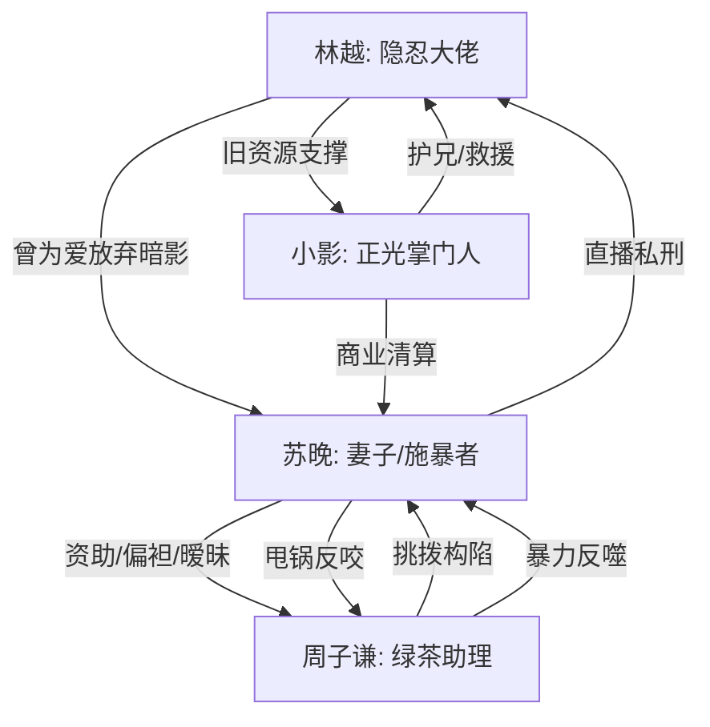

# 角色标签图谱

## 角色清单

### 林越 — 隐忍退场的大佬 / 克制复仇男主
- 叙事功能: 承受压迫、制造身份信息差、完成资源与价值清算。
- 核心标签: 隐忍、旧权力、重建者
- 弧光: 为爱藏光 → 被逼触底 → 收回权力 → 光明重建
- 台词风格: 短、稳、少解释
- 关键行为: 拒跪、吐血水反击、拒绝谅解、终止暗影业务
- 读者情绪关系: 前半心疼，后半爽，结尾认可

### 苏晚 — 利益型妻子 / 被绿茶操控的施暴者
- 叙事功能: 核心压迫者，负责把亲密关系伤害推到极致。
- 核心标签: 自负、冷血、势利
- 弧光: 高位审判者 → 真相震碎 → 跪地求饶 → 入狱
- 台词风格: 前期轻蔑命令，后期哭求甩锅
- 关键行为: 下药、直播、放狗、高压水枪、威胁扬骨灰
- 读者情绪关系: 恨、厌恶、希望她付出代价

### 周子谦 — 绿茶男助理 / 寄生型挑拨者
- 叙事功能: 点火器，每次装可怜都推动伤害升级。
- 核心标签: 装穷、装善、挑拨
- 弧光: 被保护的“贫困生” → 反噬苏晚 → 从犯获刑
- 台词风格: “林哥”“命贱”“为你好”式伪善
- 关键行为: 构陷搭车事件、诱导冲凉、逼跪、甩锅互殴
- 读者情绪关系: 生理性厌恶，期待被打脸

### 小影 — 护兄女强人 / 正光掌门人
- 叙事功能: 身份揭露者、外部权力执行者、情感补偿者。
- 核心标签: 冷静、护短、执行力
- 弧光: 神秘救援者 → 权力清算者 → 新秩序搭档
- 台词风格: 少话、冷、关键句重
- 关键行为: 接住骨灰、叫“哥”、终止合作、接管苏氏
- 读者情绪关系: 爽、安心、补偿

## 关系网络

## 角色功能对照表（供改编参考）

| 原角色 | 极致标签 | 叙事功能 | 读者情绪功能 | 改编时必须保留的 |
|--------|---------|---------|-------------|---------------|
| 林越 | 隐忍大佬 | 承压与反杀核心 | 心疼转爽 | 隐藏权力、拒绝下跪、最终重建 |
| 苏晚 | 势利施暴妻 | 亲密关系压迫 | 恨点来源 | 明知弱点仍利用、触碰亲情底线 |
| 周子谦 | 绿茶男 | 挑拨与升级 | 恶心感来源 | 伪善台词推动伤害升级 |
| 小影 | 护短女强 | 身份揭露与清算 | 爽点执行 | 公开叫出亲密身份，带来降维资源 |
