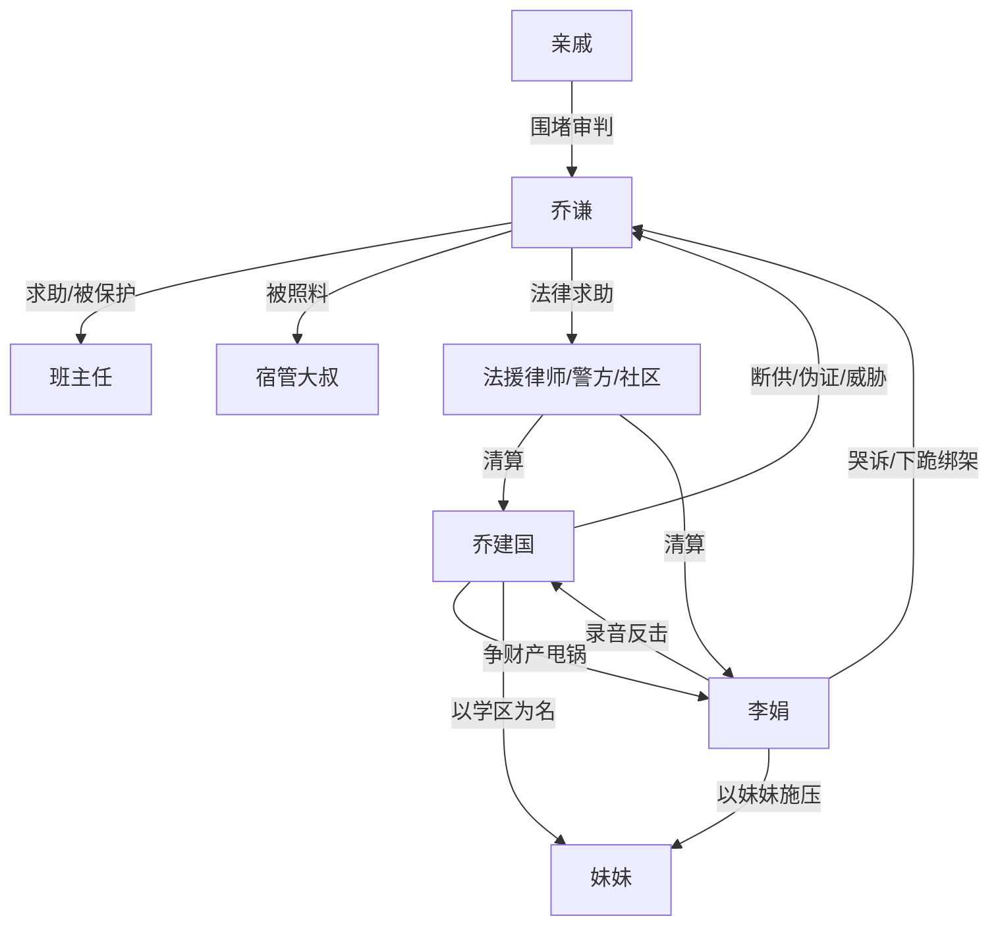

# 角色标签图谱

## 角色清单

### 乔谦 — 清醒高考生/被牺牲的哥哥
- 叙事功能: 第一人称主角，承受家庭压迫并完成证据反杀。
- 核心标签: 清醒、克制、证据意识强
- 弧光: 期待父母回头 → 亲手掐死期待 → 独立掌控人生
- 台词风格: 短句、反问、事实陈述
- 关键行为: 走进资助办、报警、录音截图、拒签谅解、公开事实
- 读者情绪关系: 心疼、代入、爽

### 乔建国（父亲） — 伪善算计型父权反派
- 叙事功能: 主要施害者，推动断供、换锁、扣证件、伪造签名。
- 核心标签: 算计、甩锅、父权压迫
- 弧光: 掌控家庭资源 → 伪证失败 → 被处分和执行
- 台词风格: “为你好”包装威胁，常用反咬和道德压迫
- 关键行为: 假离婚转存款、换锁、伪造声明、推责给妻子
- 读者情绪关系: 恨、想看清算

### 李娟（母亲） — 哭诉绑架型偏心母亲
- 叙事功能: 用眼泪、妹妹和母职苦难对主角施压。
- 核心标签: 偏心、软刀子、投机
- 弧光: 抱妹妹哭诉 → 校门下跪逼迫 → 被推出去背锅 → 迟来悔意
- 台词风格: 哭腔、诉苦、以“小的更需要”为核心逻辑
- 关键行为: 断供配合、校门下跪、提供父亲录音换条件
- 读者情绪关系: 厌恶、复杂、拒绝原谅

### 妹妹 — 资源争夺的无辜锚点
- 叙事功能: 被父母用作牺牲哥哥的理由。
- 核心标签: 婴儿、学区、道德挡箭牌
- 弧光: 被父母拿来争资源 → 学区排序取消 → 失去捷径
- 台词风格: 无
- 关键行为: 无主动行为，被抱到校门口制造舆论压力
- 读者情绪关系: 不恨本人，恨父母借她压迫主角

### 班主任 — 正义成年人/守护者
- 叙事功能: 给主角制度支持，证明世界不全是家庭压迫。
- 核心标签: 负责、敏锐、护短
- 弧光: 发现异常 → 陪同报警补证 → 公开支持
- 台词风格: 简洁有力
- 关键行为: 联系派出所、教务处、招办、法援律师
- 读者情绪关系: 安慰、信任、暖

### 宿管大叔 — 底层善意补偿者
- 叙事功能: 用具体照料对照父母冷漠。
- 核心标签: 朴素、可靠、温暖
- 弧光: 给被褥 → 考点递水 → 大学后叮嘱吃饭
- 台词风格: 生活化短句
- 关键行为: 收留、作证、关心吃饭
- 读者情绪关系: 心暖、补偿感

### 亲戚群体 — 群体性压迫放大器
- 叙事功能: 扩大羞辱面，展示“懂事哥哥”规训。
- 核心标签: 自私、势利、旁观施压
- 弧光: 围堵指责 → 伪证失败后闭嘴
- 台词风格: 道德评判、利益暴露
- 关键行为: 劝退学、围堵学校、转发长文
- 读者情绪关系: 厌烦、想看闭嘴

## 关系网络

## 角色功能对照表（供改编参考）

| 原角色 | 极致标签 | 叙事功能 | 读者情绪功能 | 改编时必须保留的 |
|--------|---------|---------|-------------|---------------|
| 乔谦 | 清醒牺牲品 | 主角与证据持有人 | 心疼、爽 | 未成年/弱势关键期、主动求助、拒绝和解 |
| 乔建国 | 算计父权 | 主谋反派 | 恨 | 断供、伪证、把压迫说成教育 |
| 李娟 | 哭诉偏心母 | 情感绑架者 | 厌恶、复杂 | 抱小的压大的、迟来悔意不被赦免 |
| 妹妹 | 无辜资源锚 | 冲突理由 | 分辨道德坐标 | 不让主角恨婴儿，而是恨规则 |
| 班主任 | 正义成年人 | 制度入口 | 安慰 | 具体行动支持，不空口安慰 |
| 宿管大叔 | 朴素善意 | 生活补偿 | 暖 | 饭、被子、水等物件照料 |
| 亲戚 | 群体压迫 | 舆论压力 | 憋屈 | 劝退学、说自私、利益暴露 |
