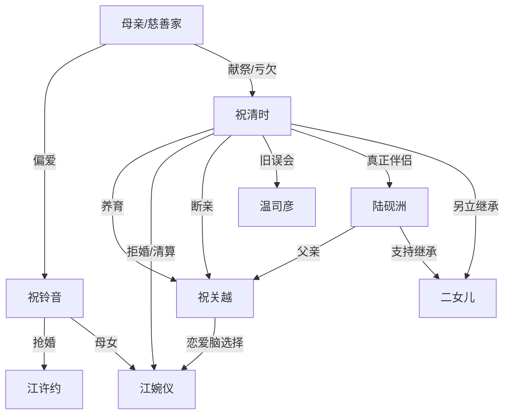

# 角色标签图谱

## 角色清单

### 祝清时/暖暖 — 清醒复仇女总裁
- 叙事功能: 受害者、复仇执行者、道德坐标中心
- 核心标签: 冷静、掌权、不原谅
- 弧光: 被母亲献祭的女儿 → 祝氏掌门人 → 拒绝亲情绑架的胜利者
- 台词风格: 短句、反问、冷淡
- 关键行为: 拒绝江婉仪、赶走旧人、与儿子断亲、另立二女儿、清算妹妹一家
- 读者情绪关系: 心疼、代入、爽

### 祝铃音 — 被偏爱的白莲妹妹
- 叙事功能: 原始施害者与被清算对象
- 核心标签: 夺位、装无辜、既得利益者
- 弧光: 穿上姐姐婚纱的胜利者 → 为女儿跪求的失败者
- 台词风格: 指责式、受害者姿态
- 关键行为: 抢走婚姻、纵容女儿嫁入祝家、跪求女主放过
- 读者情绪关系: 恨、厌恶、等报应

### 母亲 — 偏心慈善家
- 叙事功能: 最大伦理压迫源
- 核心标签: 对外慈善、对内献祭、偏心
- 弧光: 造谣下药毁女儿 → 下跪求情 → 临终仍为妹妹求情
- 台词风格: 道歉中带控制，温情称呼包裹偏心
- 关键行为: 订婚造谣、婚前下药、逼女主原谅妹妹
- 读者情绪关系: 最核心恨点

### 江许约 — 错过真相的旧未婚夫
- 叙事功能: 旧伤证明者、妹妹阵营支撑者
- 核心标签: 迟钝、偏袒、迟来道歉
- 弧光: 误信陷害娶妹妹 → 为母女求情 → 迟来道歉
- 台词风格: 劝和、补偿、旧情牌
- 关键行为: 抛弃女主、为江婉仪求婚事、最后道歉
- 读者情绪关系: 遗憾、轻蔑

### 温司彦 — 自我感动的旧男友
- 叙事功能: 误会线与真父亲反转的铺垫
- 核心标签: 自恋、误判、执念
- 弧光: 误以为被女主暗算 → 以为孩子是自己 → 发现自己不是核心
- 台词风格: 施舍式深情
- 关键行为: 两次求组建家庭、误认祝关越
- 读者情绪关系: 荒诞、讽刺

### 祝关越 — 恋爱脑背刺儿子
- 叙事功能: 女主二次触底的制造者
- 核心标签: 被养大的儿子、既得利益赌徒、冷漠
- 弧光: 孝顺儿子 → 为江婉仪断亲 → 继承权落空后求回头
- 台词风格: 先温顺后冷淡，失败后哀求
- 关键行为: 当众牵江婉仪、签断亲协议、继承权落空后反悔
- 读者情绪关系: 心寒、愤怒、看他悔

### 江婉仪 — 复制版妹妹
- 叙事功能: 代际循环的触发器
- 核心标签: 名媛女儿、被宠坏、胜利者笑容
- 弧光: 准儿媳候选 → 当众受拒 → 资源散尽
- 台词风格: 礼貌外壳下带挑衅
- 关键行为: 被拒后哭诉、招亲会胜利挑衅
- 读者情绪关系: 厌恶、等打脸

### 陆砚洲 — 迟到二十年的稳定补偿
- 叙事功能: 女主情感与继承后手
- 核心标签: 长情、强者、尊重女主
- 弧光: 被女主抛下的恋人 → 等待二十年 → 成为真正伴侣
- 台词风格: 轻松、调侃、站队明确
- 关键行为: 二十年发消息、与女主同居结婚、支持二女儿继承
- 读者情绪关系: 补偿、安心、甜

### 二女儿 — 继承权反杀载体
- 叙事功能: 打破祝关越“唯一继承人”幻想
- 核心标签: 年轻能干、隐藏继承人、女儿继位
- 弧光: 后台存在 → 被宣布为继承人
- 台词风格: 原文未直接展开
- 关键行为: 成为陆祝继承人
- 读者情绪关系: 爽、补偿

## 关系网络

## 角色功能对照表（供改编参考）

| 原角色 | 极致标签 | 叙事功能 | 读者情绪功能 | 改编时必须保留的 |
|--------|---------|---------|-------------|---------------|
| 祝清时 | 清醒复仇女总裁 | 复仇主轴 | 心疼与爽 | 冷静、不原谅、掌权 |
| 母亲 | 偏心慈善家 | 原罪制造者 | 最大恨点 | 对外善、对内恶 |
| 祝铃音 | 被偏爱的妹妹 | 既得利益者 | 等报应 | 抢走女主原有位置 |
| 祝关越 | 背刺儿子 | 二次伤害 | 心寒与清算爽 | 女主亲手养大却背叛 |
| 江婉仪 | 复制版女儿 | 代际循环触发器 | 厌恶 | 得胜笑容像母亲 |
| 陆砚洲 | 长情强者 | 补偿与后手 | 安心 | 二十年等待、尊重女主 |
| 二女儿 | 隐藏继承人 | 继承权反杀 | 爽点 | 打破唯一继承人幻想 |
