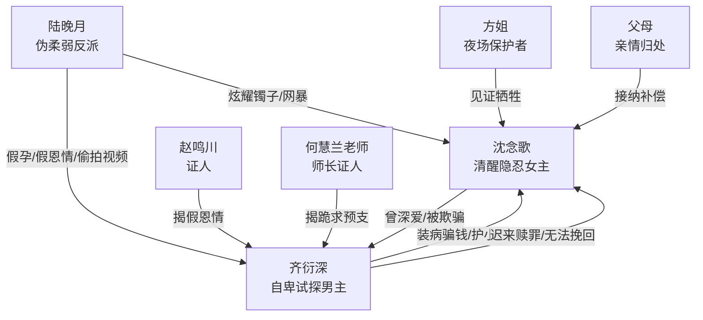

# 角色标签图谱

## 角色清单

### 沈念歌 — 清醒隐忍型受害者/自我重建大女主

- 叙事功能: 情绪承压核心、读者代入对象、最终价值坐标。
- 核心标签: 克制、深情、清醒
- 弧光: 为爱牺牲到失去尊严 → 看清骗局主动切割 → 重回钢琴与家庭
- 台词风格: 短、稳、冷，不控诉但句句定罪
- 关键行为: 夜场驻唱、交出嫁妆、拒签协议、删除照片、离开、拒绝回头、面试成功
- 读者情绪关系: 心疼、敬佩、替她不值，后期获得爽感补偿

### 齐衍深 — 自卑试探型伤害者/迟到追悔男主

- 叙事功能: 主要情绪债制造者，也是后半追悔偿还载体。
- 核心标签: 自卑、控制、迟钝
- 弧光: 装病试探爱意并纵容小三 → 女主离开后失控 → 真相揭开后赎罪但不可挽回
- 台词风格: 前期高位命令，后期低哑、沉默多
- 关键行为: 装病骗钱、护陆晚月、威胁女主工作、寻找女主、赎回嫁妆、清算陆晚月
- 读者情绪关系: 前期恨，后期看其追悔获得偿债爽感，但不期待复合

### 陆晚月 — 伪柔弱绿茶/操控型反派

- 叙事功能: 外部反派、推动男主恶念外化、承载 M3 反噬。
- 核心标签: 假孕、假恩情、表演型柔弱
- 弧光: 戴女主镯子炫耀 → 借怀孕与恩情夺位 → 真相败露被清算网暴
- 台词风格: “姐姐”式柔弱、装无辜，败露后变冷硬
- 关键行为: 占用女主钱财、挑衅女主、安排偷拍、编救命之恩、假怀孕
- 读者情绪关系: 强恨点，后期反噬带来直接爽点

### 赵鸣川 — 迟来证人/真相转述者

- 叙事功能: 男主圈层内部证人，负责揭开“装病主意”和“假恩情”。
- 核心标签: 犹豫、知情、补证
- 弧光: 吞吐回避 → 查档案 → 劝醒齐衍深
- 台词风格: 直白、兄弟间质问
- 关键行为: 透露陆晚月问题、查旧档案、告知女主后续
- 读者情绪关系: 工具性可信人物，缓和信息来源单薄问题

### 方姐 — 底层互助者/现实保护人

- 叙事功能: 夜场线见证者，提供现实温度和关键证词。
- 核心标签: 爽利、心软、看得清
- 弧光: 劝女主别撑 → 给包子 → 后期怼齐衍深
- 台词风格: 口语、直接
- 关键行为: 塞钱、递水、给包子、告知齐衍深女主受过的苦
- 读者情绪关系: 小补偿、小温暖

### 何慧兰老师 — 师长保护者/道德证人

- 叙事功能: 连接女主职业尊严与家庭困境，替女主说出她没说的苦。
- 核心标签: 正直、护短、见证
- 弧光: 提醒偷拍视频 → 骂醒齐衍深 → 转达女主拒收嫁妆
- 台词风格: 严厉、事实砸脸
- 关键行为: 告知网暴、揭女主跪经理筹钱、替女主传话
- 读者情绪关系: 替读者骂出部分愤怒

### 女主父母 — 亲情补偿线

- 叙事功能: 结尾补偿与归属，证明女主不是只剩爱情。
- 核心标签: 沉默、疼爱、家庭根系
- 弧光: 被女主隐瞒苦难 → 接纳她回家 → 收下欠债补偿
- 台词风格: 少而重
- 关键行为: 做一桌菜、父亲说“回来就好”
- 读者情绪关系: 温暖、补偿、落地

## 关系网络

## 角色功能对照表（供改编参考）

| 原角色 | 极致标签 | 叙事功能 | 读者情绪功能 | 改编时必须保留的 |
|--------|---------|---------|-------------|---------------|
| 沈念歌 | 清醒隐忍女主 | 承压与重建 | 心疼、爽、释然 | 克制、职业尊严、最终不回头 |
| 齐衍深 | 自卑试探男主 | 制造债务与追悔偿债 | 恨、看追悔 | 装病/试探/选择性相信必须保留 |
| 陆晚月 | 伪柔弱绿茶 | 外部反派与反噬载体 | 恨、清算爽 | 假柔弱、假关键身份、镜像反噬 |
| 赵鸣川 | 迟来证人 | 揭真相 | 推动反转可信度 | 内部档案/证据来源 |
| 方姐 | 底层保护人 | 见证苦难 | 温暖、替女主作证 | 现实互助与一句怼男主 |
| 何慧兰 | 师长证人 | 揭隐藏牺牲 | 替读者审判 | “你不知道她吃了多少苦”的证据段 |
| 父母 | 亲情补偿 | 女主归属 | 暖爽 | 结尾必须有非爱情补偿 |
