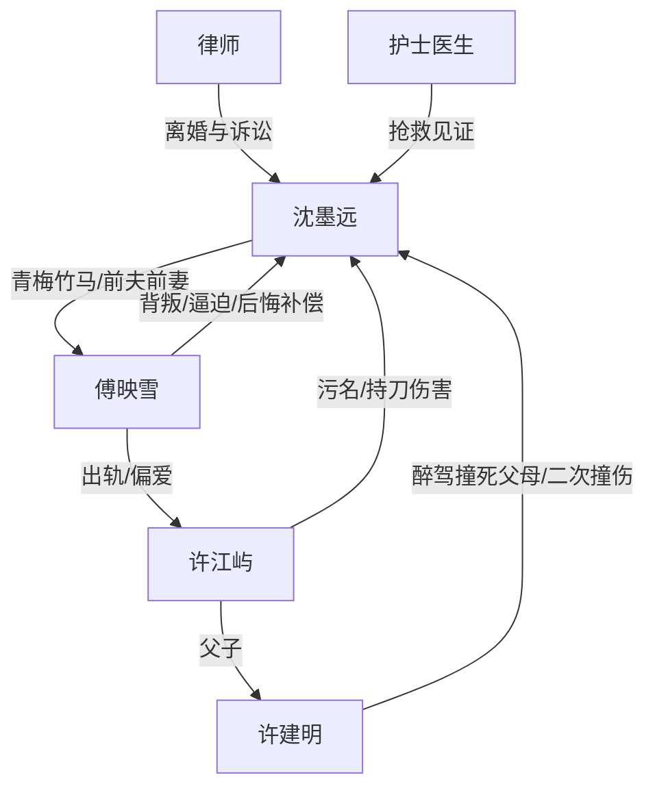

# 角色标签图谱

## 角色清单

### 沈墨远 — 创伤清醒男主/被背叛的救赎依赖者
- 叙事功能: 情绪承受体、道德中心、最终精神反杀者。
- 核心标签: 抑郁创伤、深情、清醒断舍离
- 弧光: 依赖傅映雪活着 → 被彻底摧毁 → 为自己求生 → 拒绝旧爱 → 重获人生
- 台词风格: 前期崩溃质问，后期冷静短句。
- 关键行为: 曝光许江屿、拒签离婚、被逼吃蛋糕后主动离婚、车祸后自己签手术、报警、最终拒绝复合。
- 读者情绪关系: 心疼、憋屈、期待他活下来并离开。

### 傅映雪 — 变心救赎者/迟来悔恨火葬场女主
- 叙事功能: 亲密关系施害者、温度反转核心、追妻火葬场承担者。
- 核心标签: 曾深爱、背叛、强势悔恨
- 弧光: 救命爱人 → 冷酷背叛者 → 误判真心 → 清算许家 → 求复合失败 → 终身困在过去
- 台词风格: 前期冷硬警告，后期低姿态忏悔。
- 关键行为: 出轨、护许江屿、逼吃蛋糕、拒签手术、暴打许父、替沈墨远挡刀。
- 读者情绪关系: 恨、复杂、期待悔不当初。

### 许江屿 — 绿茶小三/替代品反派
- 叙事功能: 引爆背叛、制造污名、推动傅映雪误判与醒悟。
- 核心标签: 装可怜、恶毒、贪婪
- 弧光: 被偏爱的小三 → 借势欺辱 → 求救暴露 → 被抛弃 → 持刀崩溃
- 台词风格: 前期挑衅炫耀，后期哭求撒泼。
- 关键行为: 上床挑衅、假跳楼、公开污名、炫耀偷情、求救许父、拿怀孕报告逼宫、持刀杀人。
- 读者情绪关系: 恨、厌恶、期待被抛弃。

### 许建明 — 酒驾恶父/因果债源头
- 叙事功能: 原始伤害制造者，二次车祸推动法律清算。
- 核心标签: 酒驾、无耻、逃逸
- 弧光: 撞死父母 → 被提前捞出 → 二次撞人 → 供认故意 → 重判
- 台词风格: 推责、贪婪、无底线。
- 关键行为: 醉驾撞死沈父母、二次撞沈墨远、逃逸、试图出国。
- 读者情绪关系: 强恨点，必须法律重惩。

### 律师/护士/医生 — 外部秩序见证者
- 叙事功能: 证明沈墨远不是孤立无援，提供手续、法律、医疗秩序。
- 核心标签: 公正、见证、辅助
- 弧光: 工具型角色
- 台词风格: 简洁功能性。
- 关键行为: 办离婚、跟进案件、告知病危、协助签字。
- 读者情绪关系: 提供喘息与正义感。

## 关系网络

## 角色功能对照表（供改编参考）

| 原角色 | 极致标签 | 叙事功能 | 读者情绪功能 | 改编时必须保留的 |
|--------|---------|---------|-------------|---------------|
| 沈墨远 | 创伤清醒男主 | 承压与断舍离 | 心疼、爽 | 从依赖到不要的弧光 |
| 傅映雪 | 背叛救赎者 | 温度反转 | 恨与悔 | 曾经真爱、现在亲手伤害、后期悔恨 |
| 许江屿 | 绿茶小三 | 外部挑衅 | 恨 | 装弱、挑衅、反噬 |
| 许建明 | 原罪恶父 | 因果债源 | 怒 | 原始伤害与二次伤害 |
| 律师/护士 | 秩序见证 | 托底 | 安心 | 法律/医疗证明主角求生 |
