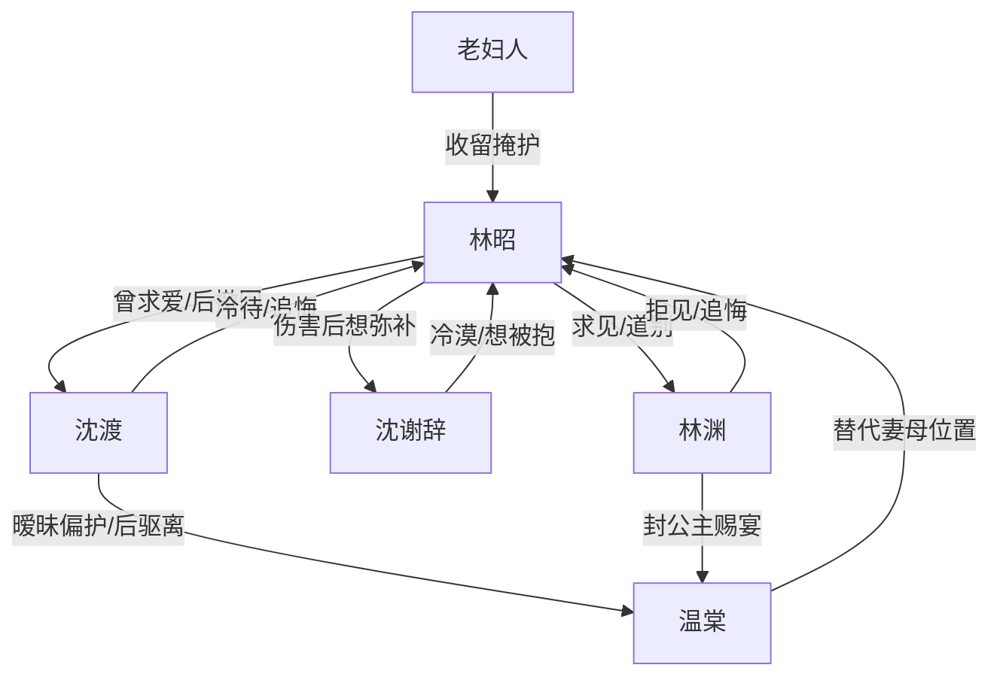

# 角色标签图谱

## 角色清单

### 林昭 — 清醒出走的瘫痪长公主
- 叙事功能: 受压者、自我觉醒者、火葬场触发器。
- 核心标签: 瘫痪、作过也醒了、不要迟来的爱。
- 弧光: 暴躁索爱 → 自责退让 → 主动离家 → 平静拒爱 → 独自重生。
- 台词风格: 前期小心讨好，后期短句清算。
- 关键行为: 同意纳妾、求修复关系、找镖局离开、假死脱身、拒绝沈渡。
- 读者情绪关系: 前期复杂，既心疼又知道她有错；后期强烈支持与爽感。

### 沈渡 — 迟来深情的冷淡夫君
- 叙事功能: 爱情线施害者、火葬场主体。
- 核心标签: 将军、责任式温柔、失去后追悔。
- 弧光: 冷待妻子 → 偏向温棠 → 失踪后崩塌 → 跪求复合 → 永远等不到。
- 台词风格: 前期质问冷淡，后期沙哑低姿态。
- 关键行为: 带回温棠、雷夜离开、忽略镖局名帖、追到豆腐坊下跪。
- 读者情绪关系: 前期恨，后期有限心疼，但不希望他轻易被原谅。

### 沈谢辞 — 嘴硬缺爱的八岁儿子
- 叙事功能: 母职情绪债、亲情火葬场。
- 核心标签: 早熟、冷脸、想被抱抱。
- 弧光: 被打后冷漠讽刺 → 母亲失踪后崩溃 → 承认不恨她。
- 台词风格: 一板一眼，像小大人。
- 关键行为: 躲开母亲、护住温棠小木马、摸车辙落泪、求父亲找母亲。
- 读者情绪关系: 既心疼他被打，也心疼他想要母爱。

### 林渊 — 厌妹后悔的皇帝哥哥
- 叙事功能: 血亲线施害者，扩大女主被世界抛弃的量级。
- 核心标签: 皇权、童年承诺、亲手推开妹妹。
- 弧光: 拒见妹妹 → 给温棠赐宴 → 失踪后撕折子找人。
- 台词风格: 前期通过太监冷传话，后期命令式崩溃。
- 关键行为: 拒绝生辰、封温棠公主、宫门隔绝、下旨搜寻。
- 读者情绪关系: 恨其无情，爽于其迟来悔恨。

### 温棠 — 温柔替代型女主位
- 叙事功能: 替代威胁、外部比较尺、推动林昭死心。
- 核心标签: 军医、温柔、上位阴影。
- 弧光: 被弹幕捧成女主 → 占据妻母位置 → 试图借丧事推进 → 被沈渡拒绝。
- 台词风格: 柔、轻、貌似体贴。
- 关键行为: 给沈谢辞上药、接受公主封赏、劝沈渡节哀。
- 读者情绪关系: 前期压迫感，后期被打脸产生爽感。

### 豆腐坊老妇人 — 女性互助的渡口
- 叙事功能: 新世界接引者、反向母性、女主重生证明。
- 核心标签: 清醒、仗义、被辜负过。
- 弧光: 收留林昭 → 掩护搜查 → 帮她再逃。
- 台词风格: 粗粝、直接、温暖。
- 关键行为: 给住处、挡副将、雇马车。
- 读者情绪关系: 安心、温暖、补偿。

## 关系网络

## 角色功能对照表（供改编参考）

| 原角色 | 极致标签 | 叙事功能 | 读者情绪功能 | 改编时必须保留的 |
|--------|---------|---------|-------------|---------------|
| 林昭 | 清醒出走的瘫痪长公主 | 主角/债务承受者 | 心疼、支持、爽 | 她有错但不该被彻底抛弃；最终不回头 |
| 沈渡 | 迟来深情夫君 | 爱情施害者 | 恨、火葬场爽 | 曾经爱过、后来冷待、跪求无果 |
| 沈谢辞 | 嘴硬缺爱儿子 | 母职债务 | 心疼、刺痛 | “我想让她抱抱我”的真实需求 |
| 林渊 | 厌妹皇兄 | 血亲背叛 | 羞辱感、追悔爽 | 拒绝生辰却给替代者荣耀 |
| 温棠 | 温柔替代者 | 对照与压迫 | 厌烦、打脸爽 | 占位妻母身份，不必写成纯恶毒 |
| 老妇人 | 女性互助者 | 新生活证明 | 温暖、补偿 | 给女主“外面也能活”的证据 |
