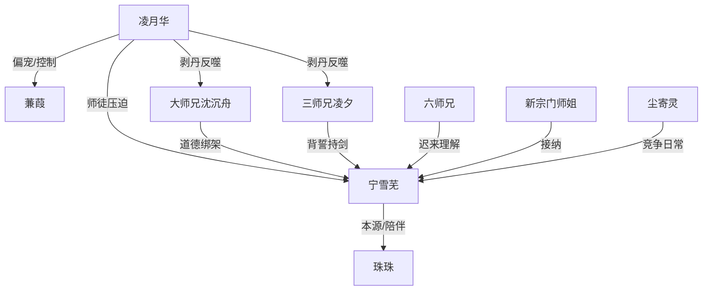

# 角色标签图谱

## 角色清单

### 宁雪芜 — 被献祭的清醒护宗天才
- 叙事功能: 主角、情绪债承受者、清算执行者。
- 核心标签: 护宗功臣、拿命换强、冷静断情。
- 弧光: 信任宗门 → 痛心解释 → 彻底斩断 → 找到真正归属。
- 台词风格: 短句质问，冷静反讽，关键时刻一字一句。
- 关键行为: 夺回本命珠、指认“邪修”、毁宗断灵脉、击败凌月华、拒绝回救旧宗门。
- 读者情绪关系: 心疼、代入、爽。

### 凌月华 — 伪慈悲的偏执师尊
- 叙事功能: 最大压迫者，旧宗门价值观代表。
- 核心标签: 道德绑架、偏心、虚浮权威。
- 弧光: 冷冽护小师妹 → 继续索珠 → 被击败 → 邪修伏诛。
- 台词风格: 师尊权威腔，先压制后软化，最后疯魔自证。
- 关键行为: 借珠给蒹葭、压下女主委屈、拦路夺珠、剥弟子本命珠。
- 读者情绪关系: 恨、厌恶、期待报应。

### 蒹葭 — 吸血小师妹
- 叙事功能: 夺珠事件的直接受益者，师门偏心的投射物。
- 核心标签: 凡人贪婪、坐享其成、挑衅。
- 弧光: 被众星捧月 → 失去本命珠 → 贪求更多 → 爆体而亡。
- 台词风格: 撒娇、哭闹、尖利索取。
- 关键行为: 使用女主本命珠、嫌弃其他本命珠、推动凌月华继续作恶。
- 读者情绪关系: 恨、轻蔑、等她反噬。

### 三师兄凌夕 — 背誓者与报应见证人
- 叙事功能: 旧情反差载体、后期报应讲述者。
- 核心标签: 忘恩、怯懦、迟来求救。
- 弧光: 曾承诺保护女主 → 持剑逼女主献珠 → 自献珠被嫌弃 → 落魄求救。
- 台词风格: 前期冲动强硬，后期哭求卑微。
- 关键行为: 用女主赠剑指她咽喉，后向女主讲述旧宗门惨状。
- 读者情绪关系: 恨后转为报应快感。

### 大师兄沈沉舟 — 大局观受害者
- 叙事功能: 将“为大局牺牲别人”的逻辑反噬到自身。
- 核心标签: 伪理性、权衡、被剥丹。
- 弧光: 逼女主为宗门未来献珠 → 自己第一个被剥本命珠。
- 台词风格: 温和包装强迫。
- 关键行为: 支持留下女主本命珠，后来反对剥弟子却无力。
- 读者情绪关系: 爽点对象。

### 六师兄 — 残余旧情的试金石
- 叙事功能: 给女主最后一次解释机会，缓冲女主转狠。
- 核心标签: 迟钝、尚有愧意、旧温情残影。
- 弧光: 用馄饨试图劝说 → 听懂真相 → 道歉。
- 台词风格: 犹豫、无措。
- 关键行为: 问出“为何不为蒹葭牺牲”，促使女主完整解释夺珠伤害。
- 读者情绪关系: 轻微遗憾，不是主要恨点。

### 珠珠 — 女主本源与童真残片
- 叙事功能: 具象化女主被伤害的本源，也承担治愈收束。
- 核心标签: 本命珠灵体、受害者、陪伴。
- 弧光: 腹中暗淡 → 丹田休养 → 活泼陪伴女主。
- 台词风格: 几乎无台词，以动作呈现。
- 关键行为: 被夺、被救、结尾撞进尘寄灵怀里。
- 读者情绪关系: 心疼、治愈。

### 新宗门师姐/尘寄灵 — 新归属的烟火气
- 叙事功能: 给女主提供健康关系与轻松日常。
- 核心标签: 热情、八卦、竞争但护短。
- 弧光: 邀女主入宗 → 打听旧事 → 带来报应消息 → 日常比试。
- 台词风格: 活泼、直白。
- 关键行为: 邀请女主进入新宗门，带来旧宗门覆灭消息。
- 读者情绪关系: 放松、补偿、安心。

## 关系网络

## 角色功能对照表（供改编参考）

| 原角色 | 极致标签 | 叙事功能 | 读者情绪功能 | 改编时必须保留的 |
|--------|---------|---------|-------------|---------------|
| 宁雪芜 | 被献祭的护宗天才 | 承债与清算 | 心疼、爽 | 曾经主动牺牲，后来冷静收回 |
| 凌月华 | 伪慈悲师尊 | 最大压迫者 | 恨、等报应 | 权威口吻与最终邪修化 |
| 蒹葭 | 吸血小师妹 | 受益者/导火索 | 恨、轻蔑 | 坐享其成且嫌弃普通补偿 |
| 凌夕 | 背誓师兄 | 旧情反差/报应信使 | 爽 | 曾受女主恩惠，后用恩物伤她 |
| 沈沉舟 | 大局观师兄 | 因果回旋靶点 | 爽 | “为大局牺牲别人”回到自己身上 |
| 珠珠 | 本源灵体 | 伤害具象化 | 心疼、治愈 | 必须可见、可怜、后期恢复 |
| 新宗门同门 | 健康关系 | 价值补偿 | 安心 | 竞争但对外团结 |
