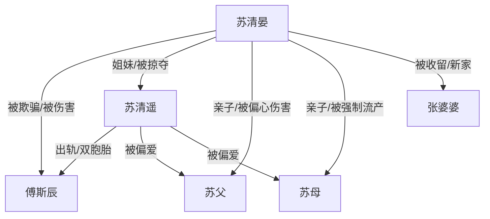

# 角色标签图谱

## 角色清单

### 苏清晏 — 清醒断亲女主
- 叙事功能: 承受压迫、积累情绪债、最终用证据和拒绝完成清算。
- 核心标签: 被背叛、失子创伤、清醒自救
- 弧光: 自责寻亲的受害者 → 跳车假死的逃生者 → 法律断亲的自由人
- 台词风格: 前期质问崩溃，后期冷静短句
- 关键行为: 贴寻人启事、拒绝回家、跳车、保存证据、报警
- 读者情绪关系: 心疼、代入、爽

### 傅斯辰 — 伪温柔背叛丈夫
- 叙事功能: 婚姻背叛与温度反转核心承载者。
- 核心标签: 假深情、纵容者、追悔者
- 弧光: 温柔安抚者假象 → 出轨施压者 → 恐慌追悔者 → 被清算者
- 台词风格: 前期道德绑架，后期哀求补偿
- 关键行为: 办假结婚证、藏妹妹、踢打女主、婚礼公开证据、强行带人
- 读者情绪关系: 恨、恶心、看他后悔的爽

### 苏清遥 — 绿茶掠夺型妹妹
- 叙事功能: 所有创伤的直接诱因和挑拨者。
- 核心标签: 绿茶、掠夺者、恶毒妹妹
- 弧光: 被偏爱的假失踪者 → 婚礼准新娘 → 精神病院囚徒
- 台词风格: 装无辜、阴阳怪气、嫁祸
- 关键行为: 假失踪、抢丈夫、刺激流产、雇人绑架、挑唆父母
- 读者情绪关系: 极恨，期待报应

### 苏父 — 偏心权威父亲
- 叙事功能: 家庭父权压迫与羞辱执行者。
- 核心标签: 偏心、冷酷、控制
- 弧光: 忽视女主 → 辱骂女主 → 短暂悲伤后冷漠 → 被铐走
- 台词风格: 命令式、羞辱式
- 关键行为: 逼让资源、羞辱不孕、要送精神病院、强行带回
- 读者情绪关系: 恨，期待失权

### 苏母 — 伪善偏心母亲
- 叙事功能: 生育伤害的关键施害者。
- 核心标签: 偏心、伪善、共犯
- 弧光: 逼流产者 → 轻描淡写者 → 悔恨找女 → 被清算
- 台词风格: “为了你好”的软压迫
- 关键行为: 强制流产、劝女主知足、寻人赎罪
- 读者情绪关系: 恨、寒心

### 张婆婆 — 补偿型善意亲人
- 叙事功能: 提供女主逃生后的安全场域和情感补偿。
- 核心标签: 善良、朴素、保护者
- 弧光: 救助陌生人 → 接纳女主 → 站在女主身边
- 台词风格: 温和朴实
- 关键行为: 收留女主、尊重女主选择、见证断亲
- 读者情绪关系: 安慰、补偿

## 关系网络

## 角色功能对照表（供改编参考）

| 原角色 | 极致标签 | 叙事功能 | 读者情绪功能 | 改编时必须保留的 |
|--------|---------|---------|-------------|---------------|
| 苏清晏 | 清醒断亲女主 | 承债与清算 | 心疼、爽 | 失去孩子/家庭骗局/最终拒绝 |
| 傅斯辰 | 伪温柔丈夫 | 温度反转 | 恨、看悔 | 曾经温柔必须可见 |
| 苏清遥 | 绿茶妹妹 | 直接施害 | 极恨 | 假失踪+抢夺+嫁祸 |
| 苏父 | 偏心父权 | 权威压迫 | 憋屈 | 羞辱和强制控制 |
| 苏母 | 伪善母亲 | 生育创伤 | 心寒 | 强制流产责任 |
| 张婆婆 | 补偿亲人 | 治愈收束 | 安慰 | 无条件接纳 |
