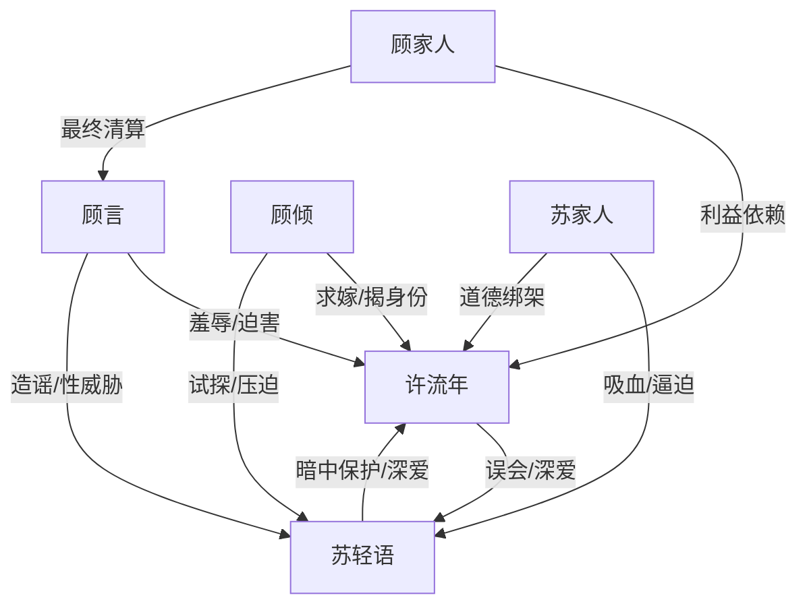

# 角色标签图谱

## 角色清单

### 许流年 — 隐忍赘婿大佬
- 叙事功能: 第一视角主角，承担被羞辱、被误会、身份爆发与最终清算。
- 核心标签: 赘婿、游戏资本家、海外佣兵公司掌控者
- 弧光: 用钱麻痹尊严 → 承认自己爱她 → 查明真相 → 以权力护妻
- 台词风格: 自嘲、短句、交易逻辑、冷酷清算
- 关键行为: 收钱让房、暗中调度公司、维护苏轻语、揭露佣兵身份、逼顾家杀顾言
- 读者情绪关系: 前期憋屈和心疼，中段爽，后段痛快与补偿

### 苏轻语 — 隐忍护夫女总裁
- 叙事功能: 伪反派/真爱人，制造全篇最大误会与后段泪点反转。
- 核心标签: 女总裁、护夫、创伤幸存者
- 弧光: 表面冷漠羞辱 → 暗中保护 → 精神崩溃 → 被主角重新守护
- 台词风格: 前期命令式、冷硬；真相后幼态依赖
- 关键行为: 资助许母、与许流年协议结婚、伪装顾言白月光、拒绝顾倾帮助、刺伤顾言
- 读者情绪关系: 先恨后心疼，最后希望她得到补偿

### 顾言 — 疯批施害白月光
- 叙事功能: 主压迫者，负责羞辱、性威胁、造谣和最终被清算。
- 核心标签: 伪白月光、性侵未遂者、权势寄生者
- 弧光: 傲慢羞辱 → 借势逼迫 → 被揭穿 → 被家人牺牲
- 台词风格: 讥讽、命令、炫耀、威胁
- 关键行为: 给钱让许流年下楼、逼绿发赴宴、造谣苏轻语爱他、对苏轻语动强
- 读者情绪关系: 强恨点，结尾死亡提供核心爽点

### 顾倾 — 高位见证者/身份揭露器
- 叙事功能: 外部权威，负责放大许流年价值并拆穿商圈误判。
- 核心标签: 京都顾氏掌权者、冷傲女强人、求嫁者
- 弧光: 高位入场 → 试探苏轻语 → 当众求嫁 → 替许流年揭身份
- 台词风格: 克制、直白、带上位者压迫感
- 关键行为: 提出舔鞋测试、公开求嫁、揭露佣兵公司护航真相
- 读者情绪关系: 爽点工具人，也制造修罗场紧张

### 苏家人 — 家庭吸血压迫群像
- 叙事功能: 展示苏轻语的内部压力，补足她“护不住许流年”的原因。
- 核心标签: 吸血亲族、甩锅者、利益至上
- 弧光: 指责许流年 → 逼他娶顾倾 → 被身份反转压制
- 台词风格: 刻薄、命令、道德绑架
- 关键行为: 责骂许流年，要求苏轻语离婚，逼许流年为苏家换资源
- 读者情绪关系: 厌恶，强化苏轻语孤立处境

### 顾家人 — 利益清算执行者
- 叙事功能: 将顾言的“利益规则”反向执行，完成 M3 终局。
- 核心标签: 家族利益、冷血、实用主义
- 弧光: 依仗顾言 → 被许流年威胁 → 亲手牺牲顾言
- 台词风格: 少言、服从压力
- 关键行为: 顾弟闷死顾言，顾父按住顾言身体
- 读者情绪关系: 恐惧与痛快并存

## 关系网络

## 角色功能对照表（供改编参考）

| 原角色 | 极致标签 | 叙事功能 | 读者情绪功能 | 改编时必须保留的 |
|--------|---------|---------|-------------|---------------|
| 许流年 | 隐忍赘婿大佬 | 被压迫者与清算者 | 憋屈、心疼、爽 | 表层低位 + 真实高位 + 爱而误会 |
| 苏轻语 | 隐忍护夫女总裁 | 最大误会与泪点 | 先恨后疼 | 日记/证据翻案，证明她一直在保护 |
| 顾言 | 疯批伪白月光 | 主反派 | 恨与清算爽 | 前期羞辱足够重，后期必须被利益反噬 |
| 顾倾 | 高位揭露器 | 身份背书 | 爽与修罗场 | 权威性、求嫁、揭穿主角资源 |
| 苏家人 | 吸血亲族 | 家庭压力 | 厌恶 | 利益化婚姻安排 |
| 顾家人 | 冷血利益体 | 终局执行 | 痛快 | 亲手杀顾言的利益闭环 |
