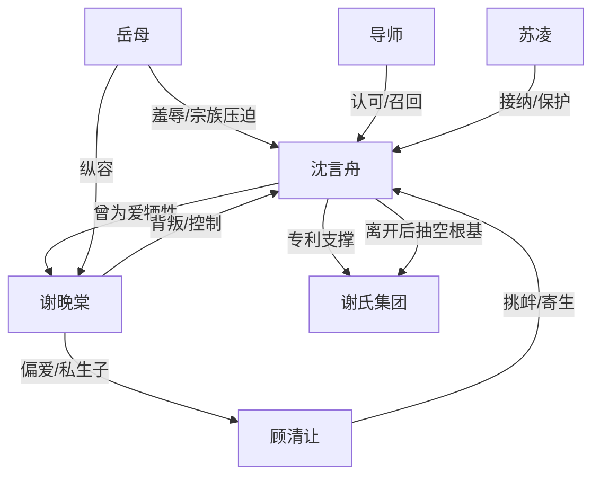

# 角色标签图谱

## 角色清单

### 沈言舟 — 清醒回归型科研男主

- 叙事功能: 受辱者、离场者、价值反杀者、主题承载者
- 核心标签: 科研天才、隐忍克制、自我重建
- 弧光: 谢家附属品 → 西北沈博士 → 自我价值定义者
- 台词风格: 短句、冷静、界限清晰
- 关键行为: 同意私生子入宗祠、递离婚协议、飞往西北、拒绝复合、科研获奖
- 读者情绪关系: 前半心疼，后半爽和敬佩

### 谢晚棠 — 膨胀背叛型女总裁

- 叙事功能: 核心施害者、温度反转对象、悔恨承担者
- 核心标签: 自负、虚伪、迟来悔恨
- 弧光: 掌控婚姻和公司 → 发现依赖男主 → 破产孤绝
- 台词风格: 前期命令式，后期哀求式
- 关键行为: 带私生子入宗祠、拒签离婚、偏袒情夫、追到西北求复合
- 读者情绪关系: 恨、厌、看她崩塌的爽感

### 顾清让 — 绿茶寄生型情夫

- 叙事功能: 刺激男主羞辱感，衬托谢晚棠虚伪，承担副线报应
- 核心标签: 装弱、挑衅、趋利
- 弧光: 被偏爱的情夫 → 破产后逃离 → 被新金主原配清算
- 台词风格: 人前谦卑，人后刻薄
- 关键行为: 抱孩子叫男主“沈哥”、商场挑衅、破产后抛弃孩子
- 读者情绪关系: 恶心、想看报应

### 岳母 — 势利宗族压迫者

- 叙事功能: 家族羞辱源，放大男主赘婿困境
- 核心标签: 香火执念、势利、冷血
- 弧光: 高高在上操控宗祠 → 中风瘫痪
- 台词风格: 慢条斯理的道德绑架
- 关键行为: 支持私生子认祖、羞辱男主无子、赠玉佩
- 读者情绪关系: 恨、期待失势

### 苏凌师兄/导师 — 正向价值见证者

- 叙事功能: 证明男主专业价值，提供新秩序接纳
- 核心标签: 尊重、专业、可靠
- 弧光: 接纳归队 → 见证男主重建
- 台词风格: 温和肯定
- 关键行为: 接机、介绍团队、保护男主不被谢晚棠纠缠
- 读者情绪关系: 暖、补偿感

## 关系网络

## 角色功能对照表（供改编参考）

| 原角色 | 极致标签 | 叙事功能 | 读者情绪功能 | 改编时必须保留的 |
|--------|---------|---------|-------------|---------------|
| 沈言舟 | 清醒科研男主 | 受辱后离场反杀 | 心疼→爽→敬佩 | 真实专业能力、平静离场、自我定义 |
| 谢晚棠 | 背叛女总裁 | 核心施害者 | 恨与看悔恨 | 曾爱过、后背叛、最终失去所有 |
| 顾清让 | 绿茶情夫 | 羞辱催化剂 | 恶心与副线爽点 | 人前装弱人后挑衅 |
| 岳母 | 势利家长 | 道德绑架源 | 厌恶 | 香火/继承/家族话术 |
| 导师/苏凌 | 正向见证者 | 价值认证 | 补偿与温暖 | 外部专业认可体系 |
