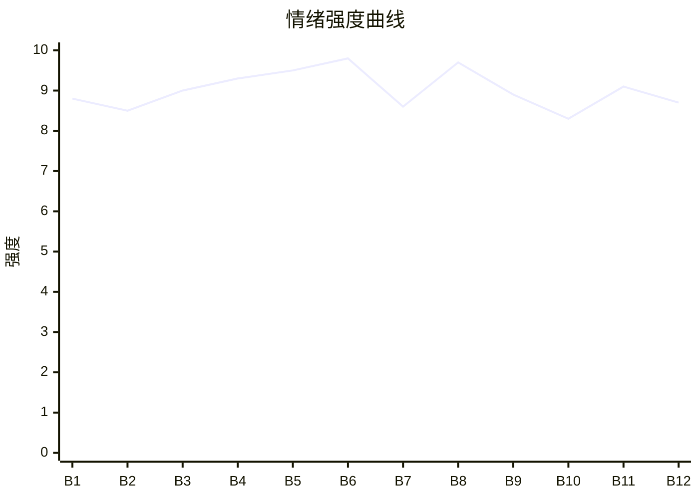

# Beat Sheet 节拍器

## 全文概况

- 总字数: 约 11200 字
- 节拍数: 12 幕
- 核心母题（Logline）: 女儿程初为了替枉死母亲讨回真相，面对假死十年、只信养妹不信妻女的首富父亲，在母亲尸骨浮现后完成真相反杀，并拒绝迟来的补偿。
- 情绪模式: 极致打压 → 母女双重濒死 → 真相铁证浮现 → 父亲悔疯清算 → 女主冷离场

## 节拍详表

### Beat 1: 状元打捞尸体，死去父亲现身 [开篇-第1章前段]

- **字数**: 约 950 字（占比 8.5%）
- **核心事件**: 高考状元程初在河边打捞母亲尸体，假死十年的父亲坐迈巴赫出现，宣布妻女通过测试。
- **情绪标签**: 震惊、荒诞、窒息
- **情绪强度**: 8.8/10
- **情绪方向**: ⚡突变
- **冲突类型**: 大转折
- **悬念钩子**: 母亲为什么会死在河里？父亲的“测试”到底造成了什么？
- **叙事速度**: 快
- **对话占比**: 38%
- **reversal_mechanism**: [M3, M5]
- **hook_strength**: 9.2/10
- **关键句**: “三年前，她为了给你买一块最好的墓地没日没夜打工，死在这条河里了。”
- **原文摘录**: 高考出分当天，记者为了采访全国状元，在河边找到了正在打捞尸体的我。死去十年的爸爸出现了。他从迈巴赫上走下来：“你妈十年未婚，你也考上了状元，果然都通过了我的测试。”我握着竹竿，茫然地看着他。“死了。”手中的打捞杆在掌心寸寸断裂，我抬眼，一字一顿：“三年前，她为了给你买一块最好的墓地没日没夜打工，死在这条河里了。”

### Beat 2: 小姑污蔑母女挥霍，父亲认定母亲刁难 [第1章中段]

- **字数**: 约 900 字（占比 8.0%）
- **核心事件**: 父亲声称留过遗产，小姑立刻栽赃母女挥霍，父亲相信并补充自己曾截断母亲升职机会。
- **情绪标签**: 憋屈、愤怒、心疼
- **情绪强度**: 8.5/10
- **情绪方向**: ↑上升
- **冲突类型**: 微冲突升级
- **悬念钩子**: 当年所谓遗产和母亲失业背后是谁动手？
- **叙事速度**: 中快
- **对话占比**: 45%
- **reversal_mechanism**: [M3, M5]
- **hook_strength**: null
- **关键句**: “当初听你的，截下她的升职机会是对的。”
- **原文摘录**: 小姑扯住我的胳膊，说母女挥霍遗产。爸爸点头：“还是你看得清楚，果然女人最了解女人。当初听你的，截下她的升职机会是对的。”我想起妈妈最早到岗、最晚下班，终于升职却第二天被辞退，还被冤枉赔光五年血汗钱。

### Beat 3: 结案书被撕，父亲举报女儿作弊 [第1章中后段]

- **字数**: 约 1100 字（占比 9.8%）
- **核心事件**: 程初拿出母亲死亡结案书，小姑撕毁；父亲为挽回公司名声，实名举报女儿高考作弊。
- **情绪标签**: 绝望、愤怒、无力
- **情绪强度**: 9.0/10
- **情绪方向**: ↑上升
- **冲突类型**: 大转折
- **悬念钩子**: 状元成绩会不会被毁？父亲还能做出什么？
- **叙事速度**: 快
- **对话占比**: 42%
- **reversal_mechanism**: [M3]
- **hook_strength**: null
- **关键句**: “为了高考的公正，请求将她的成绩，全部作废。”
- **原文摘录**: 我把发旧的警局结案书砸在他西装上：“你下去给妈妈道歉啊！”小姑一把撕成碎片，说比不上当年她做的死亡证明。小姑又质疑我没上高中不可能是状元。爸爸拨通教育局热线：“我是程氏集团总裁，也是考生程初的父亲，我实名举报我女儿高考作弊。”

### Beat 4: 舆论反噬，父亲转移战场砸外婆墓 [第1章后段]

- **字数**: 约 1050 字（占比 9.4%）
- **核心事件**: 记者追问父亲害死发妻与虐待女儿，父亲把程初拖到外婆墓地，用砸墓逼母亲现身。
- **情绪标签**: 惊惧、崩溃、恨
- **情绪强度**: 9.3/10
- **情绪方向**: ↑上升
- **冲突类型**: 大转折
- **悬念钩子**: 父亲会不会发现母亲真的不可能出现？
- **叙事速度**: 快
- **对话占比**: 34%
- **reversal_mechanism**: [M5]
- **hook_strength**: null
- **关键句**: “外婆的骨灰被爸爸全部倾倒在地上。”
- **原文摘录**: 记者问他是不是为掩盖害死发妻和虐待女儿的丑闻。爸爸攥住我的胳膊，把我扔进迈巴赫后座，带到外婆墓地。他说：“是你妈自己出来，还是要我动手逼她出来。”工作人员砸碎墓碑，外婆骨灰被全部倒在地上。

### Beat 5: 父亲短暂拒绝小姑，真凶贴脸告白 [第1章末段前]

- **字数**: 约 1150 字（占比 10.3%）
- **核心事件**: 小姑向父亲表白，父亲因旧日温情拒绝离婚；小姑转而向程初坦白自己推母亲入河并要用水下烟花毁尸。
- **情绪标签**: 错愕、恐惧、爆裂恨意
- **情绪强度**: 9.5/10
- **情绪方向**: ⚡突变
- **冲突类型**: 大转折
- **悬念钩子**: 程初如何阻止烟花炸毁母亲尸体？
- **叙事速度**: 快
- **对话占比**: 52%
- **reversal_mechanism**: [M5, M6]
- **hook_strength**: null
- **关键句**: “她好几次想游上来，都被我用石头砸下去了，头破血流。”
- **原文摘录**: 爸爸说不会和溪月离婚，因为当年母亲把他从地狱拉回来。小姑靠近我，用只有我能听见的声音说：“你知道吗，你妈是被我弄死的。”她说母亲在商场看见他们，要找父亲问明白，她就把母亲推进河里，用石头一次次砸下去。

### Beat 6: 天台坠河，母亲骸骨浮现 [第1章末]

- **字数**: 约 900 字（占比 8.0%）
- **核心事件**: 程初挟持小姑站上天台边缘，父亲救小姑刺伤程初，程初坠河；水下烟花炸开，母亲骸骨浮出。
- **情绪标签**: 绝望、牺牲、惊爆
- **情绪强度**: 9.8/10
- **情绪方向**: ⚡突变
- **冲突类型**: 大转折/付费卡点
- **悬念钩子**: 程初能否活下来？父亲会不会终于看见尸骨？
- **叙事速度**: 极快
- **对话占比**: 30%
- **reversal_mechanism**: [M6]
- **hook_strength**: null
- **关键句**: “就在我狠狠砸进河面的一瞬间，一具骸骨因为河底剧烈震动浮了上来。”
- **原文摘录**: 我箍着小姑站在高楼边缘：“现在我就是要去见妈妈，爸爸，你敢一起吗？”爸爸用水果刀扎穿我的手，把小姑拽回去。我失去平衡坠下。同一时间，水下烟花准点炸开，一具骸骨浮了上来，脖子上挂着妈妈从不摘下的定情项链。

### Beat 7: 父亲二次放弃女儿，回忆烟花温情 [第2章开篇]

- **字数**: 约 900 字（占比 8.0%）
- **核心事件**: 小姑劝父亲相信女儿是演戏，父亲下令不必报告救援；随后他想起母亲当年用仙女棒给他家的温暖。
- **情绪标签**: 心寒、迟疑、痛感
- **情绪强度**: 8.6/10
- **情绪方向**: ↓短降后蓄力
- **冲突类型**: 微冲突
- **悬念钩子**: 父亲的动摇会不会来得太晚？
- **叙事速度**: 中
- **对话占比**: 25%
- **reversal_mechanism**: [M5]
- **hook_strength**: null
- **关键句**: “人救没救上来都不用告诉我了。”
- **原文摘录**: 小姑说程初是故意抹黑报复。爸爸顿住，吩咐助理：“人救没救上来都不用告诉我了。”烟花炸开，他想起很多年前，母亲用加班换来的仙女棒陪他守岁，说以后会有十个、五十个、八十个春节。

### Beat 8: 骸骨身份确认，父亲彻底崩塌 [第2章 6]

- **字数**: 约 1150 字（占比 10.3%）
- **核心事件**: 助理报告河里浮尸，父亲看到项链与小腿旧伤，确认是溪月，抱着骸骨崩溃。
- **情绪标签**: 震撼、悔恨、痛快
- **情绪强度**: 9.7/10
- **情绪方向**: ↑爆发
- **冲突类型**: 大转折
- **悬念钩子**: 女儿是否还活着？父亲如何面对自己造成的结果？
- **叙事速度**: 中快
- **对话占比**: 28%
- **reversal_mechanism**: [M5, M6]
- **hook_strength**: null
- **关键句**: “这种不值钱的破玩意儿，除了她，还有谁会要。”
- **原文摘录**: 手下说尸体脖子上有夫人以前戴的项链。爸爸冲到河边，看见背面刻着两人姓氏首字母的廉价项链，又摸到骸骨小腿旧伤。那是母亲当年为他挡枪留下的。他跪下，抱着骸骨，嚎叫从喉咙里炸出来。

### Beat 9: 医院抢救，清北校长打脸作弊污蔑 [第2章 7-8前]

- **字数**: 约 1100 字（占比 9.8%）
- **核心事件**: 父亲送昏迷的程初抢救，小姑继续造谣；清北校长出现，用监控和自学事实证明程初清白。
- **情绪标签**: 爽、松动、迟来正义
- **情绪强度**: 8.9/10
- **情绪方向**: ↑上升
- **冲突类型**: 大转折
- **悬念钩子**: 父亲会不会真正查清小姑？
- **叙事速度**: 快
- **对话占比**: 46%
- **reversal_mechanism**: [M3, M6]
- **hook_strength**: null
- **关键句**: “你抛弃了十年的女儿，是一个真正的天才。”
- **原文摘录**: 小姑说我是因为作弊曝光才不想活。走廊尽头传来声音：“是谁说的，没上学，就考不了状元了？”清北校长播放考场监控，说举报成绩作废要有证据，又告诉父亲，我三年没上学是因交不起学费，一直用二手教材自学。

### Beat 10: 女儿拒绝父亲，父亲查清全部真相 [第2章 8后]

- **字数**: 约 850 字（占比 7.6%）
- **核心事件**: 程初醒来拒绝父亲触碰，质问他从来不信妻女；父亲查到小姑多年陷害。
- **情绪标签**: 冷、清醒、割裂
- **情绪强度**: 8.3/10
- **情绪方向**: →平稳带冷锋
- **冲突类型**: 微冲突
- **悬念钩子**: 小姑会被如何清算？
- **叙事速度**: 中
- **对话占比**: 48%
- **reversal_mechanism**: [M3, M5]
- **hook_strength**: null
- **关键句**: “我说了，你信吗？”
- **原文摘录**: 爸爸想摸我的脸，被我侧头避开。我说：“只是这次吗？从以前到现在，永远都是别人说什么，你就信什么。”他让助理查清妈妈的事。一个小时后，他捏得手机几乎裂开，说每一件事背后都有小姑手笔。我只问：“我说了，你信吗？”

### Beat 11: 小姑被反向送去美国地狱 [第2章 9前段]

- **字数**: 约 950 字（占比 8.5%）
- **核心事件**: 小姑仍求一亿送女儿去哈佛，父亲假意答应后揭穿真相，把母女送去美国遭受惩罚。
- **情绪标签**: 爽、寒意、清算
- **情绪强度**: 9.1/10
- **情绪方向**: ↑上升
- **冲突类型**: 大转折/清算
- **悬念钩子**: 程初是否会转告求救电话？
- **叙事速度**: 快
- **对话占比**: 55%
- **reversal_mechanism**: [M3]
- **hook_strength**: null
- **关键句**: “你们既然那么想去美国，我现在就送你们上路。”
- **原文摘录**: 小姑求父亲捐一亿给哈佛，让宁宁留学。爸爸笑着说没问题，又冷冷说：“站街女，怎么会需要房子。”他掐住小姑脖子，称所有事都知道了，最后把她们送走。小姑后来打电话求救，我安静听着，然后挂断。

### Beat 12: 股份补偿无效，女主不回头 [结尾]

- **字数**: 约 800 字（占比 7.1%）
- **核心事件**: 父亲把股份转给程初，长期守在学校和母亲墓地忏悔，程初始终不原谅，只为自己而活。
- **情绪标签**: 冷爽、余痛、解脱
- **情绪强度**: 8.7/10
- **情绪方向**: ↓冷收束
- **冲突类型**: 结局余波
- **悬念钩子**: 无，情绪闭环完成
- **叙事速度**: 慢
- **对话占比**: 18%
- **reversal_mechanism**: [M5, M8]
- **hook_strength**: null
- **关键句**: “最心疼爸爸的人，早就已经死了。而我以后只会为自己而活。”
- **原文摘录**: 爸爸为了补偿我，把所有股份转给我。每个周末他来学校等我，我都当他不存在。他后来常住在妈妈墓地旁，每天打扫，讲我的近况，一遍遍哭着说对不起。助理求我去看看他，我都拒绝了。最心疼爸爸的人，早就已经死了。而我以后只会为自己而活，再也不会回头。

## 情绪曲线可视化

## 节拍密度检测

- 平均每 933 字一个节拍
- 微冲突密度: 每 850 字一次
- 大转折密度: 每 1200 字一次
- 判定: 符合高频节拍器标准；转折间隔稳定，且每次升级都对应新证据或新伤害。

## 反转机制清单(Reversal Mechanisms)

| 机制 ID | 机制名 | 承载 Beat | 关键段落/金句 | 等价改编提示 |
|--------|--------|-----------|--------------|-------------|
| M3 | 因果回旋反讽 | Beat 1-3, 9-11 | “为了高考的公正，请求将她的成绩，全部作废。”→ 校长用监控反证；“我说了，你信吗？” | 施害者定下的规则必须反身应用，需保留至少一句高重复度回旋金句。 |
| M5 | 温度反转曲线 | Beat 1, 5, 7, 8, 12 | 仙女棒守岁、挡枪旧伤、廉价项链，最终变成父亲悔恨证据 | 温度正峰必须显式存在，归零有外部触发，谷底用具体行为体现。 |
| M6 | 多层递进反转 | Beat 5-9 | 小姑承认杀人 → 女主坠河 → 骸骨浮现 → 校长证明女主清白 | 层数不能少，反转量级需从个人冲突升到真相、舆论、未来命运。 |
| M8 | 道德模糊结尾 | Beat 12 | “而我以后只会为自己而活。再也不会回头。” | 胜利后必须处理代价，收尾留白，不写廉价团圆。 |
