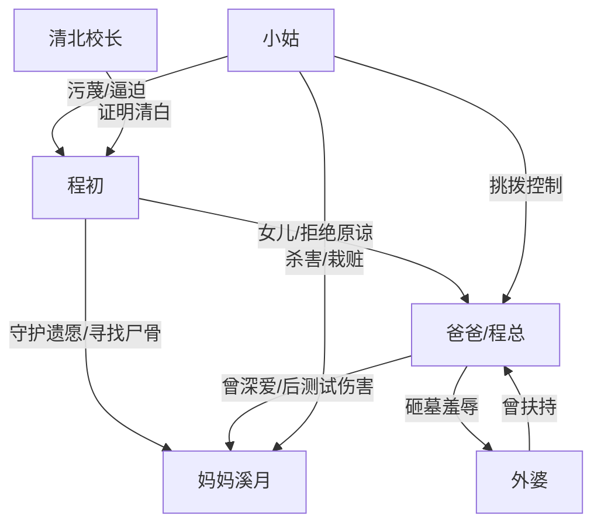

# 角色标签图谱

## 角色清单

### 程初 — 清醒孤女/冷拒绝型大女主

- 叙事功能: 受害者、真相持有人、情绪债见证者、最终裁决者
- 核心标签: 全国状元、打捞母尸、拒绝和解
- 弧光: 崩溃求信 → 以命逼真相 → 冷静接管人生
- 台词风格: 短句质问，少解释，关键处一针见血
- 关键行为: 打捞母亲、拿结案书、挟持小姑、拒绝父亲补偿
- 读者情绪关系: 心疼、代入、替她期待反击

### 爸爸/程总 — 偏执测试型父权悔罪者

- 叙事功能: 最大情绪债制造者、迟来悔恨承载者
- 核心标签: 首富、假死测试、只信养妹
- 弧光: 傲慢审判 → 持续误信 → 骸骨前崩塌 → 终身忏悔
- 台词风格: 居高临下、命令式、后期破碎求救
- 关键行为: 假死十年、截断妻子升职、举报女儿作弊、砸外婆墓、放弃救女、清算小姑
- 读者情绪关系: 恨与等他悔疯并存

### 妈妈/溪月 — 苦命圣母/唯一温暖源

- 叙事功能: 情绪核心、温度正峰、全篇被偿还的债
- 核心标签: 五份工、廉价项链、挡枪旧伤
- 弧光: 爱人救赎者 → 被测试牺牲者 → 尸骨证言者
- 台词风格: 回忆中温柔、坚定、带生活感
- 关键行为: 养家、照亮父亲人生、为父亲买墓地、被小姑害死
- 读者情绪关系: 极度心疼，是全篇道德坐标

### 小姑 — 恶毒养妹/寄生型施害者

- 叙事功能: 明面反派、持续栽赃者、父亲误判触发器
- 核心标签: 童养媳妄念、挑拨、杀人毁尸
- 弧光: 得宠操控者 → 真凶暴露 → 被送入地狱
- 台词风格: 装无辜、贴脸炫耀、哭求卖惨
- 关键行为: 提议假死测试、吞遗产、陷害母亲、推母亲入河、诱导烟花毁尸
- 读者情绪关系: 纯恨点，清算越狠越爽

### 清北校长 — 公信力裁判/降噪打脸者

- 叙事功能: 外部权威，证明女主清白
- 核心标签: 校长、导师、关门弟子
- 弧光: 突然介入 → 监控举证 → 抬高女主价值
- 台词风格: 稳、冷、有权威压迫感
- 关键行为: 播放监控，确认程初自学成才
- 读者情绪关系: 爽点工具人，帮助读者出一口气

### 外婆 — 家族恩情证据

- 叙事功能: 放大父亲忘恩负义程度
- 核心标签: 棺材本、墓地、骨灰
- 弧光: 生前扶持父亲 → 死后被辱
- 台词风格: 无直接台词
- 关键行为: 曾支持父亲创业
- 读者情绪关系: 加深恨点与不可原谅性

## 关系网络

## 角色功能对照表（供改编参考）

| 原角色 | 极致标签 | 叙事功能 | 读者情绪功能 | 改编时必须保留的 |
|--------|---------|---------|-------------|---------------|
| 程初 | 清醒孤女 | 真相见证与拒绝和解 | 心疼、爽 | 高成就身份+底层苦难反差 |
| 爸爸 | 假死测试父权 | 情绪债主与悔恨容器 | 恨、等他崩 | 曾爱过但亲手毁掉爱 |
| 妈妈 | 苦命温暖源 | 被偿还的核心债务 | 心疼、泪点 | 具体温柔回忆+死亡铁证 |
| 小姑 | 恶毒养妹 | 明面施害与挑拨 | 纯恨 | 栽赃、杀人、贴脸炫耀 |
| 清北校长 | 权威裁判 | 证明女主价值 | 打脸爽 | 外部权威举证，不靠嘴炮 |
| 外婆 | 恩情物证 | 放大忘恩负义 | 愤怒 | 墓地/骨灰类不可逆羞辱 |
