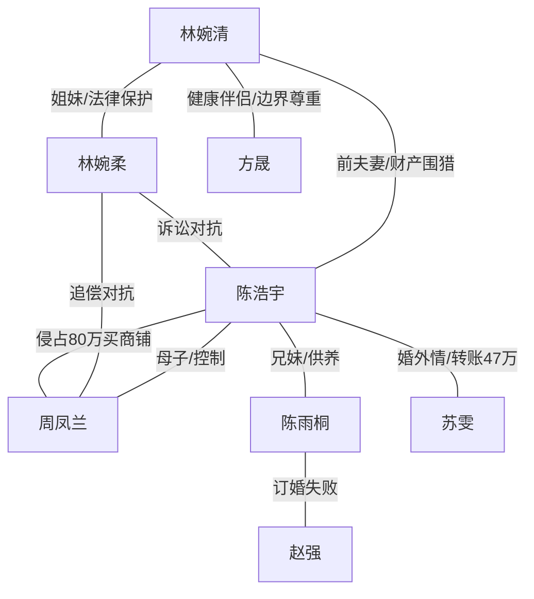

# 角色标签图谱

## 角色清单

### 林婉清 — 清醒财产保卫型大女主
- 叙事功能: 第一人称主角，承担受压、识破、反杀、重建人生全过程。
- 核心标签: 边界感、执行力、事业型
- 弧光: 相信婚姻但有防备 → 看清吸血家庭 → 法律清算 → 事业与亲密关系双重重建
- 台词风格: 短句、反问、法律边界明确
- 关键行为: 婚前办信托、拒绝索取、揭赵强有房、起诉离婚、追回商铺款
- 读者情绪关系: 心疼前期被围猎，爽于后期冷静反杀，最后获得补偿性认同

### 林婉柔 — 律师姐姐/清醒外挂
- 叙事功能: 预警者、证据提供者、法律执行者、情绪稳定器。
- 核心标签: 专业、护妹、冷静
- 弧光: 婚前警告 → 全程兜底 → 见证妹妹新生
- 台词风格: 专业判断直接给结论
- 关键行为: 建议家族信托、调查赵强房产、准备离婚材料、代理诉讼
- 读者情绪关系: 安全感、信任、爽文外挂

### 陈浩宇 — 温柔伪装型吸血丈夫
- 叙事功能: 第一层反派，完成“完美丈夫 → 算计者 → 出轨负债者 →落魄前夫”的坠落。
- 核心标签: 伪善、软饭算计、懦弱
- 弧光: 买花体贴 → 为家人逼钱 → 公开逼宫 → 出轨败露 → 穷困借钱
- 台词风格: 先软后硬，常用“一家人”“我妹妹”“你有九百万”
- 关键行为: 要 30 万、逼 60 万、订婚宴宣布 260 万、转钱给苏雯、协助母亲转移财产
- 读者情绪关系: 恨、恶心、看其社死和坠落获得爽感

### 周凤兰 — 吸血婆婆/贪婪家长
- 叙事功能: 主要压迫源，持续制造道德绑架和财产侵占。
- 核心标签: 贪婪、偏心、会演
- 弧光: 婚前眼睛发亮 → 各种索取 → 饭局失言 → 上门撒泼 → 商铺被拍卖
- 台词风格: “一家人”绑架、哭穷卖惨、公开羞辱
- 关键行为: 索车、住进女主家、纵容女儿占书房、朋友圈造谣、买商铺
- 读者情绪关系: 高恨点，承担最终被追偿的报应爽点

### 陈雨桐 — 寄生小姑/好逸恶劳者
- 叙事功能: 陈家索取的具体理由，也是家庭偏心的展示对象。
- 核心标签: 啃哥、虚荣、无劳动意识
- 弧光: 名牌上门要学费 → 霸占书房 → 要房 → 订婚失败 → 超市收银
- 台词风格: 甜腻开场，受挫后哭闹
- 关键行为: 要 4.8 万课程费、搬进嫂子家、配合订婚宴逼钱
- 读者情绪关系: 厌烦、看其从“被供养”落到自食其力产生回旋爽感

### 赵强 — 被裹挟的边缘证人
- 叙事功能: 先作为骗局参与者，后作为信息提供者帮助揭出商铺线。
- 核心标签: 懦弱、现实、半清醒
- 弧光: 低头配合陈家 → 被揭有房 → 与雨桐分手 → 向女主提供线索
- 台词风格: 客气、低姿态
- 关键行为: 鸿门宴沉默、告知 80 万商铺款
- 读者情绪关系: 轻度反感后转中性

### 方晟 — 边界感健康伴侣
- 叙事功能: 后半补偿线和价值观对照，证明女主值得被尊重。
- 核心标签: 专业、克制、尊重边界
- 弧光: 合作方 → 可靠对象 → 男友 → 丈夫
- 台词风格: 简洁、具体、不索取
- 关键行为: 记住咖啡和火锅、支持女主事业、主动签婚前协议
- 读者情绪关系: 安心、补偿、治愈

### 苏雯 — 婚外情引爆器
- 叙事功能: 揭穿陈浩宇不仅贪财，还背叛婚姻和转移财产。
- 核心标签: 情人、吞钱者、反噬工具
- 弧光: 暗线存在 → 证据曝光 → 拉黑陈浩宇
- 台词风格: 只通过聊天截图呈现
- 关键行为: 收取 47 万、九次开房
- 读者情绪关系: 加深对陈浩宇的厌恶

## 关系网络

## 角色功能对照表（供改编参考）

| 原角色 | 极致标签 | 叙事功能 | 读者情绪功能 | 改编时必须保留的 |
|--------|---------|---------|-------------|---------------|
| 林婉清 | 清醒财产保卫型大女主 | 主角/反杀执行者 | 爽、代入、补偿 | 婚前布防、拒绝道德绑架、最终重建 |
| 林婉柔 | 律师姐姐外挂 | 法律武器提供者 | 安全感 | 专业身份与证据链能力 |
| 陈浩宇 | 伪善吸血丈夫 | 主要背叛者 | 恨与社死爽 | 温柔假象、公开逼宫、出轨负债 |
| 周凤兰 | 贪婪婆婆 | 压迫源 | 高恨点 | “一家人”绑架和财产侵占 |
| 陈雨桐 | 寄生小姑 | 索取理由 | 厌恶 | 成人不工作却要求嫂子买单 |
| 方晟 | 边界感伴侣 | 后半补偿 | 治愈 | 尊重财产边界、支持事业 |
