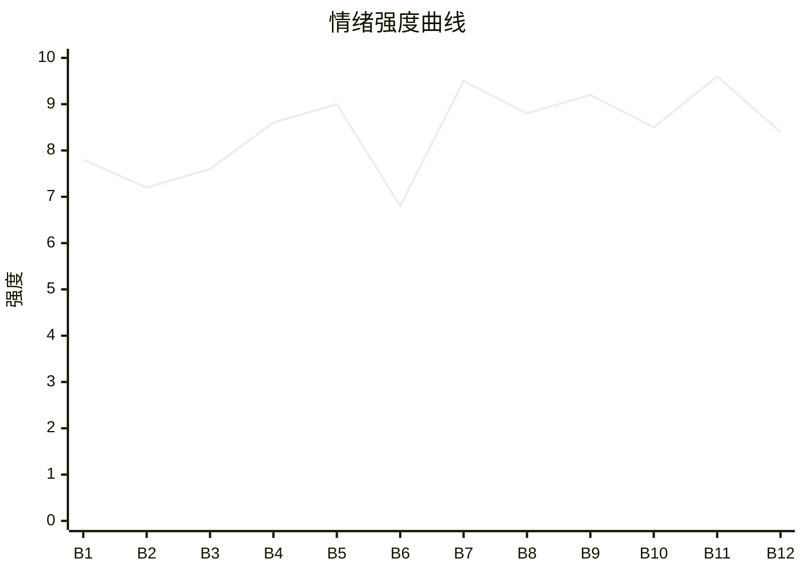

# Beat Sheet 节拍器

## 全文概况

- 总字数: 约 13800 字
- 节拍数: 12 幕
- 核心母题（Logline）: 林峰为了兑现七年欧洲结婚承诺，一再给南乔机会，却在她为实习生撒谎越界后清醒抽身，最终与真正珍视他的周妍结婚，并让南乔在失去中认清代价。
- 情绪模式: 期待破裂 → 隐忍观察 → 证据落地 → 付费抽身 → 新爱补偿 → 前任追悔 → 体面告别

## 节拍详表

### Beat 1: 欧洲结婚预期被中东实习生截胡 [第1章开头-会议结束]

- **字数**: 约 1100 字（占比 8%）
- **核心事件**: 江天借欧洲项目推动四人结婚旅行，南乔却点名带实习生苏晨去中东。
- **情绪标签**: 错愕、尴尬、压抑
- **情绪强度**: 7.8/10
- **情绪方向**: ⚡突变
- **冲突类型**: 大转折
- **悬念钩子**: 南乔是真忙，还是有意偏向苏晨？
- **叙事速度**: 快
- **对话占比**: 55%
- **reversal_mechanism**: [M5]
- **hook_strength**: 8.2/10（极端度 2.2，信息密度 2.5，悬念 1.8，节奏 1.7）
- **关键句**: “她不结，我结！”
- **原文摘录**: “兄弟要去欧洲拓展市场，点名我和梁青做翻译。同事们心领神会，跟着善意起哄。‘公费蜜月吗？想想都浪漫。’……她却慢条斯理地合上文件夹，看向了角落里的实习生苏晨。‘我跟苏晨去中东吧。小伙子经验少，我不放心。’……兄弟又急又气，隔着会议桌挤眉弄眼，拼命暗示我看微信。‘你们是去结婚！不是真的做陪翻！她是忘了还是装傻？’……我深吸一口气，笑着拿过合同签下名字。兄弟之约岂能食言。她不结，我结！”

### Beat 2: 苏晨越界知道男主雷区 [第1章后半]

- **字数**: 约 1200 字（占比 9%）
- **核心事件**: 苏晨替南乔泡咖啡，却精准提及林峰胃寒禁忌，暴露南乔与他的亲密信息流。
- **情绪标签**: 不适、警觉、被冒犯
- **情绪强度**: 7.2/10
- **情绪方向**: ↑上升
- **冲突类型**: 微冲突
- **悬念钩子**: 苏晨到底知道了多少？南乔为什么告诉他？
- **叙事速度**: 中
- **对话占比**: 50%
- **reversal_mechanism**: [M5]
- **hook_strength**: null
- **关键句**: “这是我心底的雷区，也是我们之间最讳莫如深的话题。”
- **原文摘录**: “苏晨转向我，笑了一下。‘峰哥，胃寒不宜喝咖啡，所以我就没给你泡。’我一愣。下意识与身旁的江天对视了一眼。……我天生胃不好，医生说不好好养着，得胃癌的可能性比普通人大。因为这个，她妈一直反对我们在一起。这是我心底的雷区，也是我们之间最讳莫如深的话题。……江天说：‘有的事情吧，也不是知道的越多越好。找不到边界的人，最容易失足。’”

### Beat 3: 顺路送人变成选择站队 [第2章]

- **字数**: 约 1300 字（占比 9%）
- **核心事件**: 南乔坚持送苏晨，林峰用去看高老师打断；南乔回头接苏晨，证明她心里早有选择。
- **情绪标签**: 憋屈、失望、试探
- **情绪强度**: 7.6/10
- **情绪方向**: ↑上升
- **冲突类型**: 大转折
- **悬念钩子**: 南乔答应不去中东，是否真的会守住底线？
- **叙事速度**: 中
- **对话占比**: 48%
- **reversal_mechanism**: [M3, M5]
- **hook_strength**: null
- **关键句**: “那个曾经满眼是我的女人，如今却需要我用一次一次的说理去守住底线。”
- **原文摘录**: “南乔显然也看到了，摇下车窗。‘走吧，送你。’……我说：‘好久没去看高老师了，我出差带了点礼物，正好送过去——所以，跟苏晨不顺路。’……回程时，车子又开回公司门口。苏晨还在。南乔摇下车窗。‘上车。’……我问：‘所以，你跟高老师说的有事，就是送苏晨回家？’……她说：‘林峰，我只是不想食言。’我点点头。‘那你还记得我们四个大学时的承诺吗？’……南乔最终点头：‘……好，听你的。’”

### Beat 4: 婚纱店失约与戒指证据 [第3章]

- **字数**: 约 1500 字（占比 11%）
- **核心事件**: 南乔谎称去香港，林峰从苏晨朋友圈戒指发现她去了中东。
- **情绪标签**: 心寒、清醒、讽刺
- **情绪强度**: 8.6/10
- **情绪方向**: ⚡突变
- **冲突类型**: 大转折
- **悬念钩子**: 林峰看破谎言后会怎么做？
- **叙事速度**: 快
- **对话占比**: 35%
- **reversal_mechanism**: [M3, M5]
- **hook_strength**: null
- **关键句**: “我和她之间，已经隔着数千公里的谎言。”
- **原文摘录**: “婚纱店灯光璀璨。……江天问：‘南乔呢？这都几点了，还没来？’方莹说：‘她说临时有个紧急任务要去香港做陪翻。’……周三，苏晨出发去中东。……次日晚上，苏晨发了朋友圈……床头柜上，放着一枚戒指。……那是我和南乔的对戒。她还是去了中东。……南乔电话里问礼服和机票，我没有质问戒指，没有提苏晨。……苏晨又发：‘跨越6000公里来相见，相爱的人不惧山河远。’我留言：‘知道吗？大马哈鱼为了繁殖，也能游上半个地球。’”

### Beat 5: 旧誓言回忆与付费卡点“周妍” [第4章]

- **字数**: 约 1300 字（占比 9%）
- **核心事件**: 林峰整理行李，回忆四人青春誓言，决定提前走且带周妍。
- **情绪标签**: 破碎、决断、期待
- **情绪强度**: 9.0/10
- **情绪方向**: ↓后⚡上扬
- **冲突类型**: 大转折/付费卡点
- **悬念钩子**: 周妍是谁？为什么她能替代南乔？
- **叙事速度**: 中
- **对话占比**: 25%
- **reversal_mechanism**: [M2, M5]
- **hook_strength**: null
- **关键句**: “去的是周妍。”
- **原文摘录**: “我抚摸着那块斑驳的掉漆处……原来誓言也是有保质期的。……大二时，我们四个在烧烤摊拉勾：‘爱情万岁。青春万岁。幸福万岁。’南乔红着脸轻轻说：‘林峰万岁。’……一滴眼泪砸在叠好的衣服上。原来回忆是一把生锈的锯子。……南乔发语音说下周回去，可以定机票。我翻出江天的电话：‘天天，把护照找出来。我们提前走。’江天问：‘南乔忙完了？’我说：‘不等她了。去的是周妍。’”

### Beat 6: 周妍登场与旧白月光悬念 [第5章]

- **字数**: 约 1100 字（占比 8%）
- **核心事件**: 周妍加入欧洲行，江天先防备后被她能力和细心折服。
- **情绪标签**: 好奇、轻松、暧昧
- **情绪强度**: 6.8/10
- **情绪方向**: ↑上升
- **冲突类型**: 微冲突
- **悬念钩子**: 周妍当年为什么退场？她现在想做什么？
- **叙事速度**: 中
- **对话占比**: 42%
- **reversal_mechanism**: [M2]
- **hook_strength**: null
- **关键句**: “周妍的细心与博知，比南乔有过之而无不及。”
- **原文摘录**: “江天拖着行李箱，一路没给周妍好脸色。……他提醒我：‘当年你给她递情书，她连个正眼都没给。’……我回忆大一追周妍，她来者不拒却始终没戳破。车祸住院那次，我发了仅她可见的朋友圈，来的却是南乔。……接下来两天，江天的防线塌得比罗马古迹还快。周妍在乌菲兹美术馆用流利意大利语讲解《维纳斯的诞生》。江天冲我比大拇指。”

### Beat 7: 飞行模拟舱求婚补偿 [第6章]

- **字数**: 约 1600 字（占比 12%）
- **核心事件**: 周妍以职业方式布置多语种星空求婚，林峰接受。
- **情绪标签**: 感动、补偿、释然
- **情绪强度**: 9.5/10
- **情绪方向**: ↑强上升
- **冲突类型**: 大转折
- **悬念钩子**: 南乔回来后会如何面对林峰已选择别人？
- **叙事速度**: 慢
- **对话占比**: 30%
- **reversal_mechanism**: [M2, M5]
- **hook_strength**: null
- **关键句**: “舱内，我终于听到了那个迟到了七年的、最清晰的答案。”
- **原文摘录**: “周妍把我按在副驾驶的位置上，帮我系好安全带。……屏幕中央，无数星光汇聚成‘Will you marry me?’又依次出现法语、西班牙语、阿拉伯语和中文：‘我们结婚吧？’……她举着丝绒盒子：‘Affirmative or Negative?’……我说：‘Affirmative。机长，我确认。’……她抱住我：‘收到，林先生。航向已锁定，余生请多指教。’……隔着玻璃，江天用口型对我说：‘要幸福——’”

### Beat 8: 南乔回国发现林峰消失 [第7章]

- **字数**: 约 1300 字（占比 9%）
- **核心事件**: 南乔以为林峰会原地等待，回家发现他搬走、删好友，安全感崩塌。
- **情绪标签**: 慌乱、愤怒、失控
- **情绪强度**: 8.8/10
- **情绪方向**: ⚡突变
- **冲突类型**: 大转折
- **悬念钩子**: 南乔会用什么方式挽回或压迫？
- **叙事速度**: 中
- **对话占比**: 10%
- **reversal_mechanism**: [M5]
- **hook_strength**: null
- **关键句**: “她总觉得，林峰是安全的。就像那个放在家里的旧沙发。”
- **原文摘录**: “南乔在抵达中东一周后，终于回了国。她总觉得，林峰是安全的。就像那个放在家里的旧沙发。……她想给他一个惊喜。……推开家门，预想中的人并没有扑上来迎接。鞋柜空了大半，衣柜只剩几个孤零零的衣架。……她点开微信，发现自己竟然被他删除了。南乔脑子嗡地一声，随之而来的是铺天盖地的愤怒。”

### Beat 9: 电话摊牌，附属品逻辑反身击碎 [第8章]

- **字数**: 约 1300 字（占比 9%）
- **核心事件**: 南乔以事业和恩赐逻辑贬低林峰，林峰明确辞职、切断关系。
- **情绪标签**: 恶寒、愤怒、痛快
- **情绪强度**: 9.2/10
- **情绪方向**: ↑上升
- **冲突类型**: 大转折
- **悬念钩子**: 南乔会不会追到欧洲？
- **叙事速度**: 快
- **对话占比**: 58%
- **reversal_mechanism**: [M3, M5]
- **hook_strength**: null
- **关键句**: “我林峰，从来都不是谁的附属品。”
- **原文摘录**: “南乔问：‘你做这些的时候，有没有想过我们7年的感情？’……她说：‘你现在能优哉游哉地在欧洲旅行，住好的酒店，看好的风景，是因为什么？是我在公司给你留了位置。’……话里话外的意思：你离了我什么都不是。……我轻声打断她：‘我值这个价，不是因为你南乔的施舍。至于欧洲……我是作为江天的合伙人来的，费用是我自己出的。我林峰，从来都不是谁的附属品。我已经辞职了。祝你和苏晨，百年好合。’”

### Beat 10: 南乔追机，苏晨能力破产 [第9章]

- **字数**: 约 1300 字（占比 9%）
- **核心事件**: 南乔看见求婚视频后带苏晨追去欧洲，航班上苏晨误判急救翻译，能力滤镜破碎。
- **情绪标签**: 嫉妒、狼狈、期待打脸
- **情绪强度**: 8.5/10
- **情绪方向**: ↑上升
- **冲突类型**: 大转折
- **悬念钩子**: 谁能救场？林峰真实专业力如何展示？
- **叙事速度**: 快
- **对话占比**: 40%
- **reversal_mechanism**: [M2, M6]
- **hook_strength**: null
- **关键句**: “让我过去。我是持证医疗翻译。”
- **原文摘录**: “南乔看见飞行模拟舱里周妍与我紧紧相拥，嫉妒吞噬理智。……她订了两张机票，一张自己的，一张苏晨的。……威尼斯航班上，一个中东女乘客突然倒地。苏晨站起来：‘让我来！我懂阿拉伯语，我是翻译！’可他听不懂生僻医学术语。……工作人员说：‘如果您不确定，请不要干扰急救。’……前方传来声音：‘Let me through. I’m a certified medical interpreter.’”

### Beat 11: 林峰降级碾压，南乔求婚挽回失败 [第10章]

- **字数**: 约 1600 字（占比 12%）
- **核心事件**: 林峰专业救场，周妍作为机长配合备降；南乔追上求复合，被林峰体面拒绝。
- **情绪标签**: 打脸、悔恨、爽
- **情绪强度**: 9.6/10
- **情绪方向**: ↑强上升
- **冲突类型**: 大转折
- **悬念钩子**: 周妍与林峰当年的错过真相是什么？
- **叙事速度**: 快
- **对话占比**: 45%
- **reversal_mechanism**: [M2, M3, M6]
- **hook_strength**: null
- **关键句**: “我们之间究竟什么时候结束的，我想你应该比我更早知道。”
- **原文摘录**: “林峰同步翻译：‘病人有冠心病史，做过两次支架手术，正在服用氯吡格雷和阿司匹林。’……广播响起，周妍用流利英语通报医疗紧急状况，飞机备降慕尼黑。……南乔看见周妍从操作舱走出来，满眼都是欣赏与爱意。……她追下飞机：‘林峰，我们谈谈。’我说：‘不必了，南女士。’……她问：‘我们四个说好的呢？’没人开口。……她最后说：‘我是来跟你结婚的。’我笑笑：‘谢谢。保重。’”

### Beat 12: 旧真相揭开与最后一次帮忙 [第11章]

- **字数**: 约 1500 字（占比 11%）
- **核心事件**: 林峰与周妍领证，得知当年南乔截胡；后来最后一次帮南乔处理项目危机，完成体面告别。
- **情绪标签**: 释然、余痛、安定
- **情绪强度**: 8.4/10
- **情绪方向**: ↓平稳收束
- **冲突类型**: 大转折/收束
- **悬念钩子**: 无，完成闭环。
- **叙事速度**: 中
- **对话占比**: 38%
- **reversal_mechanism**: [M2, M3, M5]
- **hook_strength**: null
- **关键句**: “我的余生，航向锁定。”
- **原文摘录**: “我们在欧洲待了一个月，最后一起在巴黎领了证。……周妍说，当年她有紧急飞行演练，走不开，让南乔帮她去医院，再带碗粥给我。……原来，当年我所以为的缘分，竟是一场并不光彩的‘截胡’。……婚后第二个月，江天说南乔中东项目出事，苏晨译错关键条款。……我飞去中东，花三天重译合同，赔偿从八位数降到六位数。……南乔电话里说谢谢。我说：‘就当我最后一次帮你。祝你幸福。也希望你，祝我幸福。’……回到家，周妍等在门口。‘回家了。’……我的余生，航向锁定。”

## 情绪曲线可视化

## 节拍密度检测

- 平均每 1150 字一个节拍
- 微冲突密度: 每 2300 字一次
- 大转折密度: 每 1250 字一次
- 判定: 符合高频节拍器标准；情感关系文用“越界细节”代替硬事件，密度稳定。

## 反转机制清单(Reversal Mechanisms)

| 机制 ID | 机制名 | 承载 Beat | 关键段落/金句 | 等价改编提示 |
|--------|--------|-----------|--------------|-------------|
| M2 | 身份反差爆发 | Beat 5-7, 10-12 | “去的是周妍”；“我是持证医疗翻译”；周妍从操作舱走出 | 身份载体可换，但新欢必须从“被误解的旧人”升级为“专业强者+真爱补偿者” |
| M3 | 因果回旋反讽 | Beat 3, 8-12 | “我只是不想食言”对照“那你还记得我们四个大学时的承诺吗”；“我从来都不是谁的附属品” | 必须保留施害者规则反身应用：她用承诺压人，男主用承诺判断她；她说施舍，男主证明自立 |
| M5 | 温度反转曲线 | Beat 1-5, 7-12 | “林峰万岁”到“你离了我什么都不是”；“谢谢。保重。” | 必须显式写出昔日温柔正峰、当下归零、失去后负值悔恨 |
| M6 | 多层递进反转 | Beat 4-5, 7, 10-12 | 戒指证据→周妍求婚→航班救场→截胡真相 | 层数不能少：证据反转、情感反转、能力反转、旧事真相反转依次升级 |
