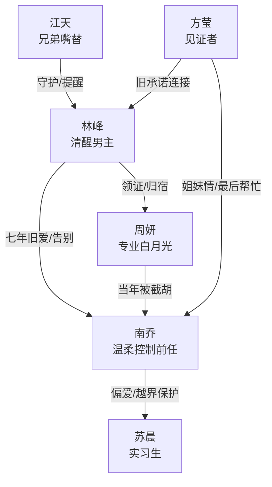

# 角色标签图谱

## 角色清单

### 林峰 — 清醒体面型男主

- 叙事功能: 被背叛者、关系审判者、最终选择者。
- 核心标签: 克制、有边界、专业强。
- 弧光: 旧承诺守护者 → 被迫清醒者 → 主动选择新生活的人。
- 台词风格: 短句、平静、关键处一锤定音。
- 关键行为: 发现戒指证据、提前赴欧、接受周妍求婚、航班救场、最后帮南乔一次后告别。
- 读者情绪关系: 心疼、代入、爽。

### 南乔 — 温柔控制型前任

- 叙事功能: 施压者、失去者、追悔火葬场承载者。
- 核心标签: 事业强、边界感弱、优越感。
- 弧光: 以为林峰永远等她 → 发现林峰抽身 → 追悔但不可逆。
- 台词风格: 温和、有理有据、实则贬低。
- 关键行为: 带苏晨中东、撒谎香港、贬低林峰依附自己、追到欧洲求复合。
- 读者情绪关系: 恨、憋屈、看她崩塌的爽。

### 周妍 — 迟到七年的专业白月光

- 叙事功能: 情感补偿者、身份反转者、真正珍视男主的人。
- 核心标签: 空乘/机长气质、深情、专业。
- 弧光: 被误解的旧人 → 主动求婚者 → 男主归宿。
- 台词风格: 职业化浪漫，克制但真诚。
- 关键行为: 欧洲同行、飞行模拟舱多语种求婚、机上广播配合救援、尊重林峰帮南乔。
- 读者情绪关系: 甜、安心、补偿。

### 苏晨 — 越界小奶狗实习生

- 叙事功能: 关系裂缝放大器、南乔失误证明。
- 核心标签: 年轻、会示弱、能力不足。
- 弧光: 被南乔偏爱的新秀 → 航班急救场露怯 → 项目翻译出错。
- 台词风格: 乖巧、试探、装无辜。
- 关键行为: 知道林峰胃寒、发戒指朋友圈、航班误判医学术语、译错合同。
- 读者情绪关系: 反感、鄙夷、等待翻车。

### 江天 — 读者嘴替兄弟

- 叙事功能: 外部见证者、情绪放大器、推进婚旅承诺。
- 核心标签: 仗义、毒舌、护短。
- 弧光: 催林峰结婚 → 警觉苏晨 → 接纳周妍 → 见证林峰幸福。
- 台词风格: 直白、急躁、吐槽强。
- 关键行为: 点破南乔失约、提醒苏晨不简单、发出南乔危机求助。
- 读者情绪关系: 爽、亲近。

### 方莹 — 旧誓言见证人与现实调停者

- 叙事功能: 四人承诺见证、信息传递者。
- 核心标签: 大方、重情、软调停。
- 弧光: 期待四人欧洲婚礼 → 目睹关系更替 → 给南乔最后信息。
- 台词风格: 温和、劝解。
- 关键行为: 婚纱店打圆场、发送周妍求婚视频、告知威尼斯航班。
- 读者情绪关系: 中性、见证感。

## 关系网络

## 角色功能对照表（供改编参考）

| 原角色 | 极致标签 | 叙事功能 | 读者情绪功能 | 改编时必须保留的 |
|--------|---------|---------|-------------|---------------|
| 林峰 | 清醒体面男主 | 抽身与选择 | 心疼、爽 | 不吵闹、不跪求、有专业高光 |
| 南乔 | 温柔控制前任 | 压迫与追悔 | 恨、看火葬场 | “我为你好/你离不开我”的控制逻辑 |
| 周妍 | 迟到白月光 | 情感补偿 | 甜、安心 | 专业舞台式求婚+当年错过真相 |
| 苏晨 | 越界实习生 | 裂缝放大 | 厌恶、等翻车 | 看似乖巧但能力不足 |
| 江天 | 嘴替兄弟 | 外部审判 | 替读者发声 | 直白指出问题 |
| 方莹 | 见证者 | 信息桥梁 | 现实感 | 旧誓言与新关系的见证 |
