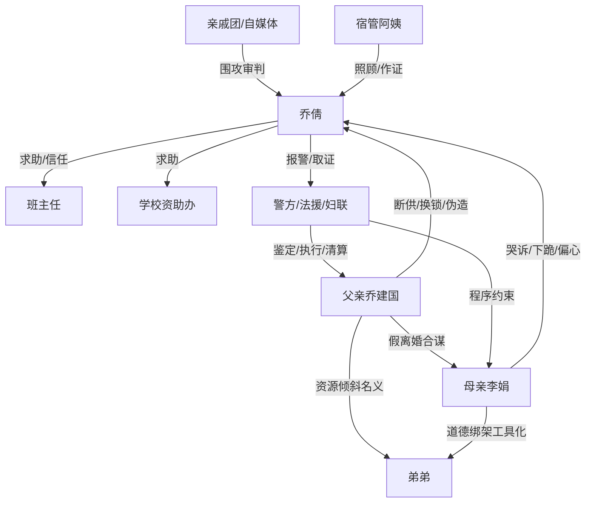

# 角色标签图谱

## 角色清单

### 乔倩 — 清醒高考大女主/被牺牲的长女

- 叙事功能: 主视角、受害者、证据链建立者、最终清算者。
- 核心标签: 清醒、克制、证据意识强。
- 弧光: 被断供换锁的未成年女儿 → 考出 706 的证据反杀者 → 脱离家庭控制的大学生。
- 台词风格: 短句、反问、确认式追问。
- 关键行为: 走进资助办、报警咨询、保存录音截图、补办证件、拒签谅解、公开长文。
- 读者情绪关系: 心疼、代入、爽、敬佩。

### 乔建国/父亲 — 吸血式父权反派/资源分配者

- 叙事功能: 主压迫源，制造断供、换锁、扣证件、伪造签名等连续冲突。
- 核心标签: 自私、控制、伪善。
- 弧光: 以父亲身份压人 → 伪造证据翻车 → 单位撤职失信。
- 台词风格: 命令式、威胁式、把压迫包装成锻炼。
- 关键行为: 假离婚转移存款，断生活费，换锁，扣证件，拿伪造声明闹学校。
- 读者情绪关系: 恨、厌恶、期待报应。

### 李娟/母亲 — 道德绑架型母亲/共犯

- 叙事功能: 以眼泪、弟弟和“母亲难处”制造亲情压力，同时提供父亲自爆录音。
- 核心标签: 偏心、软弱、推责。
- 弧光: 抱弟弟哭诉逼女儿退让 → 被父亲推出背锅 → 娘家受冷后迟到醒悟。
- 台词风格: 哭诉式、卖惨式、以“妈不怪你”铺台阶。
- 关键行为: 要女主退学照顾弟弟，校门下跪，事败后交出父亲录音。
- 读者情绪关系: 恨中带冷讽，少量迟到的悲哀。

### 弟弟 — 被用作资源倾斜借口的婴儿

- 叙事功能: 不是主动反派，而是父母牺牲女儿的名义。
- 核心标签: 无辜、工具化、学区名额。
- 弧光: 被父母拿来压迫姐姐 → 学区排序被取消。
- 台词风格: 无。
- 关键行为: 被母亲抱到校门口下跪制造围观。
- 读者情绪关系: 不恨弟弟，恨父母把“无辜”变成压迫工具。

### 班主任 — 外部保护者/正义成年人

- 叙事功能: 提供学校系统支持，证明女主不是孤立无援。
- 核心标签: 负责、敏锐、护短。
- 弧光: 发现学生贫困真相 → 陪同报警补证 → 公开为她发声。
- 台词风格: 直接、坚定、有边界。
- 关键行为: 接手证据、联系教务招办、陪派出所、挡自媒体、发文证明。
- 读者情绪关系: 安心、感动。

### 宿管阿姨 — 非血缘照顾者/温情补偿

- 叙事功能: 用被褥、热饭、作证补偿主角缺失的家庭照顾。
- 核心标签: 温暖、朴素、可靠。
- 弧光: 给被褥 → 考点送水 → 作证 → 大学前叮嘱好好吃饭。
- 台词风格: 短而实在。
- 关键行为: 安排床铺，证明女主熄灯后没离宿舍。
- 读者情绪关系: 心暖、泪点。

### 法援律师/警方/妇联/社区/学校 — 程序正义共同体

- 叙事功能: 把家庭伦理压迫转化为可执行的法律责任。
- 核心标签: 专业、程序、托底。
- 弧光: 从咨询介入 → 证据鉴定 → 追索抚养费和执行。
- 台词风格: 客观、规则化。
- 关键行为: 受理材料、鉴定签名、追责自媒体、执行抚养费。
- 读者情绪关系: 安全感、爽感支撑。

### 亲戚团/自媒体 — 舆论压迫放大器

- 叙事功能: 放大“家丑”“忘本”“自私”的道德审判，制造付费卡点现场压力。
- 核心标签: 看客、逐利、和稀泥。
- 弧光: 帮父母围攻 → 证据面前闭嘴后退。
- 台词风格: 道德评价、现实利益优先。
- 关键行为: 校门围堵、分享会拍摄逼问、亲戚群转发。
- 读者情绪关系: 厌烦、期待打脸。

## 关系网络

## 角色功能对照表（供改编参考）

| 原角色 | 极致标签 | 叙事功能 | 读者情绪功能 | 改编时必须保留的 |
|--------|---------|---------|-------------|---------------|
| 乔倩 | 清醒高考大女主 | 受害与反杀主体 | 心疼转爽 | 未成年/关键考试/证据意识 |
| 父亲 | 父权资源分配反派 | 主压迫源 | 恨与报应期待 | 断供、伪造、把压迫说成锻炼 |
| 母亲 | 道德绑架共犯 | 亲情压力与内部证据来源 | 憋屈、冷讽 | 抱小孩卖惨、事败后互咬 |
| 弟弟 | 无辜工具 | 资源倾斜借口 | 避免仇恨错位 | 不能写成主动恶人 |
| 班主任 | 正义成年人 | 托底与证明 | 安心 | 及时识别并实际帮助 |
| 宿管阿姨 | 非血缘温情 | 情绪补偿和证人 | 泪点 | 被褥/饭/作证等具体照顾 |
| 法援/警方/妇联 | 程序正义 | 法律清算 | 爽点可信度 | 不能只口头正义，必须有程序动作 |
| 亲戚/自媒体 | 舆论压迫 | 群体审判 | 打脸期待 | 当众围攻和证据后退缩 |
