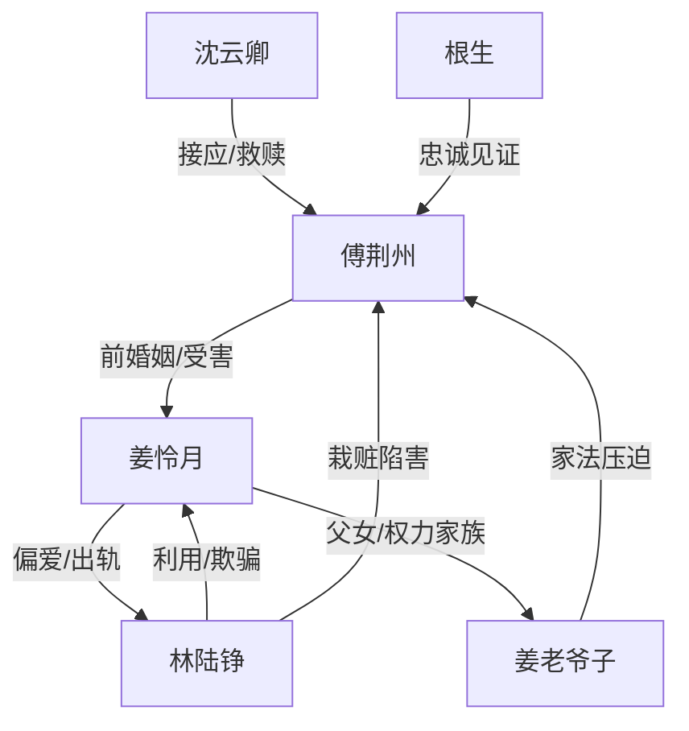

# 角色标签图谱

## 角色清单

### 傅荆州 — 重生清醒受虐男主
- 叙事功能: 承受压迫、完成抽离、拒绝原谅
- 核心标签: 重生、隐忍、清醒
- 弧光: 前世执念争斗 → 今生冷静逃离 → 新生活重建
- 台词风格: 克制短句，后期冷硬审判
- 关键行为: 接纳假象、签离婚、离开姜家、拒绝临终忏悔
- 读者情绪关系: 心疼、替他憋屈、为他脱离感到痛快

### 姜怜月 — 权力傲慢型追悔妻
- 叙事功能: 主要施害者与火葬场承载者
- 核心标签: 出轨、偏信、悔疯
- 弧光: 自以为掌控两男 → 失去傅荆州 → 真相反噬 → 挡刀死亡
- 台词风格: 前期命令审判，后期哀求忏悔
- 关键行为: 带回父子、惩罚傅荆州、发现真相、追到深城、挡刀
- 读者情绪关系: 前期恨，后期不完全同情但期待她受报应

### 林陆铮 — 白莲恶男/寄生反派
- 叙事功能: 栽赃工具人、真相炸弹、最终刺杀者
- 核心标签: 自伤陷害、贪婪、恶毒
- 弧光: 伪装柔弱 → 掌控姜家 → 败露受刑 → 疯癫刺杀
- 台词风格: 茶言茶语转恶毒辱骂
- 关键行为: 自砸额头、放火、设计小川、调包孩子、持刀杀人
- 读者情绪关系: 强恨点，清算越狠越爽

### 沈云卿 — 救赎白月光
- 叙事功能: 男主新生出口与情感补偿
- 核心标签: 深情、稳定、尊重
- 弧光: 旧日追求者 → 深城接应者 → 终身伴侣
- 台词风格: 温柔克制，不逼迫
- 关键行为: 接走傅荆州、保护他新生活、婚礼承诺忠诚
- 读者情绪关系: 安心、补偿、祝福

### 根生 — 真相控诉者
- 叙事功能: 代替读者审判姜怜月，启动真相调查
- 核心标签: 忠诚、愤怒、见证者
- 弧光: 被保护的佣人 → 离开姜家 → 公开控诉
- 台词风格: 直接、激烈、道德审判
- 关键行为: 揭露傅荆州多年付出与林陆铮陷害
- 读者情绪关系: 代嘴爽感

### 姜老爷子 — 家族权力压迫源
- 叙事功能: 制度性羞辱与酷刑执行者
- 核心标签: 重血脉、偏听、残酷
- 弧光: 维护嫡孙 → 发现假孙 → 病危崩塌
- 台词风格: 命令式、家法式
- 关键行为: 砸伤傅荆州、下令家法、纵容祠堂蛇虫
- 读者情绪关系: 厌恶，承担姜家报应合理性

## 关系网络

## 角色功能对照表（供改编参考）

| 原角色 | 极致标签 | 叙事功能 | 读者情绪功能 | 改编时必须保留的 |
|--------|---------|---------|-------------|---------------|
| 傅荆州 | 重生清醒男主 | 承债与抽离 | 心疼+爽 | 忍不是懦弱，而是为离开蓄力 |
| 姜怜月 | 悔疯前妻 | 施害与火葬场 | 恨+看报应 | 有能力查但不查，后悔也不配原谅 |
| 林陆铮 | 白莲恶男 | 栽赃和真相炸弹 | 恨点 | 自伤陷害、调包/夺子级别恶行 |
| 沈云卿 | 救赎白月光 | 补偿男主 | 安心 | 尊重边界，不强迫男主立刻回应 |
| 根生 | 代嘴见证者 | 揭真相 | 代读者骂醒 | 控诉必须具体列证据 |
| 姜老爷子 | 家族压迫 | 制度暴力 | 厌恶 | 家法/血脉偏见导致报应 |
