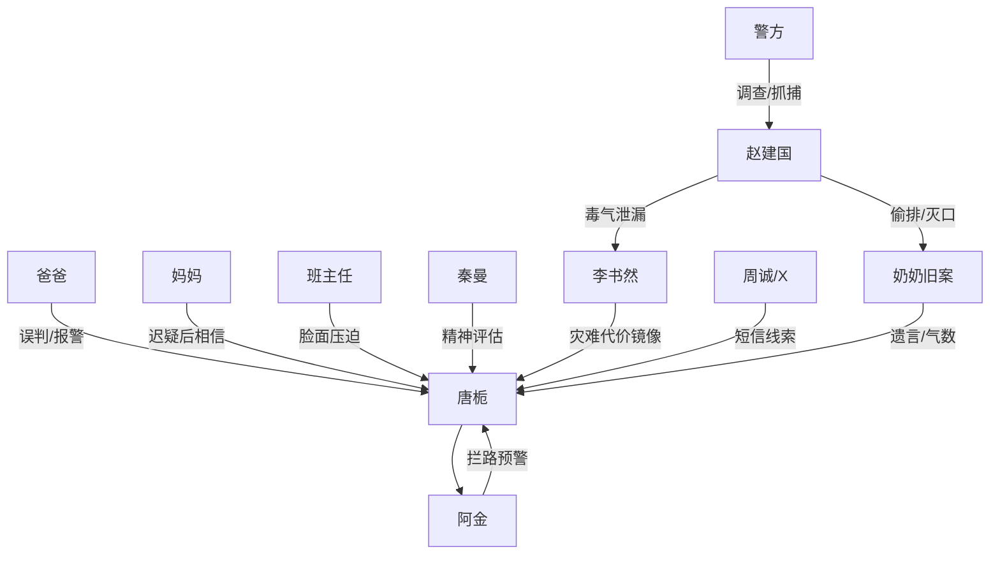

# 角色标签图谱

## 角色清单

### 唐栀 — 清醒异能感大女主
- 叙事功能: 主角、误判承受者、真相追查者。
- 核心标签: 清北苗子、养蛇少女、异常嗅觉。
- 弧光: 被全社会判疯 → 被公共新闻洗白 → 主动接局追凶 → 进入法学院。
- 台词风格: 短句、冷静反问、少解释。
- 关键行为: 撕准考证、逃离考点、提供毒气线索、赴化工厂。
- 读者情绪关系: 前半心疼，反转后代入爽，结尾获得补偿。

### 阿金 — 民俗预警物/情绪锚
- 叙事功能: Hook 触发器、神秘线索、主角可信度争议源。
- 核心标签: 黄金蟒、认主、拦路。
- 弧光: 被视为畜生/疯癫理由 → 被证明救命 → 被父亲补偿尊重。
- 台词风格: 无台词，用身体动作表达。
- 关键行为: 横安检线、撞盒壁、指向化工厂、贴近李书然。
- 读者情绪关系: 神秘、可靠、被亏欠。

### 爸爸 — 现实主义压迫者/悔恨亲人
- 叙事功能: 前半最大亲情压迫源，后半悔恨和补偿承载者。
- 核心标签: 望女成凤、要脸、事后崩塌。
- 弧光: 怒斥女儿 → 报警抓人 → 跪地痛哭 → 学会尊重阿金。
- 台词风格: 高压、道德绑架、后期破碎。
- 关键行为: 抢盒盖、发朋友圈、报警、追到服务区、通知警方。
- 读者情绪关系: 前半恨，反转后复杂，结尾可部分原谅。

### 妈妈 — 情感缓冲者
- 叙事功能: 给家庭关系留余地，证明主角不是彻底孤立。
- 核心标签: 哭求、迟疑、最终相信。
- 弧光: 劝她回考场 → 想起奶奶话 → 信她一次 → 配合救援。
- 台词风格: 软、碎、情绪化。
- 关键行为: 发消息问她是不是知道什么，把父亲骗回老家。
- 读者情绪关系: 心疼与认可。

### 班主任 — 体制脸面代表
- 叙事功能: “脸重要还是命重要”的回旋靶。
- 核心标签: 升学压力、校方脸面、崩溃忏悔。
- 弧光: 威胁上报精神崩溃 → 发消息证明考场正常 → 医院崩溃。
- 台词风格: 教导、压制、推责任。
- 关键行为: 拦人、否定报警排查、医院里承受回敬。
- 读者情绪关系: 恨其误判，爽于回旋清算。

### 秦曼 — 专业权威误判者
- 叙事功能: 把压迫升级为强制留观与镇静剂。
- 核心标签: 冷漠诊断、权威标签、快速撤退。
- 弧光: 给主角扣妄想标签 → 新闻后终止评估并道歉。
- 台词风格: 专业术语、冷淡。
- 关键行为: 记录“病态依附”“灾难化妄想”，拿出镇静剂。
- 读者情绪关系: 愤怒，后续轻度清算。

### 李书然 — 代价具象化角色
- 叙事功能: 展示如果唐栀进考场会怎样。
- 核心标签: 竞争对手、清北苗子、幸存者。
- 弧光: 模考争前三 → ICU 重伤 → 醒来比 V。
- 台词风格: 几乎无台词。
- 关键行为: 被抬出考场，醒来回应。
- 读者情绪关系: 心疼，强化灾难真实感。

### 周诚 — 卧底记者/真相递送者
- 叙事功能: 将故事从事故升级到旧案阴谋。
- 核心标签: 记者、卧底、匿名短信。
- 弧光: X 号码 → 现身 → 交代奶奶被灭口。
- 台词风格: 信息密集、急促。
- 关键行为: 发短信，引唐栀到三号车间地下室。
- 读者情绪关系: 可信工具人，推动后半。

### 赵建国 — 终极反派
- 叙事功能: 环境污染、灭口、公共灾难的责任实体。
- 核心标签: 化工厂负责人、偷排、杀人灭口。
- 弧光: 幕后黑手 → 围杀失败 → 被捕起诉。
- 台词风格: 威胁、狠话。
- 关键行为: 偷排毒气，灭口奶奶，围堵周诚唐栀。
- 读者情绪关系: 纯恨，需法律清算。

## 关系网络

## 角色功能对照表（供改编参考）

| 原角色 | 极致标签 | 叙事功能 | 读者情绪功能 | 改编时必须保留的 |
|--------|---------|---------|-------------|---------------|
| 唐栀 | 被误判的清醒者 | 承压和追凶 | 心疼、代入、爽 | 冷静拒绝解释过度 |
| 阿金 | 异常预警物 | Hook 与神秘源 | 好奇、信任 | 身体预警动作 |
| 爸爸 | 亲情压迫者 | 情绪债最大来源 | 憋屈、后怕 | 报警/公开羞辱/跪地悔恨 |
| 妈妈 | 迟来的信任 | 缓冲家庭关系 | 温暖 | “信你一次” |
| 班主任 | 脸面秩序 | 回旋金句靶 | 打脸爽 | “脸/命”价值冲突 |
| 秦曼 | 权威误判 | 压迫升级 | 愤怒 | 专业术语扣帽子 |
| 周诚 | 真相递送 | 悬疑升级 | 期待 | 匿名信息与现身 |
| 赵建国 | 公害反派 | 法律清算对象 | 恨 | 偷排、灭口、被捕 |
