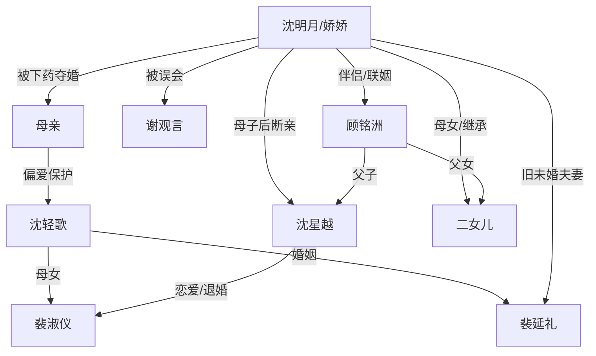

# 角色标签图谱

## 角色清单

### 沈明月/娇娇 — 清醒掌权型复仇女主
- 叙事功能: 主视角、受害者、规则掌控者、清算执行人。
- 核心标签: 被牺牲的长女、沈氏掌门人、不原谅。
- 弧光: 被母亲下药夺婚 → 二十年独自掌权 → 断亲清算 → 获得迟来的爱与继承补偿。
- 台词风格: 冷答、反问、短句砸脸。
- 关键行为: 拒绝裴淑仪；赶走沈轻歌；与沈星越断亲；启用二女儿继承；拒绝母亲临终请求。
- 读者情绪关系: 心疼、代入、爽。

### 母亲 — 对外慈善对内偏心的伦理反派
- 叙事功能: 原罪制造者，偏心逻辑的源头。
- 核心标签: 慈善家、偏心母亲、道德错位。
- 弧光: 造谣下药牺牲长女 → 下跪求长女放过妹妹 → 临终仍为妹妹求情。
- 台词风格: 先软后硬，常用“妈妈”身份压迫。
- 关键行为: 订婚宴造谣；婚前下药；承认“不想轻歌难过”；病危求原谅。
- 读者情绪关系: 恨、寒心。

### 沈轻歌 — 被偏爱的夺位妹妹
- 叙事功能: 既得利益者、白莲式受益者、清算对象。
- 核心标签: 名媛妹妹、婚纱夺位、受宠者。
- 弧光: 穿姐姐婚纱嫁首富 → 为女儿闯宴施压 → 资源崩塌后下跪求饶。
- 台词风格: 控诉、装弱、道德绑架。
- 关键行为: 配合夺婚；为裴淑仪逼宫；跪求女主放过女儿。
- 读者情绪关系: 恨、痛快看她崩塌。

### 裴延礼 — 迟来无用的旧未婚夫
- 叙事功能: 旧情温度反转载体，证明女主被二次忽视。
- 核心标签: 前首富、旧爱、迟来道歉。
- 弧光: 曾保护女主 → 误信陷害娶妹妹 → 二十年后为妹妹母女求情 → 只得到“嗯”。
- 台词风格: 叹息、补偿式、居高临下式误判。
- 关键行为: 相信女主“当过鸡”；提出用全部家当换裴淑仪婚事；最终道歉。
- 读者情绪关系: 遗憾、恨铁不成钢、轻蔑。

### 谢观言 — 自我感动型旧人
- 叙事功能: 误会线和真父线的反衬。
- 核心标签: 妹妹前男友、误认父亲、荒唐求婚。
- 弧光: 误认女主暗算 → 以为沈星越是亲生 → 得知真正父亲另有其人。
- 台词风格: 自以为牺牲、自以为宽容。
- 关键行为: 两次提出组建家庭；误解女主目的。
- 读者情绪关系: 荒诞、嘲讽。

### 沈星越 — 恋爱脑二次背叛的儿子
- 叙事功能: 中段最大刀点，复刻母亲偏心逻辑。
- 核心标签: 新首富、独子、背刺者。
- 弧光: 尊重母亲 → 为裴淑仪忤逆 → 签断亲协议 → 发现不是唯一继承人后悔。
- 台词风格: 前期孝顺，背叛时冷漠，后期求饶。
- 关键行为: 砸倒香槟塔；说“你的不幸只是你自己的事情”；签断亲协议；退婚求回头。
- 读者情绪关系: 心痛、愤怒、后期爽。

### 裴淑仪 — 复刻妹妹的下一代白莲
- 叙事功能: 旧仇触发器，代际回环载体。
- 核心标签: 校花名媛、被宠坏的女儿、得胜笑容复刻。
- 弧光: 被当众拒绝 → 与沈星越联手逼宫 → 资源崩塌。
- 台词风格: 委屈转挑衅。
- 关键行为: 摔门；招亲会入场；靠在沈星越身上挑衅。
- 读者情绪关系: 厌恶、期待被打脸。

### 顾铭洲 — 迟到但稳定的补偿型真伴侣
- 叙事功能: 情感补偿、身份反转、继承权后手。
- 核心标签: 真父亲、二十年等待、强势伴侣。
- 弧光: 被女主抛下 → 二十年持续联系 → 同居联姻 → 支持女主规则。
- 台词风格: 轻松、调侃、站队明确。
- 关键行为: 每年发消息；承认多个孩子；支持二女儿继承；拒绝替沈星越求情。
- 读者情绪关系: 补偿、安心、甜爽。

### 二女儿 — 继承权反转工具人
- 叙事功能: 打碎沈星越唯一继承幻想。
- 核心标签: 年轻能干、女性继承人、后手。
- 弧光: 暗线存在 → 被宣布为继承人。
- 台词风格: 原文未直接展开。
- 关键行为: 被女主和顾铭洲共同选定为继承人。
- 读者情绪关系: 爽、补偿、女强延展。

## 关系网络

## 角色功能对照表（供改编参考）

| 原角色 | 极致标签 | 叙事功能 | 读者情绪功能 | 改编时必须保留的 |
|--------|---------|---------|-------------|---------------|
| 沈明月 | 清醒掌权女主 | 主视角和清算者 | 心疼+爽 | 不原谅、掌握家族/公司规则 |
| 母亲 | 偏心慈善家 | 原罪源头 | 恨和寒心 | 对外善、对内牺牲长女 |
| 沈轻歌 | 被偏爱的妹妹 | 既得利益反派 | 期待清算 | 顶替女主婚姻/资源 |
| 裴延礼 | 迟来旧爱 | 温度反转 | 迟来无用 | 曾保护后误信 |
| 谢观言 | 自我感动旧人 | 误会反衬 | 荒唐讽刺 | 误认孩子/误解女主 |
| 沈星越 | 恋爱脑独子 | 二次背叛 | 最大痛点 | 先心疼后背刺再后悔 |
| 裴淑仪 | 复刻下一代 | 旧仇触发器 | 厌恶 | 长相/笑容复刻妹妹 |
| 顾铭洲 | 真伴侣真后手 | 情感和权力补偿 | 甜爽 | 二十年等待+支持女主 |
| 二女儿 | 女性继承人 | 终极继承反转 | 痛快 | 打碎独子唯一性 |
