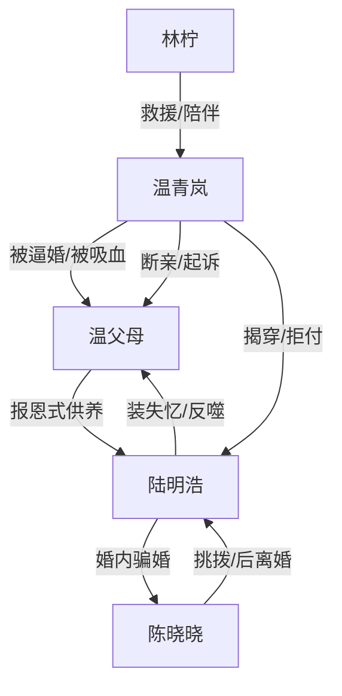

# 角色标签图谱

## 角色清单

### 温青岚 — 清醒断亲型受害者

- 叙事功能: 第一人称承压者、反击者、最终新生者。
- 核心标签: 残疾妻子、长期被驯化、冷静断亲。
- 弧光: 恐惧服从 → 第一次拒绝 → 报警起诉 → 不原谅但放下。
- 台词风格: 短句、反问、事实列举。
- 关键行为: 拒付彩礼、转钱买房、录音报警、起诉父亲、拒绝母亲情感勒索。
- 读者情绪关系: 心疼、代入、爽。

### 温建国 — 报恩魔怔父权暴力者

- 叙事功能: 家庭暴力源头、女主恐惧根源、后期因果受害者。
- 核心标签: 硬刀子、家暴父亲、名誉至上。
- 弧光: 绝对权威 → 巴掌落不下 → 入狱 → 被“儿子”抛弃致死。
- 台词风格: 命令式、威胁式。
- 关键行为: 童年殴打女主、逼女儿道歉、卖女换彩礼、逼女儿出钱。
- 读者情绪关系: 恨、解气。

### 温母 — 软刀子式偏心母亲

- 叙事功能: 道德绑架者、造谣者、最终悔恨承受者。
- 核心标签: 软刀子、偏心、迟来的悔恨。
- 弧光: 逼女儿退位 → 替陆明浩造谣 → 被陆明浩背刺 → 杀死陆明浩 → 入狱忏悔。
- 台词风格: 先哄后压，哭诉与道德绑架并用。
- 关键行为: 准备离婚协议、污蔑女主变态、求女主帮忙、反杀陆明浩。
- 读者情绪关系: 恨中带复杂，但不可原谅。

### 陆明浩 — 装失忆吸血巨婴

- 叙事功能: 全文最大因果炸弹，父母错误选择的反噬载体。
- 核心标签: 装失忆、巨婴、白眼狼。
- 弧光: 被全家供奉 → 骗婚失败 → 啃老摆烂 → 承认骗局 → 失控行凶 → 死亡。
- 台词风格: 粗暴、轻蔑、无责任感。
- 关键行为: 骂女主赔钱货、婚内相亲、拒救温建国、卷走钱财、持刀行凶。
- 读者情绪关系: 极恨，死亡清算带来强爽点。

### 陈晓晓 — 茶系现实女

- 叙事功能: 开篇冲突放大器，揭穿陆明浩骗婚的外部变量。
- 核心标签: 绿茶、现实、利益导向。
- 弧光: 以为嫁入被供养家庭 → 发现骗婚 → 怀孕结婚 → 见陆明浩破产即离婚。
- 台词风格: 表面懂事，实则挑拨。
- 关键行为: 刺激女主、质问婚姻真相、分手又结婚、最终离婚。
- 读者情绪关系: 讨厌但非主恶。

### 林柠 — 救援型闺蜜

- 叙事功能: 女主外部支持系统、证据固定者、情绪补偿者。
- 核心标签: 清醒闺蜜、行动派、保护者。
- 弧光: 童年救人 → 成年帮工作 → 报警救场 → 陪伴新生。
- 台词风格: 直接、温暖、护短。
- 关键行为: 买房、录音、带巡捕、陪女主吃鸡腿、进入女主新生活。
- 读者情绪关系: 安全感、补偿感。

## 关系网络

## 角色功能对照表（供改编参考）

| 原角色 | 极致标签 | 叙事功能 | 读者情绪功能 | 改编时必须保留的 |
|--------|---------|---------|-------------|---------------|
| 温青岚 | 清醒断亲受害者 | 主视角与反击核心 | 心疼、爽 | 长期被牺牲后的克制反击 |
| 温建国 | 家暴父权 | 压迫源 | 恨 | 暴力旧账+名誉软肋 |
| 温母 | 软刀子母亲 | 道德绑架与悔恨线 | 恨、复杂 | 造谣女儿与迟来悔恨 |
| 陆明浩 | 装失忆巨婴 | 因果反噬载体 | 极恨、爽 | 装失忆爆雷 |
| 陈晓晓 | 茶系现实女 | 开篇外部刺激 | 讨厌、推动 | 相亲/骗婚质询 |
| 林柠 | 救援闺蜜 | 支持系统 | 安全感 | 录音报警和新生活陪伴 |
