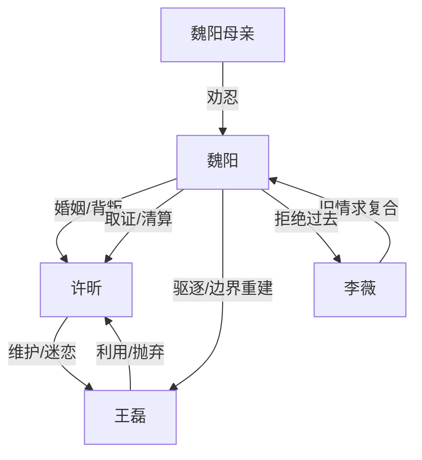

# 角色标签图谱

## 角色清单

### 魏阳 — 清醒隐忍型复仇男主
- 叙事功能: 受害者、取证者、清算者、最终自我修复者
- 核心标签: 克制、边界感、清醒
- 弧光: 忍让型丈夫 → 被逼翻脸 → 冷静谈判 → 独立重生
- 台词风格: 短句、反问、冷静陈述
- 关键行为: 离家、提出离婚、拍视频、签协议、拒绝复合
- 读者情绪关系: 心疼、代入、爽

### 许昕 — 圣母越界型妻子
- 叙事功能: 婚姻背叛者、边界破坏者、后期悔恨者
- 核心标签: 自我感动、双标、迟来后悔
- 弧光: 理直气壮维护王磊 → 逼男主让位 → 被王磊抛弃 → 道歉还钱
- 台词风格: 命令式、道德压制式、后期低姿态
- 关键行为: 给王磊录指纹、送领带、让王磊搬入、签协议、求复合
- 读者情绪关系: 恨、憋屈、后期报应爽

### 王磊 — 绿茶软饭男
- 叙事功能: 入侵者、婚姻催化剂、因果报应承载者
- 核心标签: 装可怜、会示弱、逐利
- 弧光: 柔弱男同事 → 同居入侵者 → 抛弃许昕 → 被富婆家庭反噬
- 台词风格: 道歉式、委屈式、后期现实冷酷
- 关键行为: 用指纹开门、拿领带、住客房、装哭求护、另攀富婆
- 读者情绪关系: 恨、恶心、看报应

### 魏阳母亲 — 传统和稀泥型亲属
- 叙事功能: 加重男主孤立感
- 核心标签: 劝忍、偏传统、后知后觉
- 弧光: 责怪男主不懂事 → 离婚后态度软化
- 台词风格: 家庭伦理劝和式
- 关键行为: 劝男主别离婚
- 读者情绪关系: 憋屈、现实感

### 李薇 — 旧情试探者
- 叙事功能: 检验男主是否真正走出过去
- 核心标签: 初恋、遗憾、旧路
- 弧光: 过去伤害者 → 求复合者 → 被拒绝
- 台词风格: 后悔、试探
- 关键行为: 打电话、送花
- 读者情绪关系: 释然，不强恨

## 关系网络

## 角色功能对照表（供改编参考）

| 原角色 | 极致标签 | 叙事功能 | 读者情绪功能 | 改编时必须保留的 |
|--------|---------|---------|-------------|---------------|
| 魏阳 | 清醒隐忍男主 | 边界被侵犯后的反击者 | 心疼与爽 | 冷静、取证、拒绝复合 |
| 许昕 | 越界圣母妻子 | 压迫与悔恨来源 | 恨与报应爽 | 维护第三者、赶走男主、后期后悔 |
| 王磊 | 绿茶软饭男 | 入侵与因果回旋载体 | 恶心与打脸爽 | 装可怜、占便宜、逐利抛弃 |
| 母亲 | 和稀泥亲属 | 增加孤立压迫 | 憋屈 | 劝忍逻辑 |
| 李薇 | 旧爱诱惑 | 验证成长 | 释然 | 男主拒绝回头 |
